# MVOGMBI_Sync — Document d'architecture

Version 1.9.26 — Marché MVOG-MBI Sherbrooke.

MVOGMBI_Sync relie la caisse **Clover** à la comptabilité **Sage 50 Comptabilité Édition canadienne** :

- facturation des ventes ;
- encaissement des dépôts ;
- factures et paiements fournisseurs ;
- rapprochement bancaire Desjardins ;
- rapports et statistiques.

L'application est écrite en Python 3.13, a une interface tkinter et tourne sur le poste Windows du marché. Elle n'utilise aucun service d'IA ni d'API externe autre que Clover : c'est le choix du propriétaire.

Ce document décrit les composants, les données, les intégrations et les principaux flux. Le fichier `CLAUDE.md` détaille les règles de gestion. Le manuel d'utilisation (`documentation/creer_manuel.py`) décrit l'usage au quotidien.

---

## 1. Vue d'ensemble

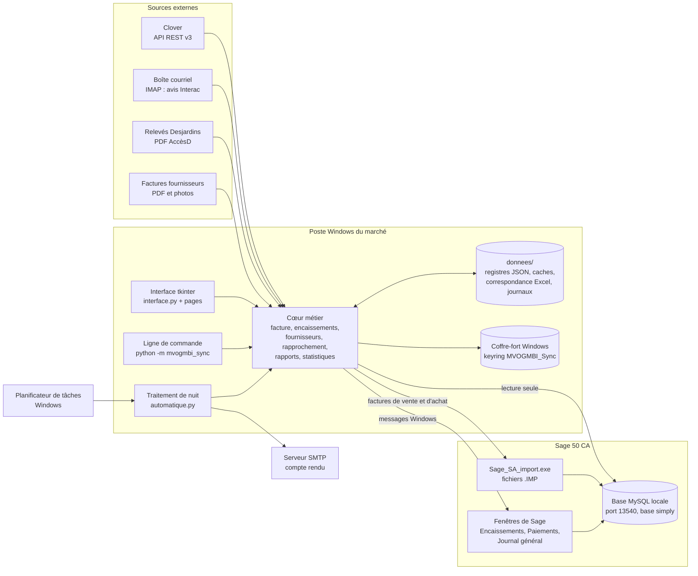

Principes :

| Principe | Mise en œuvre |
|---|---|
| Sage fait foi | Après chaque écriture, l'application relit Sage pour vérifier : présence de la facture dans `tcustr`, baisse du solde, écriture au compte 1055. `Sage_SA_import.exe` renvoie 0 même en cas d'échec. |
| Jamais deux fois | Les doublons sont détectés avant chaque import ou saisie : n° de facture, source, date et montant. En cas de doute, l'application refuse, sauf avec `--forcer`. |
| Le propriétaire confirme | La correspondance des articles, les virements proposés et les mouvements de banque passent par un état « Confirmé » avant toute écriture automatique. |
| Lecture seule par défaut | L'utilisateur MySQL `mvogmbi_sync` de Sage n'a que des droits de consultation. |
| Secrets hors des fichiers | Jeton Clover et mots de passe Sage, courriel et boîte : coffre-fort Windows (`coffre.py`). |
| Essais sur copie | Tout nouveau format est validé sur `MVOGMBI_ESSAI.SAI` avant le vrai fichier d'entreprise. |

---

## 2. Composants

### 2.1 Points d'entrée

| Point d'entrée | Rôle |
|---|---|
| `MVOGMBI_Sync.exe` (`installation/lanceur_interface.py`) | Interface : connexion, puis les pages 1 à 11. |
| `MVOGMBI_Sync_console.exe` (`installation/lanceur_console.py`) | Ligne de commande et tâche planifiée (`lancer_traitement.cmd`). |
| `python -m mvogmbi_sync <commande>` (`__main__.py`) | `facture`, `importer`, `auto`, `encaissements`, `correspondance`, `verifier-comptes`, `verifier-sage`, `rapport`, `planifier`, `langue`, `interface`. Commandes internes : `encaisser-bureau`, `payer-bureau`, `journal-bureau`. |

### 2.2 Modules

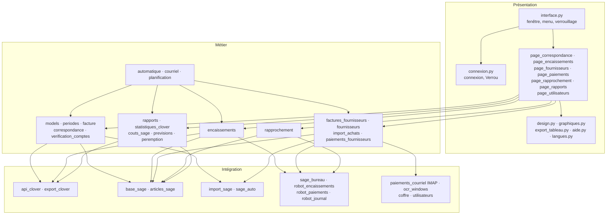

| Couche | Modules | Responsabilité |
|---|---|---|
| Présentation | `interface.py` | Fenêtre principale, menu des pages selon le profil, verrouillage après inactivité, tâches de fond. |
| | `connexion.py` | Connexion, création du premier administrateur, fenêtre `Verrou`. |
| | `page_*.py` | Une page par module. |
| | `graphiques.py` | Graphiques sur `tk.Canvas` (barres, courbes, anneau, classement, carte de chaleur, infobulles, export PDF/PNG). |
| | `export_tableau.py` | Export Excel, CSV et PDF (HTML imprimé par Edge sans fenêtre). |
| | `design.py` | Couleurs, boutons, tableaux. |
| | `aide.py`, `langues.py` | Aide et FAQ en français et en anglais ; traduction. |
| Métier | `facture.py`, `periodes.py`, `models.py` | Factures de vente : une par jour du lundi au jeudi, une pour la fin de semaine. |
| | `correspondance.py`, `verification_comptes.py` | Articles Clover → Sage ; comptes 15xx → 40xx / 50xx. |
| | `encaissements.py` | Dépôts Clover (lots), espèces (Interac, dépôts au guichet) → encaissements sur les factures. |
| | `factures_fournisseurs.py`, `fournisseurs.py`, `import_achats.py` | Lecture des factures fournisseurs, registre, import `<PurInvoice>`. |
| | `paiements_fournisseurs.py` | Avis Interac → factures fournisseurs → paiements. |
| | `rapprochement.py` | Relevé Desjardins ↔ écritures du compte 1055. |
| | `rapports.py` | Suivi des ventes et recherches dans l'historique Sage. |
| | `statistiques_clover.py`, `couts_sage.py`, `previsions.py`, `peremption.py` | Statistiques Clover, bénéfices au CUMP Sage, prévisions, péremption. |
| | `automatique.py`, `courriel.py`, `planification.py` | Traitement de nuit, compte rendu, tâche planifiée. |
| Intégration | `api_clover.py`, `export_clover.py` | API REST Clover v3 (parallélisée) ; export Excel Clover. |
| | `base_sage.py`, `articles_sage.py` | Lecture MySQL de Sage, même quand Sage est fermé (`lire_pendant_connexion`). |
| | `import_sage.py`, `sage_auto.py` | Fichier `.IMP` `<SalInvoice>` ; pilotage de `Sage_SA_import.exe`. |
| | `sage_bureau.py`, `robot_*.py` | Ouverture de Sage sur un bureau Windows séparé et saisie dans ses fenêtres par messages Windows. |
| | `paiements_courriel.py`, `ocr_windows.py` | IMAP en lecture seule ; OCR intégré à Windows. |
| | `coffre.py`, `utilisateurs.py` | Coffre-fort Windows ; comptes et profils, avec mots de passe hachés. |

---

## 3. Données

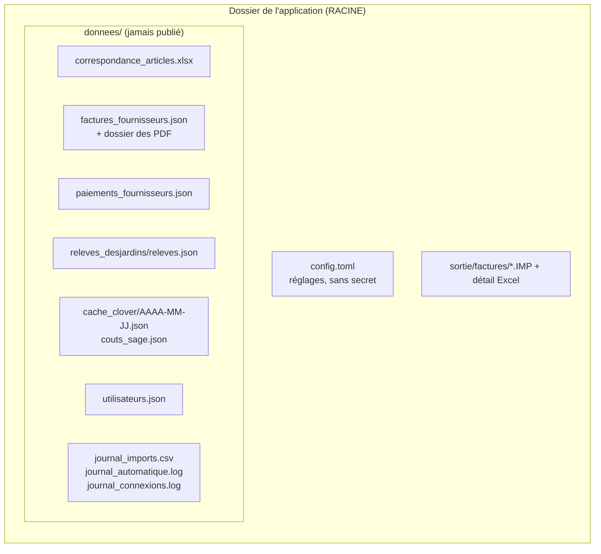

| Donnée | Format | Écrite par | Lue par |
|---|---|---|---|
| Réglages | `config.toml` | page Configuration | tous les modules |
| Secrets | coffre-fort Windows | pages Clover, Sage, Courriel | `coffre.py` |
| Correspondance Clover → Sage | Excel (« Confirmé » par le propriétaire) | `correspondance.py` | facture, coûts, statistiques |
| Registres fournisseurs, paiements, relevés | JSON | pages 8, 9, 10 | traitement de nuit, rapports |
| Ventes Clover par jour | JSON, cache, plus mémoire vive | `statistiques_clover.py` | statistiques, prévisions |
| CUMP Sage | JSON, renouvelé chaque jour | `couts_sage.py` | bénéfices, liste d'articles |
| Utilisateurs | JSON, empreintes PBKDF2 | `utilisateurs.py` | connexion, verrou |
| Journaux | CSV, texte | import, nuit, connexion | tableau de bord, courriel |

Tables Sage lues :

| Table | Contenu |
|---|---|
| `tcustr`, `tcustrdt` | Factures et encaissements clients |
| `tvendor`, `tventr`, `tventrdt` | Fournisseurs, factures et paiements |
| `tinvent`, `tinvlot` | Articles, coûts et stock |
| `tjentact`, `tjourent`, `taccount` | Écritures et comptes |
| `ttaxauth` | Taxes |

---

## 4. Flux principaux

### 4.1 Traitement de nuit (`automatique.lancer`)

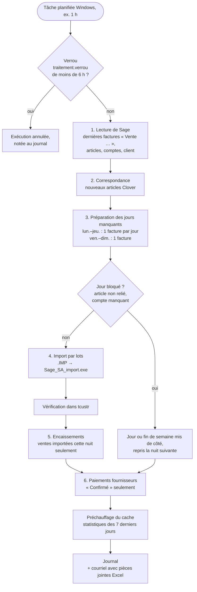

### 4.2 Facturation des ventes (Clover → Sage)

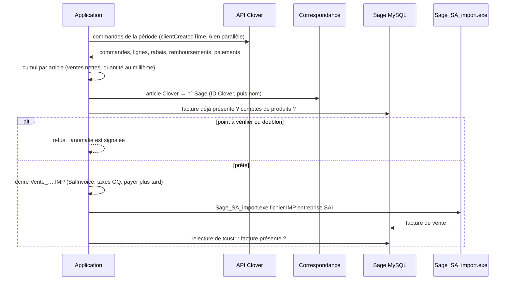

Règle : montant de ligne = ventes nettes Clover de l'article ; prix = montant ÷ quantité nette (4 décimales) ; total = ventes nettes.

### 4.3 Encaissements

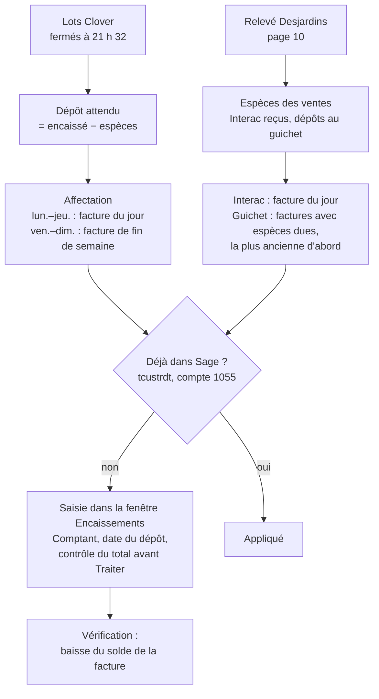

### 4.4 Factures et paiements fournisseurs

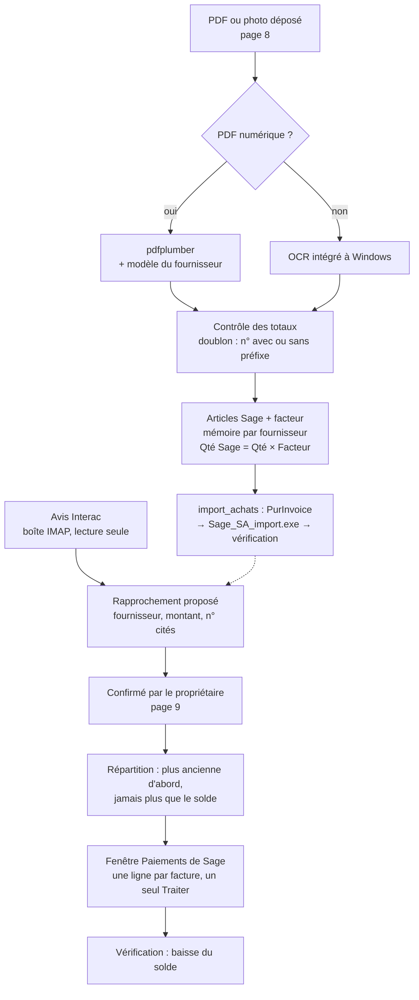

### 4.5 Rapprochement bancaire

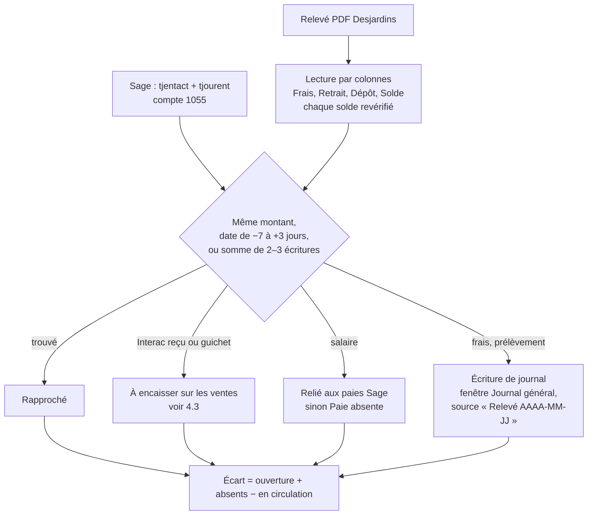

### 4.6 Rapports et statistiques Clover

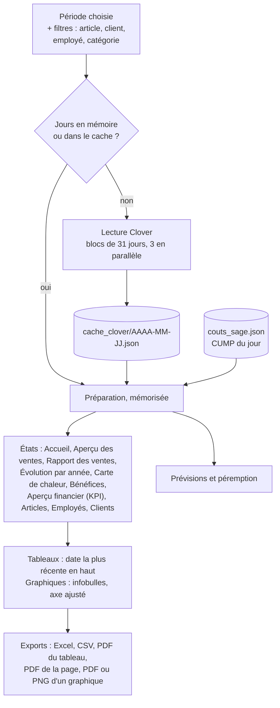

### 4.7 Connexion, profils et verrouillage

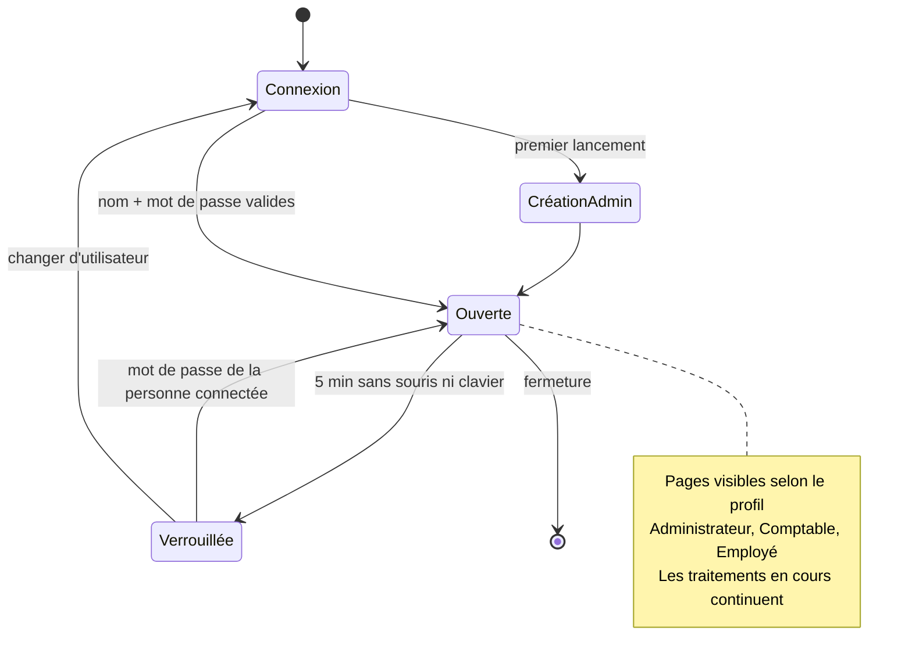

---

## 5. Pilotage de Sage

Sage 50 CA n'a pas d'API ouverte. L'application passe par trois voies :

| Voie | Utilisée pour | Sage | Vérification |
|---|---|---|---|
| MySQL en lecture seule (`base_sage.py`) | Tout ce qui se lit | ouvert, ou base ouverte par l'outil d'import pendant la fenêtre de mot de passe | — |
| `Sage_SA_import.exe` (`sage_auto.py`) | Factures de vente `<SalInvoice>` et d'achat `<PurInvoice>` | fermé (accès exclusif) | présence dans `tcustr` / `tventr` |
| Fenêtres de Sage (`sage_bureau.py` + `robot_*.py`) | Encaissements, paiements, journal général (non importables) | lancé par l'application sur un bureau Windows séparé ; fonctionne session verrouillée | baisse des soldes, écriture au 1055 |

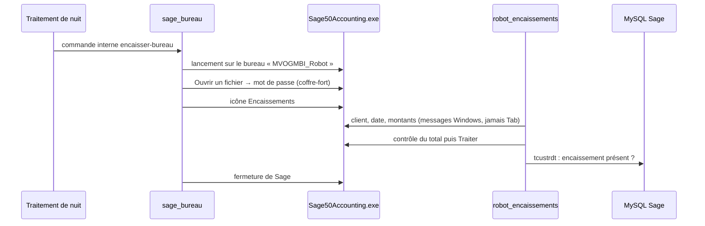

---

## 6. Sécurité

| Sujet | Mesure |
|---|---|
| Secrets | Coffre-fort Windows (keyring `MVOGMBI_Sync`) : `clover_jeton`, `sage_lecture`, `sage_import`, `courriel`, boîte des paiements. Jamais dans `config.toml` ni dans le dépôt. |
| Comptes | `utilisateurs.json` : empreintes de mots de passe, profils et pages permises ; journal des connexions. |
| Verrouillage | Après `[general] verrouillage_minutes` (5 par défaut ; 0 = jamais) sans activité. La fenêtre est cachée et le mot de passe est redemandé. |
| Sage | Utilisateur MySQL en consultation seule ; imports et saisies uniquement après contrôle des doublons. |
| Banque | Relevés chargés à la main : aucune connexion à AccèsD. |
| Courriel | IMAP en lecture seule ; SMTP pour le compte rendu. |
| Dépôt public | `.gitignore` : `config.toml`, `donnees/`, `sortie/`, `*.xlsx`, `*.IMP`, `*.SAI`, captures et manuels contenant des données réelles. |

---

## 7. Fabrication et déploiement

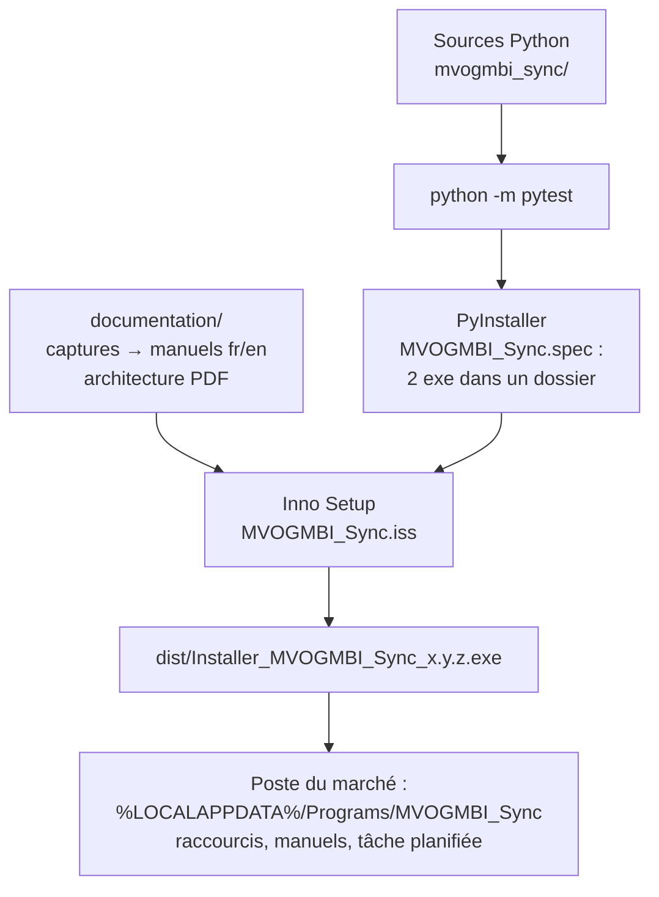

- `installation/fabriquer.cmd` enchaîne tout. Chaque livraison a son propre numéro de version : `aide.VERSION`, `version_info.txt` et `MVOGMBI_Sync.iss`.
- RACINE est le dossier de l'exe ; la variable `MVOGMBI_RACINE` en force un autre.
- Tests : `tests/`, environ 110 tests sans accès à Clover ni à Sage. Les essais réels se font sur la copie `MVOGMBI_ESSAI.SAI`.

---

## 8. Performances

| Opération | Moyen | Ordre de grandeur |
|---|---|---|
| Commandes Clover d'une période | liste filtrée par `clientCreatedTime`, commandes manquantes 6 en parallèle | secondes par jour |
| Statistiques d'une année | blocs de 31 jours, 3 en parallèle, cache par jour | 49 s à froid, quelques secondes ensuite |
| Filtres globaux | recalcul en mémoire, sans relire Clover | environ 1 s |
| Recherches dans l'historique Sage | historique gardé 10 min | 0,3 s après la première |
| Ouverture des statistiques le matin | cache des 7 derniers jours préchauffé la nuit | immédiat |
