# MVOGMBI_Sync — Document d'architecture

Version 1.0.15 (13 novembre 2026) — Marché MVOG-MBI Sherbrooke.

MVOGMBI_Sync relie la caisse **Clover** à la comptabilité **Sage 50 Comptabilité Édition canadienne** :

- facturation des ventes ;
- encaissement des dépôts ;
- factures et paiements fournisseurs ;
- rapprochement bancaire de toutes les banques et caisses du Canada (relevés PDF, OFX / QFX / QBO, CSV) ;
- rapports, statistiques et aide à la décision (Reporting : 18 états enrichis, 44 analyses, synthèse des décisions) ;
- gestion des articles, des stocks, des ventes et des achats comme dans Sage, avec la chaîne des documents (devis, commande, livraison, facture, retours) ;
- comptabilité (caisse, dépenses, plan comptable, taxes, remises, budget) ;
- agence RIA (états de compte, envois et versements, commissions) ;
- paie (pointage, planning, feuilles de temps, chèques de paie dans Sage, bulletins) ;
- plusieurs sites : dépôts (emplacements de Sage) avec ou sans Clover ;
- utilisateurs, profils, droits par fonction et audit des actions.

L'application est écrite en Python 3.13, a une interface tkinter et une application web identique, et tourne sur le serveur SERVDCSAGE, à côté de Sage 50 (depuis la version 2.14.2). Pendant la journée, l'application garde Sage ouvert en multi-utilisateur pour les saisies (version 1.0.3). Elle n'utilise aucun service d'IA ni d'API externe autre que Clover : c'est le choix du propriétaire.

Ce document décrit les composants, les données, les intégrations et les principaux flux. Les règles d'affaires sont réunies dans `documentation/REGLES_AFFAIRES.md` (codes RG-…) ; le fichier `CLAUDE.md` garde le détail technique de chaque règle. Le manuel d'utilisation (`documentation/creer_manuel.py`) décrit l'usage au quotidien ; le guide de l'administrateur (`documentation/GUIDE_ADMINISTRATEUR.md`) l'installation, la configuration, l'exploitation et le dépannage.

---

## 1. Vue d'ensemble

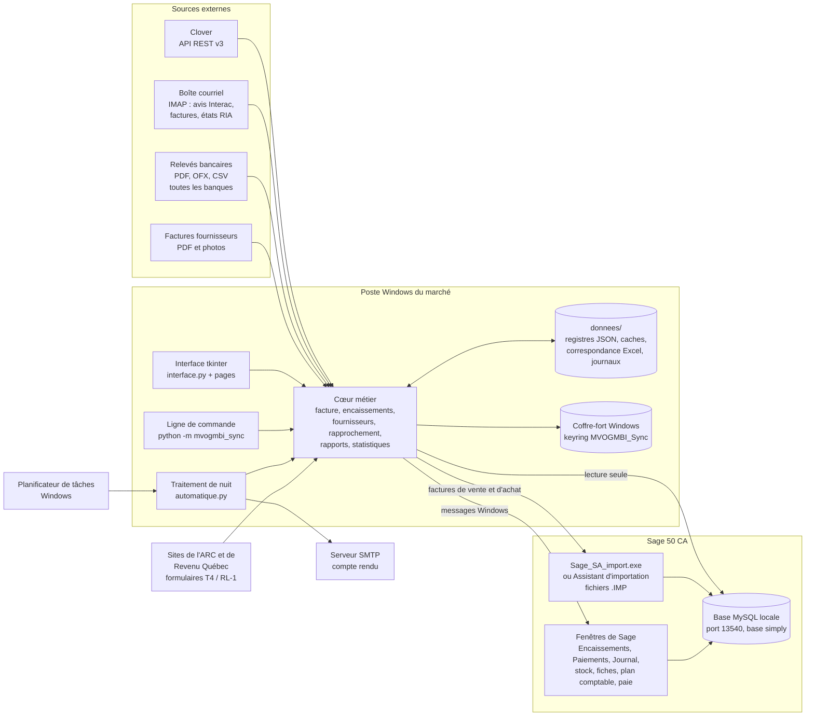

Principes :

| Principe | Mise en œuvre |
|---|---|
| Sage fait foi | Après chaque écriture, l'application relit Sage pour vérifier : présence de la facture dans `tcustr`, baisse du solde, écriture au compte 1055. `Sage_SA_import.exe` renvoie 0 même en cas d'échec. |
| Jamais deux fois | Les doublons sont détectés avant chaque import ou saisie : n° de facture, source, date et montant. En cas de doute, l'application refuse, sauf avec `--forcer`. |
| Le propriétaire confirme | La correspondance des articles, les virements proposés et les mouvements de banque passent par un état « Confirmé » avant toute écriture automatique. |
| Lecture seule par défaut | L'utilisateur MySQL `mvogmbi_sync` de Sage n'a que des droits de consultation. |
| Secrets hors des fichiers | Jeton Clover et mots de passe Sage, courriel et boîte : coffre-fort Windows (`coffre.py`). |
| Essais sur copie | Tout nouveau format est validé sur `MVOGMBI_ESSAI.SAI` avant le vrai fichier d'entreprise. |

---

## 2. Composants

### 2.1 Points d'entrée

| Point d'entrée | Rôle |
|---|---|
| `MVOGMBI_Sync.exe` (`installation/lanceur_interface.py`) | Interface : connexion, puis le menu en rubriques (Administration, Articles, Stock, Vente, Fournisseur, Comptabilité, RIA, Paie, État). |
| `MVOGMBI_Sync_console.exe` (`installation/lanceur_console.py`) | Ligne de commande et tâche planifiée (`lancer_traitement.cmd`). |
| `MVOGMBI_Sync_Serveur.exe` (`installation/lanceur_serveur.py`, = commande `web`) | Serveur de l'application web (`mvogmbi_sync/web/`) sur SERVDCSAGE (le serveur de Sage), atteint par son adresse locale sur le réseau du magasin et du bureau (sans VPN, version 1.0.15), sinon par Tailscale ; tâche planifiée « MVOGMBI_Sync Web » posée par `installer_web.ps1`. |
| `MVOGMBI_Sync_Client.exe` (`installation/lanceur_client.py`, `web/client.py`) | Client des postes (1.2.0), un seul fichier, bibliothèque standard seulement : garde l'adresse du serveur (`%APPDATA%\MVOGMBI_Sync_Client\client.json`), vérifie l'en-tête `Server: MVOGMBI_Sync`, ouvre l'application dans une fenêtre Edge en mode application (profil à part). Téléphones : navigateur. |
| `serveur.json` (à côté de `MVOGMBI_Sync_Client.exe`) | Serveur où envoie le client : écrit par « Administration > Automatisation > Serveur de l'application » (`serveur_appli.fichier_client`), recopié d'office dans `{app}\client` ; noms reconnus `app.marchemvogmbi.com` (DNS -> adresse Tailscale du serveur). |
| `python -m mvogmbi_sync <commande>` (`__main__.py`) | `facture`, `importer`, `auto`, `encaissements`, `correspondance`, `verifier-comptes`, `verifier-sage`, `rapport`, `planifier`, `langue`, `interface`. `inventaire`, `pointage`, `essai-pdf`, `web`. Commandes internes (l'application ouvre Sage elle-même) : `encaisser-bureau`, `payer-bureau`, `journal-bureau`, `depenses-bureau`, `inventaire-bureau`, `transfert-bureau`, `creer-articles-bureau`, `fiches-articles-bureau`, `tiers-bureau`, `comptes-bureau`, `paie-bureau`, `prix-sage-bureau`, `import-assistant-bureau`, `garder-sage`. |

### 2.2 Modules

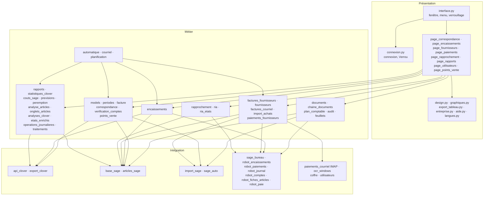

| Couche | Modules | Responsabilité |
|---|---|---|
| Présentation | `interface.py` | Fenêtre principale, menu des pages selon le profil, verrouillage après inactivité, tâches de fond. |
| | `connexion.py` | Connexion, création du premier administrateur, fenêtre `Verrou`. |
| | `page_*.py` | Une page par module. |
| | `graphiques.py` | Graphiques sur `tk.Canvas` (barres, courbes, anneau, classement, carte de chaleur, infobulles, export PDF/PNG). |
| | `export_tableau.py`, `pdf_documents.py` | Liste « Exporter » : Excel, CSV, PDF et impression ; droit d'exporter par profil. Les PDF des tableaux et des documents (bons, factures, commandes) sont dessinés par fpdf2 (`pdf_documents` : en-tête logo + entreprise, filet vert / rouge / jaune, colonnes ajustées au contenu) ; Edge ne sert plus qu'aux pages HTML, avec une création de secours. |
| | `entreprise.py` | Nom, adresse, téléphone et site web de l'entreprise lus dans Clover (une fois par jour) pour l'en-tête des impressions. |
| | `design.py` | Couleurs, boutons, tableaux. |
| | `aide.py`, `langues.py` | Aide et FAQ en français et en anglais ; traduction. |
| Métier | `facture.py`, `periodes.py`, `models.py` | Factures de vente : une par jour du lundi au jeudi, une pour la fin de semaine. |
| | `correspondance.py`, `verification_comptes.py` | Articles Clover → Sage ; comptes 15xx → 40xx / 50xx. |
| | `encaissements.py` | Dépôts Clover (lots), espèces (Interac, dépôts au guichet) → encaissements sur les factures. |
| | `factures_fournisseurs.py`, `fournisseurs.py`, `import_achats.py` | Lecture des factures fournisseurs, registre, import `<PurInvoice>`. |
| | `creation_articles.py`, `stock_clover.py` | Nouvel article dans Clover et Sage (comptes par catégorie) ; stock et coût Clover après l'import d'une facture fournisseur. |
| | `inventaire.py` | Inventaire Clover + Sage en un fichier ; saisie de l'inventaire compté dans les deux ; rapport du coût de l'ajustement. |
| | `fenetre_articles_clover.py` | Liste des articles Clover (date de péremption lue dans l'UGS ; UGS qui ne sont pas des dates effacées dans Clover après confirmation). |
| | `transferts.py`, `robot_transferts.py`, `fenetre_transferts.py` | Transferts de marchandises entre points de vente : transfert entre les deux dépôts Sage, puis stock Clover des deux marchands. |
| | `couts_clover.py`, `fenetre_couts.py`, `fenetre_cocher.py` | Coûts Clover remplacés par le coût moyen Sage (lignes cochées, sans valeur aberrante) ; comptes des articles Sage corrigés d'après la table catégorie -> comptes. |
| | `paiements_fournisseurs.py` | Avis Interac → factures fournisseurs → paiements. |
| | `rapprochement.py` | Relevés ↔ écritures du compte Sage de la banque. `lire_releve` choisit le lecteur par l'extension : OFX / QFX / QBO et CSV (`releves_bancaires.py`), PDF BNC (`lire_releve_bnc`), tout autre PDF par colonnes (`lire_releve_desjardins` généralisé : en-têtes français ou anglais, colonnes Frais / Retrait / Dépôt / Solde, « Amount », date après les montants, sens confirmé par le solde imprimé, arrêt au compte suivant). Comptes bancaires (`CompteBancaire`, `comptes_bancaires` : compte de dépôt 1055 dans la banque `[rapprochement] banque_depot`, BNC 1060, puis `[[comptes_bancaires]]` de toute banque), un registre de relevés par compte (`releves_<code>/`, `ranger_releve` : n° du compte, puis banque, puis seul compte). |
| | `banques_canada.py`, `releves_bancaires.py` | Liste des banques et caisses du Canada (code, nom, n° d'institution, mots qui la reconnaissent ; `detecter`) ; lecture des relevés OFX 1.x / 2.x et CSV (en-tête français, anglais ou absent ; dates jma / mja ; sens des montants contrôlé par le solde). |
| | `depots.py` | Dépôts : points de vente + « Emplacement par défaut » + `[sage] depots_sans_clover` ; filtres (`choisis`, `garde`) ; après l'import d'une facture, transfert « DP <n° de facture> » vers ou depuis son dépôt (`apres_import`). |
| | `impression_fournisseur.py` | Bon de réception (sans prix, quantité ajoutée dans Clover) et facture complète d'une facture fournisseur. |
| | `rapports.py` | Suivi des ventes et recherches dans l'historique Sage. |
| | `statistiques_clover.py`, `couts_sage.py`, `previsions.py`, `peremption.py` | Statistiques Clover, bénéfices au CUMP Sage, prévisions, péremption. |
| | `analyses_clover.py`, `etats_enrichis.py` | 44 analyses décisionnelles (`ANALYSES`, synthèse et décisions) et sous-pages Résumé / Graphiques des 18 états ; chaque rapport = `rapports_gestion.RapportGestion` (cartes, constats, graphiques, tableau). |
| | `operations_journalieres.py`, `traitements.py`, `facture_clover.py` | Opérations journalières (quand et par qui) ; registre des traitements ; vraie facture Clover d'une commande. |
| | `bons_commande.py`, `fenetre_bons_commande.py` | Fournisseur > Bons de commande : articles à commander, fournisseur et prix du dernier achat Sage, un bon PDF par fournisseur, comparaison avec la facture reçue. |
| | `prix_marges.py`, `fenetre_prix_marges.py` | Articles > Prix et marges : marge au CUMP Sage, prix proposé arrondi, mise à jour des prix Clover cochés. |
| | `paie_temps.py`, `fenetre_pointage.py`, `fenetre_feuilles_temps.py` | Paie : poste de pointage par NIP (commande `pointage`, raccourci « Pointage des employés »), feuilles de temps de 14 jours, heures supplémentaires, corrections avec motif, approbation, employés et NIP (empreintes seulement). |
| | `retenues.py` | Paie > Retenues à la source : retenues et cotisations du mois par compte de passif de Sage, versements, total à remettre par organisme (Revenu Québec, ARC, CNESST), échéance du 15. |
| | `sauvegarde.py`, `fenetre_sauvegarde.py` | Administration > Sauvegarde des données : archive vérifiée de donnees/ chaque nuit (OneDrive par défaut), conservation 14 j / 8 sem. / 12 mois, restauration. |
| | `caisse.py`, `fenetre_caisse.py` | Comptabilité > Contrôle de la caisse : espèces attendues d'après Clover, comptage du soir par coupures, écarts, dépôts d'espèces contre relevés du compte de dépôt. |
| | `pertes.py`, `fenetre_pertes.py` | Articles > Pertes et démarque : déclaration valorisée au coût, sortie du stock Clover et document de stock Sage, rapport par motif / catégorie / article / mois en % des ventes. |
| | `conges.py`, `fenetre_conges.py` | Paie > Jours fériés et congés : jours fériés du Québec, indemnité (1/20 des 4 semaines), congés et soldes (vacances 4 % / 6 %, 2 jours de maladie payés), heures ajoutées à la paie. |
| | `retenues.py` (suivi) | Comptabilité > Suivi des remises : remises des retenues par mois et par organisme (à temps, en retard, à remettre), alertes au résumé du matin. |
| | `depenses.py`, `fin_emploi.py`, `journal_operations.py`, `fenetres_gestion2.py` | Petite caisse et dépenses (écriture du journal général dans Sage), fin d'emploi et préparation du RE, concordance T4 / RL-1, journal des opérations. |
| | `retours.py`, `etiquettes.py`, `budget.py`, `fenetres_gestion3.py` | Retours fournisseurs (facture d'achat négative), étiquettes de prix Code 128, budget et écarts, coût de la main-d'œuvre. |
| | `paquet3.py`, `fenetres_gestion4.py` | Inventaire tournant, promotions datées dans Clover, relances des clients professionnels, tableau du gérant pour le téléphone. |
| | `paie.py`, `fenetre_paie.py` | Paie > Traitement de la paie : heures planifiées (planning) et réalisées (pointages de l'application), récapitulatif par employé et par semaine, heures validées (feuilles approuvées) à saisir dans la paie de Sage, paies de Sage (écritures du module Paie : brut, retenues par sorte, net, cotisations de l'employeur) et relevé de paie imprimé ou en PDF avec le total de l'année ; lien employé Clover -> employé Sage (« Employés et NIP » > « Lier aux employés Sage… ») ; création d'un employé dans l'application, Clover et Sage Paie (« Ajouter ») ; `robot_paie.py` : fiche employé et chèque de paie remplis dans Sage (commande interne `paie-bureau`). |
| | `comptabilite.py`, `fenetre_comptabilite.py` | Comptabilité : âge des comptes, déclaration TPS/TVQ, prévision de trésorerie, clôture du mois et état des résultats (lecture seule de Sage). |
| | `listes_sage.py`, `documents.py`, `fenetre_saisie.py`, `fenetre_gestion.py` | Gestion des ventes, achats et stocks (menus comme Sage) : listes des clients, fournisseurs, documents de vente, d'achat et de stock, articles, livre d'inventaire ; commandes clients, factures de vente (.IMP SalInvoice), documents de stock (ajustements), factures d'achat et bons saisis. |
| | `cache_lectures.py` | Mémoire des lectures de Sage et du catalogue Clover (quelques minutes, partagée, vidée après chaque écriture, préchargée au démarrage si Sage répond). |
| | `robot_tiers.py` | Création de clients et de fournisseurs dans Sage : fiche « Enregistrements des clients / fournisseurs » remplie, « utilise mes numéros d'articles » cochée, vérifiée dans la base (commande interne `tiers-bureau` si Sage est fermé). |
| | `fiches.py` | Fiches ouvertes par double-clic (client, fournisseur, article, document de vente, d'achat ou de stock), lues dans Sage. |
| | `planning.py`, `fenetre_planning.py` | Paie > Planning mensuel du gérant, publication, « Mon horaire » de l'employé (compte relié) et au poste de pointage. |
| | `manuel.py` | Manuel d'utilisation du profil : chapitres des pages permises seulement, renumérotés, PDF par Edge dans donnees/manuels/. |
| | `resume_matin.py` | Résumé du matin en tête du courriel de nuit (ventes, marge, banque, factures à payer, ruptures, péremption). |
| | `analyse_articles.py`, `onglets_articles.py` | État > Produits inactifs (sans vente depuis N jours) et Articles 80/20 (classes A/B/C, stock et sa valeur) ; source Clover ou Sage. |
| | `ria.py`, `ria_etats.py`, `fenetre_ria.py` | RIA : mouvements RIA des relevés, surplus des dépôts d'espèces, commissions ; états de compte RIA (PDF lus et recontrôlés, reçus par courriel) transformés en opérations (envois, versements en espèces) puis saisies au journal général. |
| | `chaine_documents.py`, `fenetre_chaine.py` | Chaîne des documents de vente (DV, CC, PL, BL, RC, FV, FRC) et d'achat (PC, BC, BR, FA, RT, FRT) : transformer, importer les factures, Clover mis à jour par les factures, annuler un document de stock par son inverse. |
| | `plan_comptable.py`, `robot_comptes.py`, `fenetre_plan_comptable.py` | Plan comptable de Sage : lecture, création, modification, inactivation, suppression ; contrôle des comptes saisis dans l'application. |
| | `robot_fiches_articles.py`, `fenetre_fiches_articles.py` | Liste des articles : modifier (description, inactif) ou supprimer un article dans Sage, puis renommer ou supprimer les articles Clover reliés. |
| | `audit.py`, `fenetre_audit.py` | Audit des actions : une ligne par bouton, entrée du menu et connexion, chaînée par empreinte SHA-256. |
| | `feuillets.py`, `calendrier_paie.py` | T4 et RL-1 sur les formulaires officiels (téléchargés des sites de l'ARC et de Revenu Québec, contrôlés) ; calendrier des paies aux 14 jours. |
| | `automatique.py`, `courriel.py`, `planification.py` | Traitement de nuit, compte rendu, tâche planifiée ; envoi réessayé 3 fois, copie cachée au propriétaire des courriels personnels. |
| Intégration | `api_clover.py`, `export_clover.py` | API REST Clover v3 (parallélisée) ; export Excel Clover. |
| | `base_sage.py`, `articles_sage.py` | Lecture MySQL de Sage, même quand Sage est fermé (`lire_pendant_connexion`). |
| | `import_sage.py`, `sage_auto.py` | Fichier `.IMP` `<SalInvoice>` ; pilotage de `Sage_SA_import.exe` (`executer_outil`), puis de l'assistant si l'outil refuse l'entreprise partagée (`executer`, fichier noté dans `entreprises_partagees.json`). |
| | `robot_import_assistant.py` | « Assistant d'importation des transactions » de Sage : menu Fichier > Importer/Exporter repéré par son texte (OCR de Windows), type de transaction, fichier, résumé lu ; Sage gardé ouvert pendant le résumé pour vérifier la facture (commande interne `import-assistant-bureau`). |
| | `sage_bureau.py`, `robot_*.py` | Ouverture de Sage sur un bureau Windows séparé et saisie dans ses fenêtres par messages Windows. |
| | `paiements_courriel.py`, `ocr_windows.py` | IMAP en lecture seule ; OCR intégré à Windows. |
| | `coffre.py`, `utilisateurs.py` | Coffre-fort Windows ; comptes et profils, avec mots de passe hachés. |
| | `pointage_wifi.py` | Pointage seulement depuis le Wi-Fi du magasin : réseau de l'appareil lu dans Tailscale (`tailscale status`, sinon `tailscale ping`) comparé aux adresses publiques du magasin ; postes du magasin toujours permis. |
| | `prix_sage.py`, `robot_prix_sage.py` | Prix de vente régulier de Sage depuis Clover : comparaison, liste à cocher, écriture dans la fiche article (onglet des prix, case Régulier), vérifiée dans tinvprc. |
| | `serveur_appli.py` | Serveur de l'application ([serveur] et [web] de `config.toml`) : ordinateur, adresse Tailscale, adresse locale, nom tapé dans le client, port ; fichier `serveur.json` du client. |
| Web | `web/serveur.py`, `web/pages.py`, `web/menu.py`, `web/accueil.py` | Serveur HTTP sans bibliothèque, sessions, sécurité, menu et accueil identiques à Windows ; `page()` donne aux pages de l'application leur en-tête (`entete_page`) et aux fenêtres de travail leur bandeau « ✖ Fermer ». |
| | `web/style_windows.py`, `web/export_web.py`, `web/a_cocher.py` | Allure des fenêtres Windows ; « ⬇ Exporter ▾ » de chaque tableau ; liste à cocher commune (`FenetreACocher`). |
| | `web/pages_*.py`, `web/consultations*.py` | Une page par entrée du menu (76), mêmes calculs que les fenêtres ; `pages_dossiers.py` (contenu des dossiers du serveur, choix d'un fichier ou d'un dossier) ; `pages_fiches.py` (nouveau client / fournisseur, modifier ou supprimer un article dans Sage et Clover). |
| | `web/graphiques_svg.py`, `web/taches.py`, `web/client.py` | Graphiques de `graphiques.py` en SVG ; travaux longs dans un fil (un seul dans Sage à la fois) ; client des postes. |
| | `web/filtres.py` | Filtre à choix multiples sans script (dépôts : cases, « Tout sélectionner »). |

---

## 3. Données

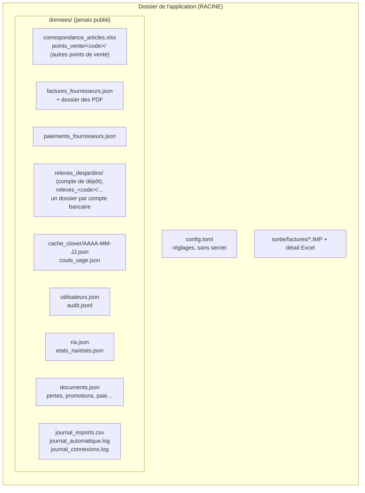

| Donnée | Format | Écrite par | Lue par |
|---|---|---|---|
| Réglages | `config.toml` | page Configuration | tous les modules |
| Secrets | coffre-fort Windows | pages Clover, Sage, Courriel | `coffre.py` |
| Correspondance Clover → Sage | Excel (« Confirmé » par le propriétaire) | `correspondance.py` | facture, coûts, statistiques |
| Registres fournisseurs, paiements, relevés | JSON | pages 8, 9, 10 | traitement de nuit, rapports |
| Ventes Clover par jour | JSON, cache, plus mémoire vive | `statistiques_clover.py` | statistiques, prévisions |
| CUMP Sage | JSON, renouvelé chaque jour | `couts_sage.py` | bénéfices, liste d'articles |
| Utilisateurs | JSON, empreintes PBKDF2 | `utilisateurs.py` | connexion, verrou |
| Journaux | CSV, texte | import, nuit, connexion | tableau de bord, courriel |
| Audit | `audit.jsonl`, une ligne par action, chaînée | `audit.py` | Administration > Audit des actions |
| RIA | `ria.json` (opérations, comptes), `etats_ria/` (PDF et lecture) | `ria.py`, `ria_etats.py` | RIA, journal général |
| Documents de l'application | `documents.json` + PDF | `documents.py`, `chaine_documents.py` | listes, import Sage |

Tables Sage lues :

| Table | Contenu |
|---|---|
| `tcustr`, `tcustrdt` | Factures et encaissements clients |
| `tvendor`, `tventr`, `tventrdt` | Fournisseurs, factures et paiements |
| `tinvent`, `tinvlot` | Articles, coûts et stock |
| `tinvloc`, `tinvbyln` | Dépôts (emplacements d'inventaire), stock et valeur par dépôt |
| `tjentact`, `tjourent`, `taccount` | Écritures et comptes |
| `ttaxauth` | Taxes |
| `tpydet`, `tpydet1`, `tpydet2`, `tcomppy5`, `temp` | Paies (brut, gains, retenues), libellés, employés (jamais le NAS) |
| `titrec`, `titrline` | Mouvements d'articles (ventes, achats, ajustements, transferts) ; `titrec.bTrfLoc` distingue un transfert d'un ajustement du journal 14, `titrline.lInvLocId` donne le dépôt de chaque ligne |

---

## 4. Flux principaux

### 4.1 Traitement de nuit (`automatique.lancer`)

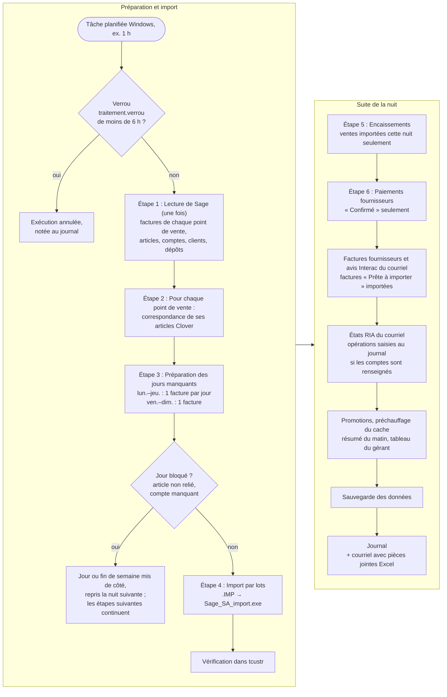

### 4.2 Facturation des ventes (Clover → Sage)

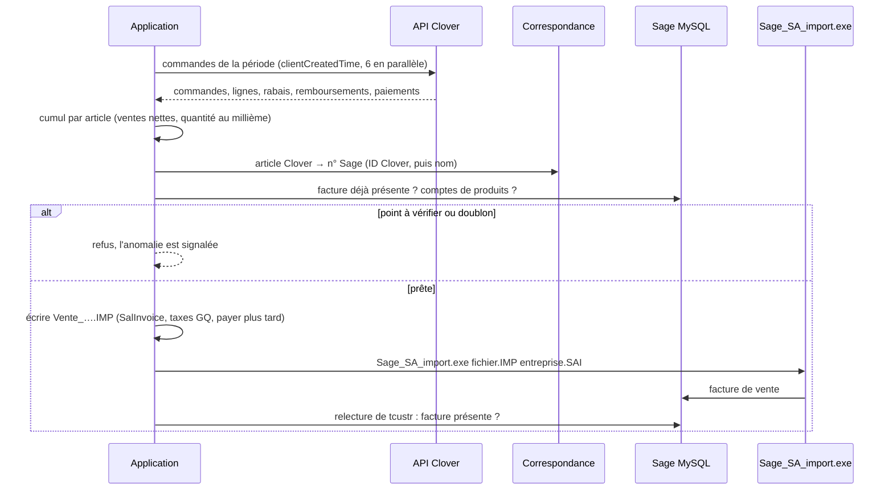

Règle : montant de ligne = ventes nettes Clover de l'article ; prix = montant ÷ quantité nette (4 décimales) ; total = ventes nettes.

### 4.3 Encaissements

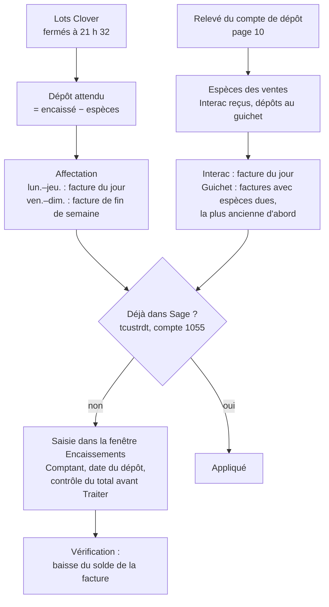

Saisie des dépôts (`robot_encaissements.appliquer`) : chaque dépôt « À saisir » dans son propre essai (`_encaisser_et_verifier`, la base de Sage fait foi) ; un échec est noté « NON encaissé » avec une photo de la fenêtre, puis `remettre_a_zero` referme les questions restées ouvertes (la fenêtre « Traitement… » est attendue, jamais touchée), rouvre la fenêtre Encaissements si elle a disparu (`SessionSage.ouvrir_encaissements`) et efface la saisie ; fenêtre impossible à rouvrir : dépôts restants « Non tenté » (toujours un résultat par dépôt). Cellule « Montant reçu » : position selon la largeur réelle de la grille, cellule sélectionnée en entier (EM_SETSEL), montant tapé caractère par caractère, relu (WM_GETTEXT) et retapé (3 essais) avant le Tab (`_saisir_controle`, version 1.0.20) ; total contrôlé avant « Traiter ». `robot_paiements.appliquer` suit les mêmes règles.

Un dépôt d'espèces supérieur aux espèces dues garde son surplus en « Part RIA à confirmer » (`repartir_especes`). `ria.py` (`donnees/ria.json`) note la part confirmée, retirée du dépôt au calcul suivant ; `journal_sur_bureau_cache` saisit aussi les opérations de RIA (`mouvements_a_saisir`), avec le n° « RI-0001 » comme source.

Les états de compte RIA (`ria_etats.py`) deviennent des opérations une seule fois chacune : envoi « MT Send » = débit espèces / crédit RIA ; versement ou remboursement en espèces = débit RIA / crédit espèces ; un versement payé par virement Interac (même montant au relevé, à 3 jours près) est laissé à la banque ; les règlements ACH et dépôts restent des mouvements de banque.

### 4.4 Factures et paiements fournisseurs

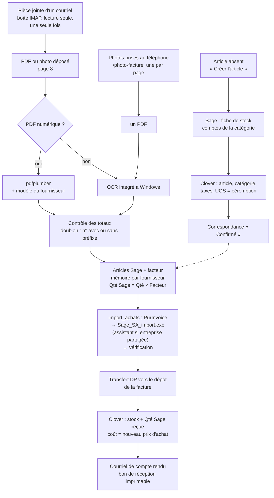

Particularités des factures fournisseurs (versions 1.0.1 à 1.0.6) :

- **Deux onglets**, Windows et web : « Liste des factures » (filtres, cases à cocher, imports) et « Saisie de la facture » (liste déroulante « Facture à traiter », enregistrement automatique).
- **Article Sage tapé** : n° ou désignation Sage saisi dans la ligne, avec propositions pendant la frappe (`fournisseurs.article_saisi` ; web : listes `sage-numeros` / `sage-designations`) ; l'autre champ se remplit seul.
- **Notes de crédit** : un document dont le titre est « CREDIT » ou « NOTE DE CRÉDIT » (`factures_fournisseurs.est_note_credit`) est lu en négatif (`signer_credit`), case « Note de crédit » ; importé comme une `<PurInvoice>` négative.
- **Retours et notes de crédit dans Clover** : la quantité négative retire le stock Clover des articles reliés ; le coût Clover n'est jamais changé par un retour (`stock_clover.mettre_a_jour`).

Inventaire, transferts, coûts et comptes :

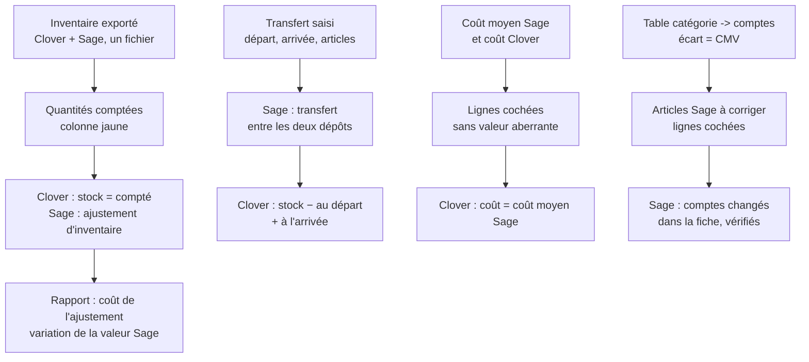

Paiements des fournisseurs (après l'import de leurs factures) :

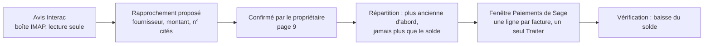

### 4.5 Rapprochement bancaire

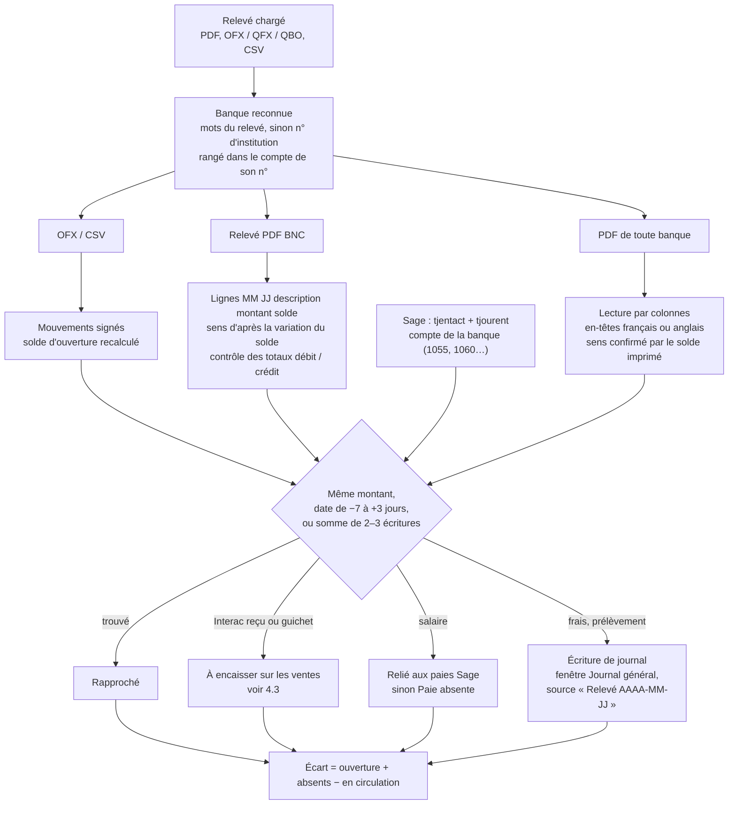

### 4.6 Rapports et statistiques Clover

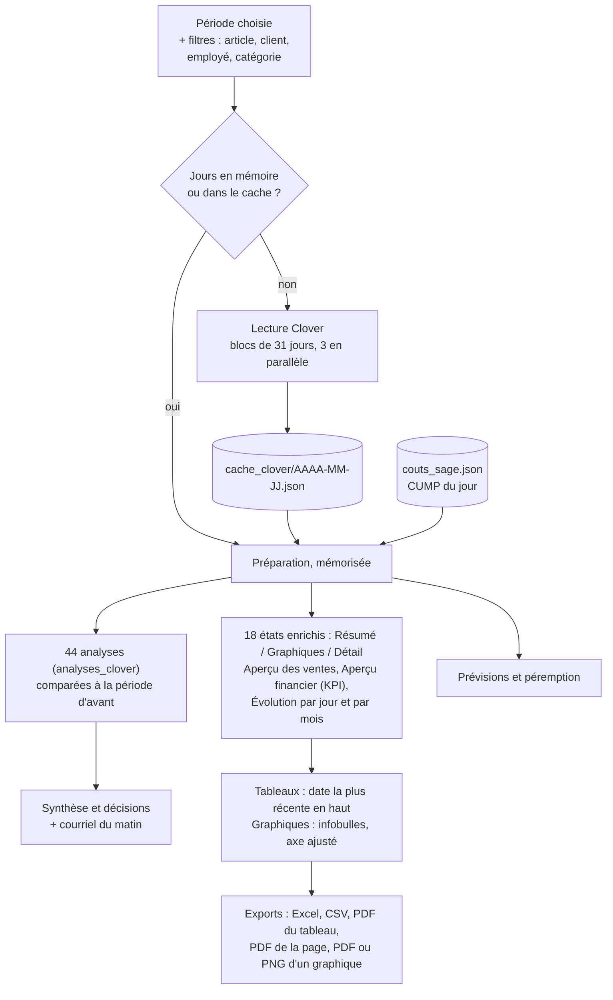

#### Reporting décisionnel (version 1.0.0 du 9 novembre 2026)

L'onglet « Reporting » (ancien « Statistiques Clover ») range ses rapports dans les sections du menu de Clover ; une section de plus de 7 rapports les montre dans un ruban horizontal. Chaque rapport est calculé sur les ventes déjà lues de la période et de sa comparaison, sans relire Clover, avec les filtres globaux appliqués.

| Élément | Rôle |
|---|---|
| `analyses_clover.ANALYSES` | (libellé, clé, fonction, section, place) : chaque fonction `(ventes, ventes d'avant, contexte) -> RapportGestion` |
| `RapportGestion` | cartes (feu vert / jaune / rouge, variation), constats marqués ✔ ⚠ ✖ ℹ, évolution, répartition, graphiques de plus, tableau, ids de commandes (facture Clover) |
| `etats_enrichis.enrichir` | même présentation pour les 18 états de base, à partir de leur tableau et du même état de la période d'avant |
| `synthese` / `_decisions` | décisions priorisées 1 à 3 avec les éléments concernés ; reprises par `resume_matin` (28 jours) |
| Sous-pages | Résumé, Graphiques, Détail (filtre texte + liste de la colonne de regroupement) ; Windows et web identiques |
| Web | graphiques SVG interactifs (`/filtres.js` : bulle, légende cliquable), filtres qui relancent la page d'eux-mêmes, bandeau « Chargement… » ; CSP `script-src 'self'` |

Le catalogue complet des rapports est dans `documentation/CATALOGUE_REPORTING.md`.

### 4.7 Connexion, profils et verrouillage

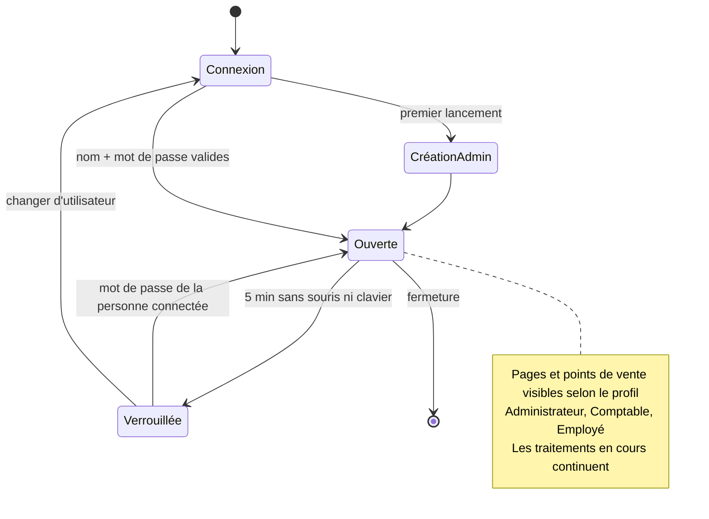

### 4.7 bis Application web (version 1.1.0)

Serveur HTTP de Python (`http.server`, aucune bibliothèque de plus) dans `mvogmbi_sync/web/` : `serveur.py`
(sessions, sécurité, aiguillage) et `pages.py` (pages HTML, sans script). Mêmes comptes, profils et droits par
fonction que l'application Windows (`utilisateurs.Registre`) ; chaque page porte le titre de l'entrée du menu qui
lui correspond. Mêmes fichiers de `donnees/` : le serveur web et l'application de bureau doivent donc tourner sur le
même ordinateur (SERVDCSAGE, avec Sage et le traitement de nuit).

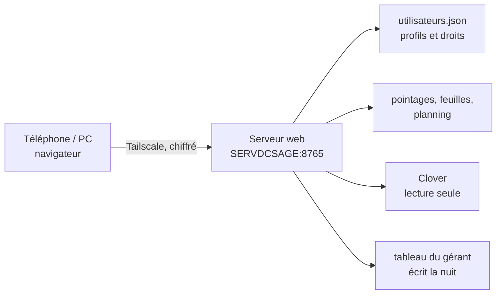

| Page | Entrée du menu (droit) | Contenu |
|---|---|---|
| `/` | — | fonctions permises au profil |
| `/pointage` | Pointage des employés | NIP ; seulement depuis les adresses de `[web] postes_pointage` |
| `/horaire` | Mon horaire | 5 semaines publiées ; le gérant choisit l'employé |
| `/mes-heures` | Mes heures et mes paies | période en cours et précédente |
| `/feuilles` | Feuilles de temps | approbation des feuilles sans anomalie |
| `/statistiques` | Statistiques Clover | cartes avec variation, ventes par heure ou par jour ; employé limité : ses ventes |
| `/tableau` | Tableau du gérant (téléphone) | page écrite chaque nuit |
| `/mot-de-passe` | — | ferme toutes les sessions du compte |

Mot de passe web à part (2.17.0) : `Utilisateur.sel_web` / `empreinte_web` (PBKDF2), `Registre.verifier_web` (mot de passe web s'il existe, sinon celui de l'application puis création obligatoire : `Session.creer_web`, toute page renvoie à `/mot-de-passe`), `probleme_mot_de_passe_web` (12 caractères, minuscule, majuscule, chiffre, caractère spécial, différent du mot de passe Windows).

Sécurité : témoin de session HttpOnly + SameSite=Strict (Secure en HTTPS), 5 min d'inactivité (la page passe d'elle-même à la connexion), 12 h au plus ;
jeton anti-falsification sur chaque formulaire et refus des envois d'une autre origine ; politique de contenu sans
script ni cadre ; 3 mots de passe faux = compte verrouillé (règle de l'application), 10 échecs en 10 min = adresse
refusée 10 min ; pare-feu ouvert sur la carte Tailscale seulement ; audit de chaque page et action (fenêtre « Web »),
journal `donnees/journal_web.log`.

Depuis la version 2.0.0, toutes les entrées du menu (76) ont leur page web, avec le même affichage que
l'application Windows (bandeau, menu de gauche en rubriques, Mise en route). Les pages sont réparties en modules
(`pages.MODULES` : paie, consultations, comptabilité, trésorerie, rapprochement, RIA, ventes, documents,
fournisseurs, achats, articles, catalogue, administration, traitement de la paie) qui appellent les mêmes fonctions de
calcul que les fenêtres. Les traitements longs (saisies dans Sage, imports, lectures de boîtes de courriel) passent
par `web/taches.py` : un fil par travail, une seule saisie dans Sage à la fois, page de suivi rafraîchie sans script.

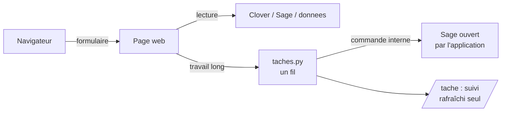

#### Interface identique à Windows (versions 2.1 à 2.14)

Les 76 entrées du menu ont été comparées côte à côte (photo de chaque fenêtre Windows et de la page web à la même
taille) et alignées : mêmes boutons, même ordre, même position, mêmes couleurs d'état.

| Fenêtre Windows | Équivalent web |
|---|---|
| Page de l'application (`entete_page` : icône, titre souligné, sous-titre) | même en-tête, sans bandeau « Fermer » |
| Fenêtre de travail (`Application.nouvel_outil`) | titre de la fenêtre + « ✖ Fermer » |
| Ligne de tableau choisie d'un clic | bouton radio caché, chaque cellule l'étiquette (`ligne_cliquable`) |
| `bouton_exporter` placé à droite (`placer_a_droite`) | « ⬇ Exporter ▾ » dans la barre de boutons du tableau |
| Fenêtre de saisie à part (`DialogueEmploye`, `DialogueTiers`, `DialogueHoraire`…) | carte ouverte sous la liste |
| Carte du bas vide avant le choix d'une ligne | mêmes champs et boutons, inactifs |
| Calcul seulement au bouton (« Calculer », « Vérifier ») | `Consultation.attente` : zones vides titrées avant le clic |
| Dossier ouvert dans l'Explorateur | contenu du dossier du serveur, fichiers téléchargés (`pages_dossiers.py`) |
| Copier dans le presse-papiers | texte seul affiché (pas de script dans la page) |

Restent différents, à cause du navigateur sans script : un bouton « Afficher » ou « Choisir » là où Windows réagit au
choix d'une liste, les dates au format du navigateur et les petites fenêtres de saisie ouvertes dans la page.

#### Déploiement et configuration du serveur (version 2.14.2)

Sage 50, MVOGMBI_Sync, son serveur web et le traitement de nuit sont sur le même ordinateur : depuis le
4 novembre 2026, **SERVDCSAGE** (réseau local 192.168.2.62, Tailscale 100.99.52.28). Le nom
`app.marchemvogmbi.com` (DNS chez WHC) mène à son adresse Tailscale ; HTTPS sur le port 443 avec un certificat Let's Encrypt validé par le DNS (`installation/certificat_https.ps1`, win-acme ; [web] certificat / cle), relu par le serveur à chaque renouvellement. Aucune adresse n'est écrite dans le programme :
tout se règle dans « Administration > Automatisation > Serveur de l'application ».

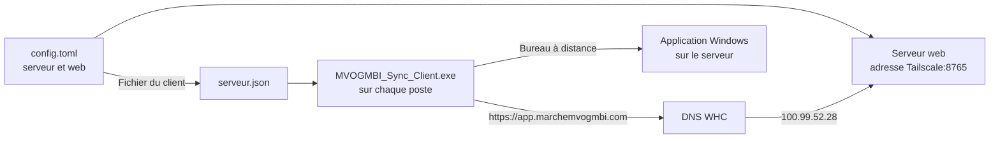

#### Pointage sur le Wi-Fi du magasin (version 2.14.2)

Les appareils joignent le serveur par Tailscale : le serveur voit leur adresse 100.x, pas leur Wi-Fi. Tailscale sait
par quelle adresse il joint l'appareil : c'est l'adresse publique de la connexion Internet du réseau où il se trouve.


Pause automatique (version 2.15.0) : le téléphone qui a servi à pointer est suivi (`donnees/pointage_telephones.json`) tant que l'employé est au travail. Le serveur web contrôle chaque minute (`pointage_wifi.controler`) : 5 minutes de suite hors du Wi-Fi du magasin (réglage `[pointage] pause_hors_wifi_minutes`) = « Début de pause » à l'heure du départ (`Registre.pointer_auto`, auteur « Automatique ») ; retour sur le Wi-Fi = « Fin de pause ». Un départ arrête le suivi.

#### Rapidité de l'application web (version 2.22.0)

Une lecture de Sage qui échoue est retenue 45 s (`_ECHECS_LECTURE`) : les pages suivantes s'affichent tout de suite avec le bandeau « Sage ne répond pas ». Tant que quelqu'un a utilisé le site dans les 15 dernières minutes, un fil du serveur (`_garder_sage_pret`) garde la base ouverte (`SELECT 1` toutes les 45 s), jamais la nuit ni pendant un travail Sage. Feuille de style et logo sont gardés par le navigateur. Mesure sur une copie : 64 pages du menu en 3,8 s au 2e tour (60 ms par page) au lieu de 62,8 s.

Version 1.0.3 (« je veux que le processus soit instantané ») : seule la surveillance de fond (fil « sage-pret ») ouvre la base ; une page ne fait qu'une lecture sur la base déjà ouverte, sinon répond tout de suite « Sage ne répond pas » et réveille la surveillance (`SURVEILLANCE_SAGE`). Les pages lentes à la 1re ouverture (lectures Clover) sont préparées au démarrage puis chaque heure de 6 h à minuit (`prechauffer`, `PAGES_A_PREPARER`). Mesure : 1er passage des 64 pages en 2,8 s au lieu de 70,5 s, aucune page au-dessus de 0,3 s.

#### Tableaux : textes longs coupés (version 1.0.6)

Les cellules restent sur une ligne, comme dans Windows. Une seule description très longue élargissait sa colonne au point de pousser les montants hors de la zone (page Rapprochement). Le serveur passe sur chaque page affichée (`export_web.couper_textes_longs`) : une cellule de plus de 45 caractères est coupée à 34 caractères de large environ (« … ») et son texte complet vient au survol (`title`) ; les cellules avec un champ, un bouton ou un formulaire ne sont jamais touchées. Tour des 66 pages : seuls quatre tableaux à beaucoup de colonnes défilent encore à l'horizontale (Articles Clover, Feuilles de temps, Produits inactifs, Articles 20/80).

#### Fenêtre web fixe sur PC (version 1.0.9)

Sur un écran de plus de 820 px, la page web ne défile jamais dans son ensemble, comme une fenêtre Windows : le menu et la zone de travail défilent chacun dans leur cadre (`menu.STYLE_MENU`). Le script `/filtres.js` (`remplirListe`) donne à la liste principale de la page (le tableau qui cache le plus de lignes) toute la hauteur qui reste, au chargement et à chaque changement de taille ; `data-sans-remplir` l'écarte. La position de la page et des zones défilantes est gardée après un envoi de formulaire (version 1.0.2). Pendant une saisie, `/filtres.js` signale l'activité au serveur (`/actif`) : la session n'expire qu'après 5 minutes SANS activité, même sans envoi de formulaire (version 1.0.3).

#### Même état dans Windows et sur le web (version 2.23.1)

Le registre des factures fournisseurs retient ce qu'il a lu ; s'il a changé sur le disque entre-temps (autre plateforme), `enregistrer` fusionne : seules les factures modifiées ici remplacent celles du disque, et une facture « Importée » n'est jamais ramenée à un autre état. La page Windows relit le registre toutes les 3 s s'il a changé.

### 4.8 Plusieurs points de vente

Chaque point de vente Clover (identifiant marchand et jeton) est un dépôt Sage, avec son client et ses factures. Le n° 1 garde ses réglages d'origine.

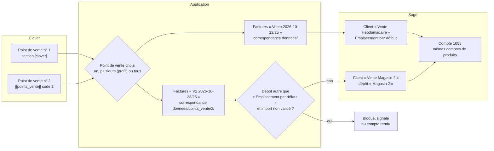

### 4.9 Dépôts (plusieurs sites)

Un dépôt est un emplacement d'inventaire de Sage (`tinvloc`) : celui d'un point de vente Clover, l'« Emplacement par défaut », ou un dépôt sans Clover (`[sage] depots_sans_clover`). Le fichier `.IMP` n'a pas de champ d'emplacement : la facture entre dans l'emplacement par défaut, puis un transfert la place dans son dépôt.

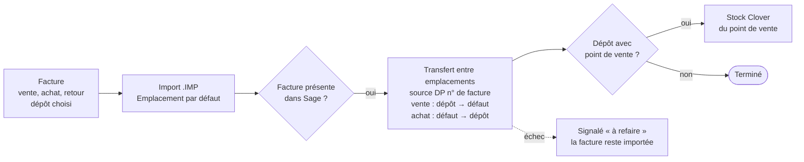

| Où | Effet du dépôt |
|---|---|
| Factures fournisseurs, documents FV / FRC, retours, traitement de nuit | dépôt de la facture (`depots.apres_import`) |
| Employés, planning, feuilles de temps | dépôt principal de l'employé (`Employe.depot`), dépôt du quart (`Quart.depot`) : une cédule par dépôt |
| Documents de stock, livre d'inventaire, liste des articles | colonne et filtre Dépôt lus dans Sage (`titrline.lInvLocId`, `tinvbyln`) |
| Main-d'œuvre, suivi des ventes, rapports de gestion | heures et ventes des dépôts / points de vente choisis |

Filtres : Windows `design.filtre_depots` (liste à choix multiples), web `web/filtres.filtre_depots` (cases, « Tout sélectionner », sans script).

---

## 5. Pilotage de Sage

Sage 50 CA n'a pas d'API ouverte. L'application passe par trois voies :

| Voie | Utilisée pour | Sage | Vérification |
|---|---|---|---|
| MySQL en lecture seule (`base_sage.py`) | Tout ce qui se lit | Sage de la journée ouvert par l'application, ou Sage de la personne ; sinon (la nuit, ou réglage `[sage] garder_ouvert = false`) base ouverte par l'outil d'import ; refusée : Sage ouvert par l'application (`garder-sage`) | — |
| `Sage_SA_import.exe` (`sage_auto.py`) | Factures de vente `<SalInvoice>` et d'achat `<PurInvoice>` (retours compris) | fermé, **mono-utilisateur** (accès exclusif) | présence dans `tcustr` / `tventr` |
| Assistant d'importation de Sage (`robot_import_assistant.py`) | Mêmes fichiers `.IMP`, quand l'outil refuse une **entreprise partagée** (« You cannot use this utility to import transactions into a shared company ») | ouvert par l'application en **mono-utilisateur** ; menu repéré par son texte (OCR de Windows) | résumé de Sage lu, facture retrouvée dans la base pendant le résumé |
| Fenêtres de Sage (`sage_bureau.py` + `robot_*.py`) | Encaissements, paiements, journal général, dépenses, documents de stock, inventaire, transferts, articles, clients, fournisseurs, employés, paie | le jour : Sage de la journée **emprunté** tel quel ; la nuit : lancé par l'application sur un bureau Windows séparé, **multi-utilisateur** ; fonctionne session verrouillée | baisse des soldes, écriture présente, stock relu |

Règles d'ouverture de Sage :

- **Mono-utilisateur pour l'import, multi-utilisateur pour les saisies et la lecture** (règle du propriétaire). Le multi-utilisateur exige le service Windows « Sage 50 Gestionnaire de connexion de base de données ».
- Le fichier réel est une **entreprise partagée** : Sage demande comment l'ouvrir ; `SessionSage._repondre_entreprise_partagee` répond selon la règle. Le partage n'est jamais arrêté (choix du propriétaire) : les imports passent par l'assistant d'importation.
- L'écran « Lancement de Sage 50. Veuillez patienter… » n'est pas un message d'erreur : l'application attend jusqu'à 60 s avant de juger un message. Sage déjà ouvert sur un autre fichier dans la même session Windows : erreur tout de suite.
- Diagnostic de l'assistant : photos de la fenêtre et des menus dans `donnees/diagnostic_assistant/`, citées dans le message d'erreur.
- Sur le bureau séparé, une page du menu de gauche s'ouvre par le **cadre** de son libellé (`robot_articles.afficher_page`), une tâche par le cadre de son libellé (`cible_tache`) ; un clic sur le libellé seul est ignoré.
- Sage refuse l'accès MySQL des applications tant que l'entreprise n'est pas ouverte par Sage ou par l'outil d'import : l'utilisateur `mvogmbi_sync` (« Accès par des tiers ») doit exister avec le même mot de passe dans chaque fichier d'entreprise.

### 5.1 Base gardée ouverte

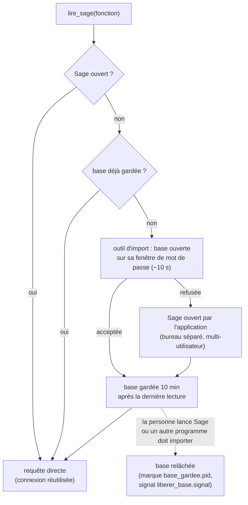

- Une erreur de la fonction de lecture (calcul, requête fautive) remonte tout de suite ; seules les erreurs de connexion déclenchent un autre moyen d'ouverture.
- Une lecture automatique (démarrage, préchargement) n'ouvre jamais Sage lui-même (`ouvrir=False`, `OUVERTURE_SAGE`).

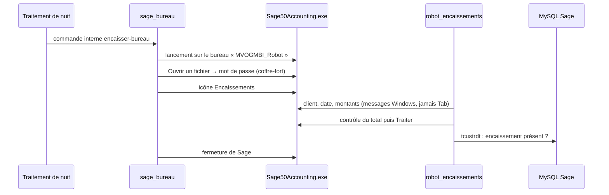

Grille de la fenêtre Encaissements (version 1.0.4) : sa taille dépend de l'écran où Sage s'ouvre (791 points de large et 8 lignes sur la copie d'essai, environ 640 points et 4 lignes sur le serveur). La colonne « Montant reçu » est visée à 90 % de la largeur réelle de la grille (`FenetreEncaissements.x_montant`), le nombre de lignes visibles est lu sur sa hauteur ; une cellule ouverte hors de la dernière colonne est refermée sans rien taper (photo dans `donnees/diagnostic_encaissements/`).

### 5.2 Sage ouvert pour la journée (versions 1.0.3 à 1.0.5)

Règles du propriétaire du 6 novembre 2026 : Sage s'ouvre quand on ouvre l'**application Windows** (après la connexion) en **multi-utilisateur**, sur le bureau séparé, et se ferme quand on la ferme ; si l'application n'est pas ouverte, Sage reste fermé (version 1.0.10 : le serveur web ne lance plus que la fermeture des Sage orphelins, `garder_sage_ouvert(ouvrir=False)`). Le gardien (`garder-sage`) surveille l'application qui l'a lancé (`os.getppid`) : partie, il referme Sage ; il attend la fin d'une saisie qui emprunte Sage (`donnees/sage_emprunt.json`). La nuit, le traitement fonctionne comme avant. Une personne peut ouvrir Sage sur le serveur, dans n'importe quelle session : Sage n'ouvre une entreprise partagée qu'une fois par ordinateur (« Cette entreprise partagée est déjà ouverte », constat du 6 novembre 2026), le Sage de la journée lui laisse donc la place en quelques secondes et ne se rouvre que 5 minutes après la fermeture de ce Sage (version 1.0.8). Pendant ce temps, les saisies de l'application demandent de le fermer.

```mermaid
flowchart TD
    F["Fil « sage-journee »<br/>de l'application Windows<br/>(toutes les 5 s)"] --> N{"0 h - 6 h, traitement de nuit<br/>ou garder_ouvert = false ?"}
    N -- oui --> X["Sage de la journée refermé"]
    N -- non --> D{"Sage déjà gardé, en ouverture,<br/>travail mono-utilisateur en cours ?"}
    D -- oui --> F
    D -- non --> M["marque « ouverture »<br/>donnees/sage_garde.json"]
    M --> O["garder-sage : Sage ouvert<br/>en multi-utilisateur (~2 min)"]
    O --> P["marque « pid » :<br/>Sage prêt"]
    P --> S1["Saisie (encaissement, transfert…) :<br/>Sage emprunté, prêt en 0,2 s,<br/>fenêtres de travail refermées après"]
    P --> S2["Lectures : base de ce Sage,<br/>jamais l'outil d'import"]
    P --> S3["Import (mono-utilisateur) :<br/>Sage de la journée libéré (~30 s),<br/>import, puis rouvert à la minute suivante"]
```

- Marque `donnees/sage_garde.json` : `ouverture` (programme qui ouvre Sage) pendant l'ouverture, puis `pid` de Sage, fichier, dossier de travail et session Windows. Un Sage lancé par l'application n'est jamais pris pour « le Sage de la personne » (`pids_gardes`, y compris pendant l'ouverture : instantané des processus, parent = programme qui l'ouvre).
- Tant que ce Sage est ouvert ou s'ouvre (`sage_journee_en_cours`), aucune lecture ne passe par l'outil d'import : il prendrait l'entreprise pour lui seul et Sage refuserait de s'ouvrir (« Un autre utilisateur utilise actuellement cette entreprise sur cet ordinateur », constat du 6 novembre 2026 sur SERVDCSAGE, version 1.0.4). Une lecture demandée attend qu'il soit prêt ; une lecture automatique répond « Sage s'ouvre pour les saisies de la journée ».
- Une saisie lancée pendant l'ouverture attend la fin de l'ouverture (`attendre_fin_ouverture`), puis emprunte ce Sage. Un import attend aussi la fin de l'ouverture, puis le libère (`liberer_sage_garde`, fichier « arret »).
- **Sage orphelin** (version 1.0.9) : tout Sage dont une fenêtre est sur le bureau séparé est celui de l'application (`sages_du_bureau_cache`, `EnumDesktopWindows`) ; s'il n'a plus de programme parent (`sages_orphelins` : gardien coupé, par exemple par une installation), il est refermé proprement sur ce bureau (`fermer-sage-orphelin` : fenêtre fermée, mise à jour remise à plus tard, jamais arrêté de force) avant toute nouvelle ouverture. L'installateur lance `liberer-sage` avant d'arrêter les programmes (pause `donnees/sage_pause.txt` pour les programmes déjà lancés) ; le gardien referme Sage avant d'effacer sa marque.
- **Inactivité** (version 1.0.12) : Sage ferme l'entreprise après une période d'inactivité et demande s'il faut la rouvrir ; le gardien le voit (contrôle toutes les 30 s, `inactivite_signalee`), referme Sage (réponse « Non ») et l'application en rouvre un neuf au besoin.
- Échec de l'ouverture : nouvel essai 10 minutes plus tard. Chaque étape est notée dans `donnees/journal_sage_garde.log`.
- `donnees/sage_mono.verrou` marque un travail mono-utilisateur en cours (import, compte ou article rendu inactif) : le Sage de la journée attend.

---

### 5.3 Fenêtres de Sage pilotées : référence

Chaque saisie suit le même schéma : ouvrir (ou emprunter) Sage, ouvrir la fenêtre par l'accueil, remplir les champs par messages Windows (`WM_SETTEXT`, `CB_SETCURSEL` + `CBN_SELCHANGE`, `WM_CHAR` dans les grilles, clics par `PostMessage`), contrôler le total affiché, « Traiter » ou « Enreg. et Fermer », répondre aux questions connues, puis **vérifier dans la base**. Les identifiants ci-dessous ont été relevés sur la copie d'essai et confirmés sur le vrai fichier.

| Fenêtre de Sage | Module | Contrôles (identifiant) | Vérification dans la base |
|---|---|---|---|
| Encaissements | `robot_encaissements` | client 25, « Payé par » 49, « Dépôt » 51, date 31, grille 5013 (lignes de 16 points, 1re à y = 40, « Montant reçu » à 90 % de la largeur réelle), total 100, Traiter 106 | baisse du solde de chaque facture (`tcustrdt`, compte de dépôt) |
| Paiements | `robot_paiements` | liste 39 « Payer les factures d'achat », 49 « Comptant », 51 compte, fournisseur 25, date 31, grille 5012 (factures et notes de crédit ouvertes par date puis n° interne ; montant à 91,5 % de la largeur, 1re ligne y = 42), total 101 | baisse du solde (`tventrdt`) |
| Journal général | `robot_journal` | source 20, date 21, remarque 23, grille 5006 (y = 30 + 16 × rang ; compte x = 60, débit x = 168, crédit x = 264), totaux 100 / 101, Traiter 102 | source + date + montant au compte de banque (`tjourent`) |
| Ajustements des Stocks & Transferts | `robot_inventaire`, `robot_transferts` | source 21, date 22, remarque 24, emplacement 37, grille 5015 (y = 30 + 16 × rang ; article x = 40, qté x = 120 ou 114, coût x = 338), transfert : liste 35, de 40, à 42 ; total 100, Traiter 34 ; 7 lignes par « Traiter » | stock relu (`tinvbyln`) ; transfert : `titrec` journal 14, `bTrfLoc`, source |
| Enregistrements des stocks & services | `robot_articles`, `robot_fiches_articles`, `robot_prix_sage` | n° 23, description 24, stock / service 30 / 31, comptes actif 77, produits 73, CMV 74, écart 78 (onglet « Associé »), inactif 153, prix « Régulier » grille 3679 (x = 150, y = 25, virgule décimale), Enreg. et Fermer 1002 ; liste : 3000 ouvrir, 3001 nouvelle fiche ; menu 412 supprimer | `tinvent`, `tinvprc` |
| Enregistrements des clients / fournisseurs | `robot_tiers` | nom 26, contact 43, rue 44 / 45, ville 46, province 47, code postal 48, téléphones 49 / 50, courriel 52, site 53, n° de taxe 58, compte de produits 80 / de charges 105 (n° tapé), « mes n° d'articles » 227 | `tcustomr` / `tvendor` |
| Enregistrements du plan comptable | `robot_comptes` | n° 22, description 26, types 40-44, inactif 200 ; recherche par la fenêtre « Chercher » (413 : champ 40, « Numéro » 50, bouton 223) | `taccount` |
| Chèques de paie | `robot_paie` | employé choisi **par clic** dans la liste, dates et n° « PAYjjmmaaaa » **tapés** (un texte posé par message est ignoré), grille des gains (heures normales, supplémentaires), Traiter | `tjourent` module 3, remarque = nom + date |
| Enregistrements des employés | `robot_paie` | nom, adresse, NAS (jamais gardé), naissance, embauche, impôt du Québec, 26 périodes, taux dans la grille | `temp` |
| Assistant d'importation des transactions | `robot_import_assistant` | menu Fichier > Importer/Exporter > Importer des transactions repéré par son **texte** (photo + OCR), radio 443 factures (442 journal), Suivant 12324, fichier 450 ; erreur « Importation - Sage 50 », résumé « Sage 50 - Importation » (Edit 100) | facture présente (`tcustr` / `tventr`) pendant le résumé |

Questions de Sage reconnues (texte lu par `WM_GETTEXT`, aussi les boutons WinForms) :

| Question | Réponse |
|---|---|
| « …antérieure à la date de session » / « …postérieure… » | Oui |
| « Cette transaction utilise des comptes de taxe associés… » | Oui |
| Conseil (« Votre compte chèques est à découvert… ») | fermé, noté |
| « Traitement… » (progression) | attendue, jamais touchée |
| « La transaction en cours sera supprimée » (changement de client) | Oui |
| « Voulez-vous sauvegarder… » (à la fermeture) | Non |
| « …fermée suite à une période d'inactivité. Voulez-vous la réouvrir ? » | Non |
| « …un autre utilisateur traitait aussi une transaction… » / « Un autre utilisateur utilise actuellement cette entreprise… » | OK |
| « Comment voulez-vous ouvrir cette entreprise partagée ? » | Mono (import) ou Multi (saisie) |
| « Sage 50 - Mise à jour » | « Rappelez-le-moi plus tard » |
| Toute autre question | Non / Annuler, texte noté et photographié |

### 5.4 Saisie de plusieurs dépôts : enchaînement et reprise

```mermaid
sequenceDiagram
    participant A as Application
    participant F as Fenêtre Encaissements
    participant B as Base de Sage
    loop chaque dépôt « À saisir »
        A->>B: ordre des factures en souffrance, solde avant
        A->>F: client, Comptant, compte de dépôt, date
        A->>F: clic dans « Montant reçu », tout sélectionner, taper
        A->>F: relire la cellule (retaper au besoin), un seul Tab
        A->>F: lire le total (3 essais, saisie effacée sinon)
        A->>F: Traiter, répondre aux questions connues
        A->>B: solde après (la base fait foi)
        alt échec
            A->>F: refermer les questions, effacer la saisie
            A->>F: rouvrir la fenêtre si elle a disparu
            Note over A: dépôt « NON encaissé », photo, dépôt suivant
        end
    end
```

Si la fenêtre ne peut pas être rouverte, les dépôts restants sont rendus « Non tenté » : chaque dépôt « À saisir » a toujours un résultat (le résumé reste aligné sur la liste). `robot_paiements.appliquer` suit le même enchaînement.

## 6. Sécurité

| Sujet | Mesure |
|---|---|
| Secrets | Coffre-fort Windows (keyring `MVOGMBI_Sync`) : `clover_jeton`, `sage_lecture`, `sage_import`, `courriel`, boîte des paiements. Jamais dans `config.toml` ni dans le dépôt. |
| Comptes | `utilisateurs.json` : empreintes de mots de passe (PBKDF2), profils ; journal des connexions ; 3 mots de passe faux = compte verrouillé (le dernier administrateur n'est bloqué que 15 min) ; 12 caractères au moins, PBKDF2-SHA256 de 600 000 tours (préfixe « pbkdf2$tours$ », anciennes empreintes refaites à la connexion). |
| Audit | `audit.jsonl` : chaque action (bouton, menu, connexion), poste et utilisateur ; chaque ligne porte l'empreinte de la précédente, une modification est repérée. |
| Droits | Par profil : fonctions du menu permises une à une (`fonctions_permises` : « Liste des articles » sans le reste de la rubrique), actions refusées dans les fenêtres (`fonctions_refusees` : traiter la paie, restaurer une sauvegarde…), « Supprimer des éléments » (tous les boutons Supprimer / 🗑 et la touche Suppr), « Exporter les données », points de vente permis. L'administrateur a tout. |
| Verrouillage | Après `[general] verrouillage_minutes` (5 par défaut ; 0 = jamais) sans activité. La fenêtre est cachée et le mot de passe est redemandé. Web : déconnexion après `[web] inactivite_minutes` (5). |
| Application web | Mot de passe web à part (12 caractères, minuscule, majuscule, chiffre, caractère spécial) ; HTTPS (certificat Let's Encrypt) ; serveur sur la carte Tailscale seulement ; un compte désactivé perd ses sessions. |
| Sage | Utilisateur MySQL en consultation seule ; imports et saisies uniquement après contrôle des doublons. |
| Banque | Relevés chargés à la main (PDF, OFX, CSV téléchargés du site de la banque) : aucune connexion aux services en ligne des banques. |
| Courriel | IMAP en lecture seule ; SMTP pour le compte rendu ; documents personnels à un seul destinataire visible, copie cachée au propriétaire. |
| Analyse du code | SonarQube (serveur local dans Docker, `installation/analyse_sonarqube.ps1`) : 0 bug, 0 vulnérabilité, notes A en sécurité, fiabilité et maintenabilité (version 1.0.14) ; Bandit et pip-audit en complément ; constats acceptés commentés un à un (`documentation/ANALYSE_SECURITE.md`). |
| Fichiers reçus | Reçus, factures fournisseurs, états RIA : PDF et images seulement, reconnus par leur contenu (`securite.document_permis`) ; ouverts sous Windows seulement après ce contrôle (`securite.ouvrir_document`). |
| Exports | Aucun texte « =… » écrit comme formule dans un fichier Excel (`securite.installer_protections` : crochet posé au chargement d'openpyxl) ; CSV : apostrophe devant = + - @ (`texte_csv`). |
| Pointage | NIP : attente de 1, 5, 30 puis 120 min par série de 5 NIP faux, alerte à l'audit. |
| Dépôt public | `.gitignore` : `config.toml`, `donnees/`, `sortie/`, `*.xlsx`, `*.IMP`, `*.SAI`, captures et manuels contenant des données réelles. |

---

## 7. Fabrication et déploiement

```mermaid
flowchart TD
    SRC["Sources Python<br/>mvogmbi_sync/"] --> T["python -m pytest"]
    T --> PY["PyInstaller<br/>MVOGMBI_Sync.spec :<br/>2 exe dans un dossier"]
    DOC["documentation/<br/>captures → manuels fr/en<br/>architecture PDF"] --> INNO
    PY --> INNO["Inno Setup<br/>MVOGMBI_Sync.iss"]
    INNO --> SETUP["dist/Installer_MVOGMBI_Sync_x.y.z.exe"]
    SETUP --> POSTE["Serveur SERVDCSAGE (avec Sage) :<br/>%LOCALAPPDATA%/Programs/MVOGMBI_Sync<br/>raccourcis, manuels, tâche planifiée,<br/>serveur web (installer_web.ps1)"]
    POSTE -->|serveur.json| CLIENT["Postes : Installer_MVOGMBI_Sync_Client_x.y.z.exe<br/>(sans droits d'administrateur)"]
```

- `installation/fabriquer.cmd` enchaîne tout et produit deux installateurs : `Installer_MVOGMBI_Sync_x.y.z.exe` (serveur) et `Installer_MVOGMBI_Sync_Client_x.y.z.exe` (postes, avec `serveur.json` écrit d'après `config.toml`). Chaque livraison a son propre numéro de version : `aide.VERSION`, `version_info.txt`, `MVOGMBI_Sync.iss` et `MVOGMBI_Sync_Client.iss`. Numérotation remise à 1.0.0 le 5 novembre 2026 (après la 2.24.2) et le 9 novembre 2026 (après la 1.0.44) ; les anciens installateurs sont dans `dist/Archives`.
- Le serveur web (`MVOGMBI_Sync_Serveur.exe`) tourne sans fenêtre, une seule copie à la fois (verrou nommé), démarré par le dossier Démarrage ; ses erreurs vont dans `donnees/journal_web.log`.
- Image du marché (version 1.0.8) : logo carré `ressources/logo.png` (en-têtes, filigrane pâli transparent de l'accueil) et emblème `ressources/embleme.png` (icône du menu) ; `installation/creer_icone.py` en tire les icônes .ico et les images de l'assistant d'installation.
- RACINE est le dossier de l'exe ; la variable `MVOGMBI_RACINE` en force un autre.
- Mise en service sur un serveur : installer, reprendre `config.toml` et `donnees/` (« Reprendre une configuration existante… »), retaper les mots de passe (coffre-fort propre à chaque machine), régler « Serveur de l'application », lancer `installer_web.ps1` (il remet `[web] adresse` à l'adresse Tailscale de la machine) et la tâche planifiée ; sur l'ancien serveur, retirer la tâche et le serveur web.
- Tests : `tests/`, 384 tests automatiques sans accès à Clover ni à Sage. Les essais réels se font sur la copie `MVOGMBI_ESSAI.SAI` (voir `documentation/PLAN_DE_TEST.md`).
- Documents : `documentation/creer_documents.py` produit les PDF de l'architecture, du guide de l'administrateur, de la documentation fonctionnelle, des règles d'affaires, du plan de test, du projet, des workflows et des processus métier ; `creer_presentation.js` (Node.js, pptxgenjs) la présentation PowerPoint ; `creer_manuel.py` les manuels.

---

## 8. Performances

| Opération | Moyen | Ordre de grandeur |
|---|---|---|
| Commandes Clover d'une période | liste filtrée par `clientCreatedTime`, commandes manquantes 6 en parallèle | secondes par jour |
| Statistiques d'une année | blocs de 31 jours, 3 en parallèle, cache par jour | 49 s à froid, quelques secondes ensuite |
| Filtres globaux | recalcul en mémoire, sans relire Clover | environ 1 s |
| Recherches dans l'historique Sage | historique gardé 10 min | 0,3 s après la première |
| Ouverture des statistiques le matin | cache des 7 derniers jours préchauffé la nuit | immédiat |
| Requêtes Sage | index utilisés (pas de TRIM dans les conditions), connexion réutilisée | 0,01 à 0,6 s |
| 1re lecture, Sage fermé | outil d'import, puis base gardée 10 min | ~10 s, puis immédiat |
| Listes Sage au démarrage | préchargement en arrière-plan (clients, fournisseurs, articles) | 0,1 à 0,4 s au clic |
| Ventes par article sur 365 jours | résumés par jour sur disque | 0,3 s (4,6 s au 1er appel du jour) |
| Page de l'application web | base gardée prête par la surveillance de fond, échec de Sage retenu 45 s, pages lentes préparées, style en cache | aucune page au-dessus de 0,3 s ; 64 pages en 2,8 s au 1er passage, 2,5 s ensuite |
| Saisie dans Sage pendant la journée | Sage de la journée emprunté tel quel | prêt en 0,2 s ; saisie complète en 11 à 13 s au lieu d'environ 2 min |
| Import de nuit, rattrapage de 10 mois | lots de 25 factures par l'assistant d'importation | ~0,28 s par ligne écrite par Sage + 2 à 3 min d'ouverture et de fermeture par lot (durées notées par lot) ; une nuit normale = 1 facture |
| Import par l'assistant d'importation | Sage ouvert par l'application, menu repéré par son texte | 1 min 40 à 1 min 45 par fichier |
| Transfert vers le dépôt après un import | fenêtre « Ajustements des Stocks & Transferts », Sage fermé | environ 2 min 45 |
| Lecture des boîtes de courriel | en-têtes de tous les messages en une demande, messages déjà lus sautés | une demande au lieu d'une par message |
