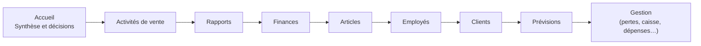

# MVOGMBI_Sync — Catalogue des rapports (Reporting)

Version 1.0.1 (9 novembre 2026) — Marché MVOG-MBI Sherbrooke. Éditeur : Concept Informatique inc.

Ce catalogue présente tous les rapports de la page **État > Reporting** (ancien onglet « Statistiques Clover »). Il dit, pour chacun, la question à laquelle il répond et la décision qu'il aide à prendre. Le document ne contient aucune donnée réelle.

---

## 1. Principes communs

**Source des données**
- Les ventes sont lues dans Clover, en lecture seule, jour par jour. Une journée terminée est gardée sur le serveur ; elle n'est jamais relue.
- Les coûts viennent de Sage 50 : coût moyen (CUMP) de chaque article relié par la correspondance. Un coût aberrant (plus de 5 fois le prix de vente) est écarté.
- Une vente est datée de son premier paiement réussi, comme les factures envoyées à Sage. Les montants sont donc les mêmes partout.

**Période et comparaison**
- On choisit la période comme dans Clover : aujourd'hui, hier, cette semaine, 30 derniers jours, ce mois, cette année, ou des dates personnalisées.
- Chaque rapport compare automatiquement à la période d'avant de même durée. Pour un seul jour, il compare au même jour de la semaine précédente.
- Les courbes comparées sont nommées par leurs dates (par exemple « 01/11 → 08/11 »).

**Filtres globaux**
- Point de vente, Article, Client, Employé, Catégorie et Mode de paiement s'appliquent à tous les rapports, sans relire Clover.
- Un employé connecté avec un compte limité ne voit que ses propres ventes.
- Sur le web, choisir un filtre relance la recherche tout seul. Un bandeau « Chargement… » s'affiche pendant le calcul.

**Trois sous-pages par rapport**
- **Résumé** : les cartes d'indicateurs (avec feu vert, jaune ou rouge et la variation ▲ / ▼), puis les constats en clair :
  - ✔ bon ;
  - ⚠ à surveiller ;
  - ✖ à agir ;
  - ℹ information.
- **Graphiques** : le graphique principal et deux graphiques complémentaires. Ils sont interactifs : une bulle s'affiche au survol, un clic sur la légende masque ou réaffiche une série.
- **Détail** : le tableau complet, titré « Détail : … », à la hauteur de la fenêtre. Deux filtres l'accompagnent :
  - un texte sur la 1re colonne ;
  - une liste de la colonne de regroupement (catégorie, groupe de clients, employé, jour, mode de paiement…).

**Exports et impression**
- Chaque tableau s'exporte en Excel, CSV ou PDF, ou s'imprime, selon le droit « Exporter » du profil.
- « 📕 PDF de la page » prend les cartes, les constats, les graphiques et le tableau.

**Factures Clover**
- Partout où apparaît un n° de commande, un clic (web) ou un double-clic (Windows) ouvre la vraie facture Clover.
- C'est le cas dans les anomalies, les remboursements, les commandes, les paiements et les décisions.

**Rabais Direction**
- Les rabais nommés « Direction » et ceux des comptes administrateurs de Clover sont mis à part.
- Ils ne faussent ni les anomalies, ni le taux de rabais des employés.

---

## 2. Menu du Reporting

Le menu de gauche suit le menu de Clover. Les sections de plus de 7 rapports (Rapports, Articles, Finances) présentent leurs rapports dans un **ruban horizontal** en haut de la page.

---

## 3. États de base (18)

Chacun a ses sous-pages Résumé / Graphiques / Détail, comparées à la période d'avant.

| État | Question |
|---|---|
| Rapport des ventes | Brutes, rabais, remboursements, nettes, taxes, pourboires, perçu : par jour ou par heure |
| Par jour | Combien chaque jour a-t-il vendu ? |
| Par jour de la semaine | Quels jours sont les plus forts ? |
| Par heure | À quelles heures vend-on le plus ? |
| Jour × heure | Carte de chaleur des heures fortes de chaque jour |
| Par employé | Ventes, commandes et panier de chaque employé |
| Par article | Quantités, ventes, coût, bénéfice et marge de chaque article |
| Par catégorie | Poids de chaque catégorie, bénéfice et marge |
| Bénéfices | Coût des ventes et marge brute au coût moyen de Sage |
| Par mode de paiement | Espèces, débit, crédit, Interac… |
| Par type de carte | Visa, Mastercard, Interac… |
| Par mode de saisie de la carte | Puce, sans contact, bande… |
| Par appareil | Ventes de chaque caisse Clover |
| Par client | Ce qu'achète chaque client identifié |
| Rabais | Rabais accordés, par employé et par motif |
| Commandes | Liste des commandes, avec la facture Clover |
| Paiements | Liste des paiements |
| Remboursements | Liste des remboursements |

Le Détail de chaque état a ses filtres : texte sur la 1re colonne et liste de la colonne de regroupement quand il y en a une (jour, employé, catégorie, mode de paiement, type de carte, mode de saisie, appareil…).

La case **« Détail par jour »** ajoute la date à chaque ligne : les ventes de chaque article, catégorie, employé… jour par jour.

---

## 4. Analyses décisionnelles (44)

### 4.1 Accueil

| Analyse | Question | Décision aidée |
|---|---|---|
| **Synthèse et décisions** | Que faut-il faire cette semaine ? | Liste priorisée (1 à 3) des décisions de toutes les analyses, avec les articles, clients ou commandes concernés et l'endroit où vérifier ; reprise dans le courriel du matin |

### 4.2 Activités de vente

| Analyse | Question | Décision aidée |
|---|---|---|
| Ventes inhabituelles à vérifier | Quels jours ou commandes sortent de l'ordinaire (rabais de 50 % et plus, commandes à 0 $, prix inhabituels) ? | Contrôler les commandes suspectes |
| Remboursements à surveiller | Les remboursements augmentent-ils ? Quels articles, quels employés ? | Encadrer les remboursements au-delà de 2 % des ventes |

### 4.3 Rapports

| Analyse | Question | Décision aidée |
|---|---|---|
| Tendance des ventes | La tendance de fond monte-t-elle, hors effet du jour de la semaine ? | Situer le magasin dans le temps |
| Pourquoi les ventes changent | Est-ce le nombre de commandes ou la taille du panier ? | Agir sur l'achalandage ou sur le panier |
| Ce qui fait monter ou baisser les ventes | Quelles catégories et quels articles expliquent l'écart en dollars ? | Cibler les articles en recul |
| Prix et volume | La croissance vient-elle des prix ou des quantités vendues ? | Repérer une hausse de prix qui fait fuir les clients |
| Rythme et objectif | Atteindra-t-on l'objectif du mois (budget, sinon la période d'avant) ? | Rattraper l'objectif sous 95 % |
| Jours fériés | Combien vend-on un jour férié et la veille ? | Personnel et stock des jours fériés |
| Ventes selon le jour du mois | Le début, le milieu ou la fin du mois vend-il plus ? | Commandes selon les jours de paie |
| Taille des paniers | Combien d'articles et quel montant par commande ? | Faire grossir le panier |
| Dépendance aux meilleurs | Quelle part des ventes repose sur quelques articles (courbe de Lorenz) ? | Ne jamais manquer les articles clés |
| Rabais Direction et administrateurs | Combien de rabais accordés par la direction ? | Suivre ces rabais à part |
| Effet des rabais | Les rabais font-ils acheter plus ? | Garder les rabais qui grossissent le panier |

### 4.4 Finances

| Analyse | Question | Décision aidée |
|---|---|---|
| Pourquoi le bénéfice change | Effet prix, quantités, mélange d'articles, articles nouveaux ou arrêtés sur la marge brute | Protéger la marge (alerte si elle perd 1 point) |
| Espèces et cartes | Quand l'argent comptant arrive-t-il ? L'usage des espèces baisse-t-il ? | Dépôts et fond de caisse |
| Taxes et pourboires | Taxes perçues et pourboires, par jour et par employé | Contrôler les taxes avant la déclaration |
| Quand le magasin gagne le plus | Bénéfice par jour de la semaine et par heure | Heures d'ouverture et promotions |
| Seuil de rentabilité | Les ventes couvrent-elles les frais du mois ? | Ventes à atteindre par jour ouvert |

### 4.5 Articles

| Analyse | Question | Décision aidée |
|---|---|---|
| Articles rentables ou non | Quatre groupes : très vendu et rentable, très vendu peu rentable, peu vendu mais rentable, peu vendu peu rentable | Augmenter le prix ou négocier l'achat des articles très vendus peu rentables |
| Catégories qui montent ou baissent | Part des ventes × croissance : étoile, vache à lait, prometteuse, en recul | Développer les catégories prometteuses |
| Articles achetés ensemble | Quelles paires reviennent souvent (affinité) ? | Placement en magasin, offres groupées |
| Effet des changements de prix | Un changement de prix a-t-il fait baisser les quantités (sensibilité au prix) ? | Revoir un prix qui fait fuir |
| Nouveaux articles | Les nouveaux articles démarrent-ils bien ? | Garder ou retirer un nouvel article |
| Articles qui baissent | Quels articles importants perdent des ventes semaine après semaine ? | Comprendre la baisse |
| Articles qui montent | Quels articles gagnent des ventes chaque semaine ? | Prévoir plus de stock |
| Catégories selon le jour | Quelle catégorie vend quel jour ? | Préparer les produits frais pour le bon jour |
| Articles de saison | Quels articles dépendent du mois ? | Préparer le mois qui vient |
| Ventes au poids | Part des ventes au poids et prix moyen au kg ou à la livre | Suivre le prix au poids |
| Prix selon le format | Un grand format est-il plus cher au kg qu'un petit ? | Corriger les prix des formats |
| Ventes par tranche de prix | Quelles tranches de prix vendent le plus ? | Assortiment par gamme de prix |
| Productivité de l'assortiment | Ventes par article de chaque catégorie, références peu vendues | Alléger les catégories encombrées |
| Articles qui se remplacent | Quel article délaissé est remplacé par quel article semblable ? | Prix et stock des paires concurrentes |
| Ruptures probables | Quels articles quotidiens ne se vendent plus plusieurs jours de suite ? | Remettre en stock (priorité 1 si l'absence dure) |
| Articles d'appel | Pour quels articles les clients viennent-ils et achètent-ils plus ? | Ne jamais les laisser manquer |
| Ventes complémentaires manquées | Quel complément habituel a été oublié ? | Le proposer à la caisse |

### 4.6 Employés

| Analyse | Question | Décision aidée |
|---|---|---|
| Performance des employés | Ventes, commandes, panier, rabais (hors Direction) de chaque employé | Encadrer les rabais |
| Achalandage et personnel | Heures sous tension (beaucoup de commandes par employé) et heures calmes | Renforcer ou alléger l'équipe ; heures d'ouverture peu achalandées |

### 4.7 Clients

| Analyse | Question | Décision aidée |
|---|---|---|
| Groupes de clients | Récence, fréquence, montant : fidèles, à risque, perdus… | Relancer les clients perdus |
| Clients qui reviennent | Quelle part des clients rachète ? | Mesurer la fidélité |
| Valeur des clients | Que rapporte un client sur un an ? | Soigner les meilleurs clients |
| Retour des nouveaux clients | Les nouveaux clients reviennent-ils 1, 2, 3 mois plus tard ? | Mesurer l'accueil des nouveaux clients |

### 4.8 Prévisions

| Analyse | Question | Décision aidée |
|---|---|---|
| Achalandage prévu | Combien de commandes attendre chaque jour et chaque heure de la semaine prochaine ? | Nombre d'employés conseillé |
| Quantités prévues par article | Quelles quantités prévoir chaque jour pour les articles importants ? | Commandes de produits frais |

La section Prévisions comprend aussi les **ventes prévues**, les **achats à prévoir**, les **articles à commander** (stock − ventes de l'horizon choisi) et la **péremption** (date dans le code UGS de Clover : rouge à moins d'un mois, jaune de 1 à 3 mois).

---

## 5. Rapports de gestion (7)

Section « 🧩 Gestion », sur la même période :

| Rapport | Contenu |
|---|---|
| Pertes et démarque | Pertes au coût par motif, catégorie et article ; taux sur les ventes |
| Contrôle de la caisse | Espèces attendues, comptées, écarts par jour |
| Dépenses | Petite caisse et cartes, par compte |
| Main-d'œuvre | Heures, coût et part des ventes par jour |
| Promotions | Effet de chaque promotion sur les ventes |
| Retours fournisseurs | Retours par fournisseur et article |
| Bons de commande | Bons créés, reçus, écarts avec les factures |

---

## 6. Autres onglets de la page Rapports

| Onglet | Contenu |
|---|---|
| Suivi des ventes | Chaque journée : facture, statut (importée, bloquée, remplacée par la fin de semaine…), encaissement, rapprochement ; filtre Dépôt |
| Opérations journalières | Ventes, achats, encaissements et paiements fournisseurs jour par jour : quand et par qui chaque traitement a été fait ; ◀ ▶ |
| Recherche dans l'historique | Client, fournisseur, vente, encaissement, paiement, article, catégorie, employé ; plage d'articles |
| Factures fournisseurs archivées | Factures importées, PDF, détail, « Refaire la mise à jour Clover » |
| Produits inactifs | Articles sans vente depuis 30 à 365 jours, valeur du stock immobilisé |
| Articles 20/80 | Les 20 % d'articles qui font l'essentiel des ventes, classes A / B / C, couverture du stock |

---

## 7. Courriel du matin

Chaque matin, le courriel du traitement de nuit reprend :
- les ventes d'hier ;
- la marge ;
- le solde du compte de dépôt ;
- les factures à payer ;
- les ruptures ;
- les articles à commander ;
- la péremption ;
- les **décisions de la direction**, tirées de la synthèse sur les 28 derniers jours. Chacune est colorée par priorité, avec ses 5 premiers éléments concernés.
