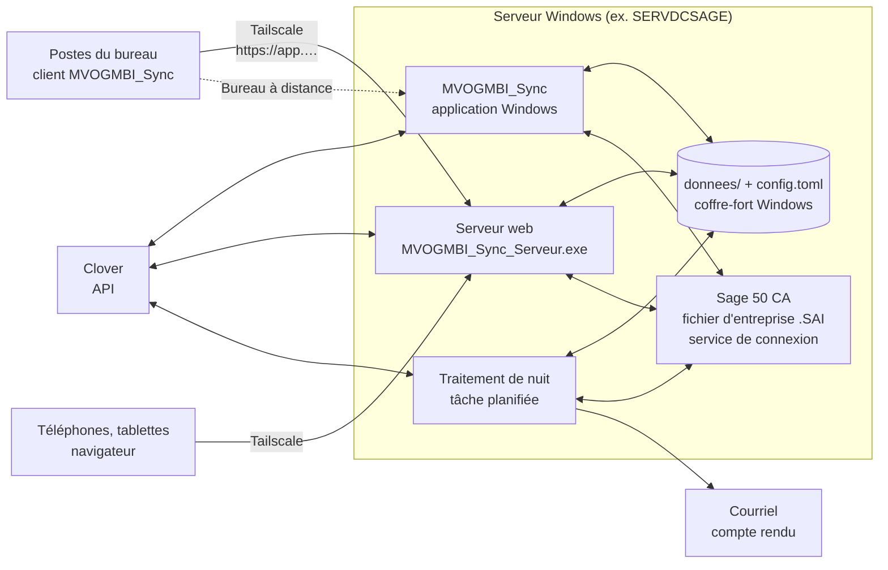
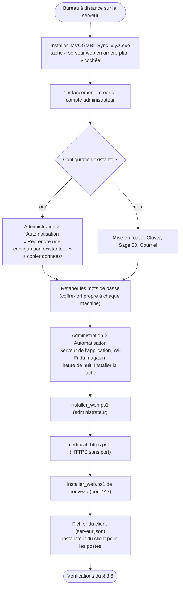
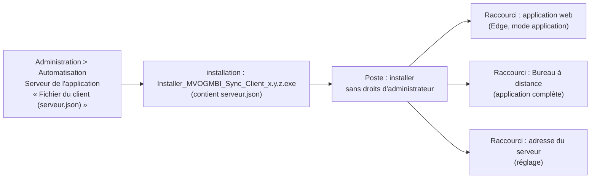

# MVOGMBI_Sync — Guide de l'administrateur

Version 1.0.10 (6 novembre 2026) — Marché MVOG-MBI Sherbrooke. Éditeur : Concept Informatique inc.

Ce guide s'adresse à la personne qui **installe, configure, met à jour et surveille** MVOGMBI_Sync : le propriétaire ou son technicien. Il couvre le serveur, Sage 50, Clover, le réseau (Tailscale, nom de domaine, HTTPS), les postes et les téléphones, les comptes et les droits, le traitement de nuit, la sauvegarde, les journaux et le dépannage.

Le mode d'emploi au quotidien est dans le **manuel d'utilisation** ; les règles de calcul sont dans les **règles d'affaires** ; le fonctionnement interne est dans le **document d'architecture**. Aucune donnée réelle (mot de passe, jeton, montant, nom de client) n'apparaît ici : les exemples sont fictifs.

---

## 1. Vue d'ensemble de l'installation



**Sage lié à l'application Windows (versions 1.0.3 et 1.0.10).** Quand on ouvre l'application Windows MVOGMBI_Sync, elle ouvre Sage en multi-utilisateur, sans fenêtre visible, et le garde ouvert jusqu'à sa fermeture ; **application fermée = Sage fermé** (le serveur web ne garde plus Sage ouvert) : les saisies (encaissements, transferts, documents de stock, articles, dépenses, paies) commencent tout de suite au lieu d'attendre 1,5 à 2 min. Il occupe un poste de la licence Sage. Une personne peut ouvrir Sage sur le serveur, dans n'importe quelle session : Sage n'ouvre une entreprise partagée qu'une fois par ordinateur (« Cette entreprise partagée est déjà ouverte », constat du 6 novembre 2026), le Sage de la journée lui laisse donc la place en quelques secondes et ne se rouvre que 5 minutes après la fermeture de ce Sage (version 1.0.8). Pendant ce temps, les saisies de l'application demandent de le fermer. Si Sage affiche ce message, cliquer sur OK, attendre 30 secondes et rouvrir le fichier (ligne « Sage ouvert par une personne : Sage de la journée refermé » dans `journal_web.log`). L'import et la nuit le referment comme avant. Pour revenir à l'ancien fonctionnement : `[sage] garder_ouvert = false` dans config.toml.

Après l'ouverture de l'application Windows, comptez **2 à 3 minutes** avant que Sage soit prêt (ligne « Sage ouvert pour les saisies de la journée » dans `journal_web.log`, étapes dans `journal_sage_garde.log`). Une saisie lancée pendant ce temps attend simplement la fin de l'ouverture. Pendant l'ouverture et tant que ce Sage tourne, l'application ne lit plus la base par l'outil d'import (version 1.0.5) : sinon l'outil prenait l'entreprise et Sage refusait de s'ouvrir. Si l'ouverture échoue, l'application réessaie 10 minutes plus tard.

**Règle d'or : tout est sur le même serveur.** Sage 50, MVOGMBI_Sync, son serveur web et le traitement de nuit doivent être sur la même machine : l'application ouvre elle-même les fenêtres de Sage pour y saisir les encaissements, paiements, transferts, etc. Les postes et les téléphones n'installent rien d'autre que le client (ou un navigateur) et Tailscale.

| Élément | Où | Rôle |
|---|---|---|
| `MVOGMBI_Sync.exe` | serveur | application Windows complète (aussi par Bureau à distance) |
| `MVOGMBI_Sync_console.exe` | serveur | ligne de commande, traitement de nuit |
| `MVOGMBI_Sync_Serveur.exe` | serveur | application web (sans fenêtre, une seule copie) |
| `MVOGMBI_Sync_Client.exe` | postes | ouvre l'application web dans une fenêtre Edge ; Bureau à distance |
| `config.toml` | dossier de l'application | réglages (jamais de mot de passe) |
| `donnees/` | dossier de l'application | registres, journaux, caches, PDF (jamais publié) |
| Coffre-fort Windows | session Windows du serveur | jeton Clover, mots de passe Sage et courriel |

---

## 2. Prérequis

### 2.1 Serveur

| Prérequis | Détail |
|---|---|
| Windows 10 ou 11 (ou Windows Server) | session Windows du propriétaire **ouverte** en permanence (verrouillée, c'est permis) ; jamais en session 0 : l'application doit pouvoir ouvrir Sage |
| Sage 50 Comptabilité Édition canadienne 2026 | installé, avec le fichier d'entreprise ; `Sage_SA_import.exe` présent (installé avec Sage) |
| Service « Sage 50 Gestionnaire de connexion de base de données » | démarrage **Automatique**, **démarré** (sans lui : pas de multi-utilisateur, lectures refusées) |
| Microsoft Edge | fenêtres de l'application web sur les postes, pages HTML (fiches de paie) |
| Tailscale | connecté au réseau privé du marché |
| Internet | Clover, courriels, formulaires T4 / RL-1, certificat HTTPS |
| Disque | quelques centaines de Mo pour l'application et ses données ; sauvegardes sur **un autre disque** ou OneDrive |

### 2.2 Comptes et accès à préparer

| Où | Quoi |
|---|---|
| Clover (tableau de bord) | identifiant marchand (13 caractères) ; **jeton API** avec lecture de tout, **écriture Inventaire** (stock, coûts, prix, articles) et **écriture Employés** |
| Sage 50 | utilisateur `mvogmbi_sync` dans chaque fichier d'entreprise (même mot de passe partout), droits « Accès par des tiers : consultation seule » + accès Vue aux modules Stocks & Services, Clients & Ventes (et Paie pour la lecture des paies) ; mot de passe de l'utilisateur qui ouvre Sage pour les saisies et les imports |
| Sage 50 (fiches) | client **« Vente Hebdomadaire »** (et un client par autre point de vente) avec « Ce client utilise mes n° d'articles » ; chaque fournisseur importé avec « utilise mes numéros d'articles » ; chaque article avec un compte de produits |
| Courriel | serveur d'envoi (SMTP) et compte ; boîte de réception des avis Interac et des factures (IMAP) ; boîte des états RIA si elle est différente |
| Nom de domaine (WHC) | enregistrements `app.marchemvogmbi.com` et `www.app.marchemvogmbi.com` → adresse Tailscale du serveur ; TXT `_acme-challenge.app` au renouvellement du certificat |

---

## 3. Installation sur le serveur



### 3.1 Installer le programme

1. Ouvrir une session sur le serveur (Bureau à distance) **avec le compte Windows qui gardera la session ouverte**.
2. Lancer `Installer_MVOGMBI_Sync_x.y.z.exe`. L'installation se fait dans `%LOCALAPPDATA%\Programs\MVOGMBI_Sync` (pas besoin d'être administrateur). Choisir la langue.
3. Laisser cochée la tâche **« Démarrer le serveur de l'application web en arrière-plan »** : raccourci dans le dossier Démarrage et démarrage à la fin de l'installation.
4. Raccourcis créés au menu Démarrer : MVOGMBI_Sync, Pointage des employés, Serveur de l'application web, Client, Manuel, Document d'architecture, Documents du projet (dont ce guide), Journal du traitement automatique, Désinstaller.

Une mise à jour s'installe **par-dessus** : `config.toml` et `donnees/` ne sont jamais écrasés ; le serveur web est arrêté avant la copie puis relancé.

### 3.2 Premier lancement

- Le premier lancement demande de **créer le compte administrateur** (nom, mot de passe d'au moins 6 caractères). Il en reste toujours au moins un actif.
- L'accueil affiche la **« Mise en route » en 10 étapes** ; chaque étape se coche quand elle est faite.

### 3.3 Reprendre une installation existante (changement de serveur)

1. Sur l'ancien serveur : « Administration > Sauvegarde des données » → sauvegarde ; **retirer la tâche planifiée** (« Administration > Automatisation » → Retirer) et le serveur web (`installer_web.ps1 -Retirer`). Il ne doit jamais y avoir deux traitements de nuit.
2. Sur le nouveau serveur : installer, puis « Administration > Automatisation » → **« Reprendre une configuration existante… »** (choisir le `config.toml` copié) et copier le dossier `donnees/` dans le dossier de l'application.
3. **Retaper tous les mots de passe** (Clover, Sage, courriel, boîtes) : le coffre-fort Windows est propre à chaque machine et à chaque compte Windows.
4. Vérifier les chemins des fichiers Sage (`.SAI`) dans « Administration > Sage 50 ».

**Attention :** copier le dossier `donnees` **dans** le dossier de l'application, pas à l'intérieur d'un autre dossier `donnees` (sinon l'application lit un dossier vide : factures, états RIA et documents semblent absents).

### 3.4 Réglages par page (Administration)

| Page | Cartes et champs | Secrets (coffre-fort) |
|---|---|---|
| **Clover** | identifiant marchand ; **Points de vente** (➕ Ajouter / Modifier / Supprimer / 🔌 Tester) : code, nom, identifiant marchand, client Sage, dépôt Sage, préfixe des factures (5 car.), actif | jeton du n° 1 et de chaque point de vente |
| **Sage 50** | fichier d'entreprise lu ; fichier d'import (« Parcourir… ») ; port ; client des ventes ; **dépôts sans Clover** (« Entrepôt; Réserve ») ; « 📒 Tester l'accès à Sage » ; carte **Paie** (première paie de l'année, délai) ; carte **4. Comptes bancaires (rapprochement)** (Desjardins, BNC, autres : banque, format du relevé, compte Sage, n° de compte) ; encaissements (compte de dépôt, premier jour, automatique) | utilisateur `mvogmbi_sync`, utilisateur d'import |
| **Courriel** | 1. envoi (serveur, port, sécurité, expéditeur, destinataires, copie, Cci) et test ; 2. résumé du matin ; 3. boîte des avis de paiement (IMAP, depuis) ; 4. factures reçues par courriel (expéditeurs, textes, depuis, import la nuit) ; 5. boîte des états RIA | mots de passe SMTP et IMAP |
| **Automatisation** | 1. traitement de nuit (heure, date de départ, factures par import) et tâche planifiée (État / Installer / Retirer, « Lancer maintenant ») ; 2. raccourci et configuration existante ; 3. **Serveur de l'application** (ordinateur, adresse Tailscale, adresse locale, nom tapé dans le client, port, certificat, clé, « Fichier du client (serveur.json) ») ; 4. **Wi-Fi du magasin (pointage)** | — |
| **Utilisateurs** | comptes, profils, fonctions permises, actions, droits, points de vente (voir § 6) | — |

« Enregistrer la configuration » (en bas à droite des pages Clover, Sage 50, Courriel, Automatisation) écrit `config.toml`. Les mots de passe ne sont **jamais réaffichés** : un champ vide garde celui du coffre-fort.

### 3.5 Le fichier `config.toml` (référence)

Il se règle par les pages ci-dessus ; à la main seulement en cas de besoin, application fermée. Sections principales :

| Section | Clés utiles |
|---|---|
| `[clover]`, `[[points_vente]]` | `merchant_id`, `base_url` ; par point de vente : `code`, `nom`, `merchant_id`, `client_sage`, `depot_sage`, `prefixe`, `actif` |
| `[general]` | `fuseau_horaire` (America/Toronto), `langue`, `verrouillage_minutes` (5 ; 0 = jamais) |
| `[sage]`, `[sage_base]`, `[sage_import]` | `depots_sans_clover` ; `port` (13540), `fichier_entreprise` (lecture) ; `fichier_entreprise` (import), `version` (12001), `pays`, `position_numero` |
| `[encaissements]`, `[rapprochement]`, `[[comptes_bancaires]]` | `compte_depot` (1055), `mode`, `date_depart`, `automatique` ; `compte_bnc` (1060) ; `code`, `nom`, `format` (desjardins / bnc), `compte_sage`, `numero`, `actif` |
| `[automatique]` | `date_depart`, `heure`, `factures_par_import` (25) |
| `[courriel]`, `[boite_paiements]`, `[factures_courriel]`, `[ria]` | serveur, port, sécurité, expéditeur, destinataires, `cci`, `resume_matin` ; boîte IMAP et `depuis` ; `expediteurs`, `textes`, `import_nuit` ; boîte des états RIA |
| `[paie]`, `[caisse]`, `[inventaire]`, `[feuillets]` | `debut_reference`, `taux_moyen`, `charges_sociales` ; `fond` (200) ; `semaines_cycle` (8) ; `url_t4`, `url_rl1` |
| `[sauvegarde]`, `[tableau]` | `dossier` (sinon OneDrive\MVOGMBI_Sync_sauvegardes) ; dossier du tableau du gérant |
| `[serveur]`, `[web]` | `machine`, `adresse`, `adresse_locale`, `nom_public` ; `adresse` (Tailscale), `port` (8765, ou 443 en HTTPS), `certificat`, `cle`, `inactivite_minutes` (5), `postes_pointage` |
| `[pointage]` | `wifi` (nom affiché), `adresses_magasin` (adresses publiques du magasin), `pause_hors_wifi_minutes` (5 ; 0 = jamais) |

Ne jamais publier `config.toml` ni le dossier `donnees/`.

### 3.6 Vérifications après l'installation

| Contrôle | Comment | Attendu |
|---|---|---|
| Accès à Sage | Administration > Sage 50 > « 📒 Tester l'accès à Sage » (Sage ouvert, puis fermé) | les deux fichiers se lisent |
| Clover | Administration > Clover > « 🔌 Tester ce point de vente » | nom du marchand, nombre d'articles |
| Courriel | Administration > Courriel > test d'envoi | courriel reçu |
| Traitement de nuit | Administration > Automatisation > État | tâche « Prêt », prochaine exécution |
| Serveur web | navigateur du serveur : `https://app.marchemvogmbi.com/` (ou `http://<adresse Tailscale>:8765/`) | page de connexion |
| Import | sur la **copie d'essai** : une facture de vente, puis un 2e import | importée, puis refusée (doublon) |

---

## 4. Sage 50 : réglages et règles d'exploitation

### 4.1 Utilisateur de lecture `mvogmbi_sync`

- Créé dans Sage (Configuration > Utilisateurs) dans **chaque** fichier d'entreprise lu, **même mot de passe** partout, retapé dans « Administration > Sage 50 ».
- Droits : « Accès par des tiers : consultation seule » **et** accès Vue aux modules Stocks & Services, Clients & Ventes (sans module coché, Sage n'accorde aucune lecture) ; Paie pour lire les paies (détail des gains et retenues, T4 / RL-1).
- Message « Accès refusé pour l'utilisateur mvogmbi_sync » (1045) : mot de passe différent dans ce fichier, ou service de connexion arrêté.

### 4.2 Mono-utilisateur et multi-utilisateur

| Opération | Mode | Sage de la personne |
|---|---|---|
| **Imports** (factures de vente, d'achat, retours) | **mono-utilisateur** | doit être **fermé partout** |
| **Saisies** (encaissements, paiements, journal, dépenses, stock, transferts, fiches, prix, paie) | multi-utilisateur | peut rester ouvert sur le même fichier |
| Rendre un compte ou un article **inactif** | mono-utilisateur (exigé par Sage) | fermé |
| Lectures | base du Sage de la journée (le jour) ; base ouverte par l'outil d'import (la nuit, ou `garder_ouvert = false`) | indifférent |

Le jour, la saisie se fait dans le **Sage de la journée** que l'application garde ouvert ; la nuit (ou `garder_ouvert = false`), **l'application ouvre Sage elle-même**, fait la saisie, vérifie dans la base, puis referme Sage proprement. Ne jamais arrêter Sage de force : sa base garde alors l'entreprise ouverte (« D'autres utilisateurs travaillent avec cette entreprise ») ; il faut fermer Sage partout ou redémarrer le serveur.

### 4.3 Entreprise partagée et assistant d'importation

Le vrai fichier est une **entreprise partagée** et le partage n'est jamais arrêté. L'outil d'import de Sage refuse une entreprise partagée (« You cannot use this utility to import transactions into a shared company ») : l'application passe alors par l'**Assistant d'importation des transactions** de Sage (Fichier > Importer/Exporter > Importer des transactions), ouvert par elle en mono-utilisateur. Le fichier est retenu dans `donnees/entreprises_partagees.json` : les imports suivants y passent directement.

- Compter environ **1 min 45 par fichier** importé par l'assistant.
- En cas d'échec, des photos de la fenêtre et des menus sont gardées dans `donnees/diagnostic_assistant/` et citées dans le message.

### 4.4 Dépôts (emplacements)

- Activer les emplacements multiples dans Sage (Paramètres > Stocks & Services > Emplacements) et créer un emplacement par point de vente et par dépôt sans Clover.
- Déclarer chaque point de vente (Administration > Clover > Points de vente : « dépôt Sage ») et les dépôts sans Clover (Administration > Sage 50).
- Une facture s'importe dans l'**« Emplacement par défaut »**, puis l'application la **transfère** dans son dépôt (source « DP <n° de facture> », environ 2 min 45). Un transfert échoué est signalé « à refaire » ; la facture reste importée.

### 4.5 Essais

**Tout nouvel usage se valide d'abord sur une copie** du fichier d'entreprise (« Fichier d'import » d'Administration > Sage 50 pointé vers la copie). Le vrai fichier n'est remis en place qu'après un essai réussi.

---

## 5. Réseau : Tailscale, nom de domaine, HTTPS, postes

### 5.1 Tailscale

- Installer Tailscale sur le serveur, sur chaque poste et chaque téléphone qui utilise l'application web, tous dans le même réseau privé (« tailnet »).
- Le serveur web n'écoute **que sur la carte Tailscale** : rien n'est ouvert sur Internet ni sur le réseau local.

### 5.2 Serveur web : `installer_web.ps1`

À lancer **par le propriétaire**, sur le serveur, dans un PowerShell « Exécuter en tant qu'administrateur » :

```
powershell -ExecutionPolicy Bypass -File "%LOCALAPPDATA%\Programs\MVOGMBI_Sync\installer_web.ps1"
```

Le script : (1) met `[web] adresse` à l'adresse Tailscale de **ce** serveur (même si `config.toml` vient d'un autre serveur) et lit le port ; (2) ouvre le port dans le pare-feu **sur la carte Tailscale seulement** ; (3) crée la tâche « MVOGMBI_Sync Web » à l'**ouverture de session** du compte (le jeton Clover est dans son coffre-fort). Retrait : `installer_web.ps1 -Retirer`.

### 5.3 HTTPS sans port : `certificat_https.ps1`

1. Télécharger win-acme (version « x64 trimmed ») et placer `wacs.exe` dans `C:\win-acme`.
2. Lancer en administrateur : `powershell -ExecutionPolicy Bypass -File "...\certificat_https.ps1" -Courriel <adresse réelle>`.
3. win-acme affiche un enregistrement **TXT** `_acme-challenge.app` : le créer dans la zone DNS chez WHC, attendre quelques minutes, appuyer sur Entrée.
4. Le certificat est écrit dans `C:\Certificats\MVOGMBI_Sync` ; `config.toml` reçoit `[web] port = 443`, `certificat`, `cle`.
5. Relancer `installer_web.ps1` (pare-feu sur le port 443), puis refaire le « Fichier du client ».

Le certificat dure 90 jours et se renouvelle par la tâche de win-acme ; **chaque renouvellement redemande un TXT** (environ tous les 60 jours). Le serveur web relit le certificat renouvelé sans redémarrage (contrôle chaque heure).

### 5.4 Postes du bureau : client



- Le client **ouvre directement l'application web** ; la fenêtre de réglage seulement par le raccourci « adresse du serveur ».
- Adresse prise dans cet ordre : celle choisie dans la fenêtre de réglage, sinon `serveur.json` de l'installateur, sinon l'adresse gardée, sinon `app.marchemvogmbi.com`.
- **Bureau à distance** : 2 personnes à la fois sans licences RDS ; le compte Windows du serveur est demandé.
- Téléphones et tablettes : navigateur sur `https://app.marchemvogmbi.com/` avec Tailscale connecté.

### 5.5 Wi-Fi du magasin (pointage)

- « Administration > Automatisation > Wi-Fi du magasin (pointage) » : nom du Wi-Fi (affiché à l'employé refusé), **adresses publiques du magasin**, postes du magasin toujours permis.
- Pour relever l'adresse : ouvrir cette carte **dans l'application web depuis un appareil sur le Wi-Fi du magasin** : la page affiche le réseau de l'appareil.
- Pause automatique : un téléphone qui a servi à pointer et quitte le Wi-Fi **5 minutes de suite** met l'employé en pause ; son retour termine la pause (`pause_hors_wifi_minutes`, 0 = jamais).

---

## 6. Comptes, profils et droits

### 6.1 Profils de départ

| Profil | Accès |
|---|---|
| Administrateur | tout, dont « Administration > Utilisateurs » ; non modifiable |
| Gérant | planning, feuilles de temps, tous les employés |
| Comptable | fournisseurs, paiements, rapprochement, comptabilité, RIA, paie |
| Employé | facturation des ventes, pointage, ses heures, son horaire et ses paies ; pas d'export |

### 6.2 Régler un profil

« Administration > Utilisateurs », carte « Profils et fonctions permises » :

1. Choisir ou créer le profil (➕ / 🗑).
2. Cocher les **fonctions une à une** dans l'arbre du menu (cocher une rubrique coche toutes ses fonctions).
3. **Actions dans les fenêtres** : traiter la paie, restaurer une sauvegarde, saisir les dépenses, modifier les articles dans Sage et Clover, changer les prix de vente dans Sage, modifier le plan comptable, « Lancer maintenant »…
4. **Droits** : Exporter les données, Supprimer des éléments, Voir tous les employés.
5. **Points de vente permis**.
6. « Enregistrer les accès » : appliqué à la prochaine connexion.

### 6.3 Comptes

| Besoin | Action |
|---|---|
| Nouvelle personne | Ajouter, profil, mot de passe ; employé : relier le compte à son employé (Paie > Employés et NIP > « Relier à un compte… ») |
| Personne partie ou absente | **Activer / désactiver** (pas supprimer) : connexion refusée partout, sessions web fermées, fenêtre Windows verrouillée sous 10 s |
| 3 mots de passe faux | compte verrouillé : donner un **nouveau mot de passe** pour le rouvrir |
| Mot de passe web | créé par la personne à sa 1re connexion web (12 caractères, minuscule, majuscule, chiffre, caractère spécial, différent du mot de passe Windows) ; l'administrateur peut le définir ou l'**effacer** (colonne « Mot de passe web ») |
| Administrateur unique oublié | application fermée, supprimer `donnees/utilisateurs.json` : le premier lancement recrée un administrateur (profils et comptes à refaire) |

### 6.4 Délais

- Application Windows : écran verrouillé après 5 min sans activité (`[general] verrouillage_minutes`) ; les traitements en cours continuent.
- Application web : déconnexion après 5 min sans activité (`[web] inactivite_minutes`), 12 h au plus par session ; 10 échecs de connexion en 10 min = adresse refusée 10 min.

---

## 7. Exploitation courante

### 7.1 Traitement de nuit

Tâche planifiée Windows (« Administration > Automatisation » : Installer / État / Retirer), à l'heure réglée, **session ouverte** (verrouillée possible). Un seul traitement à la fois (`donnees/traitement.verrou`).

| Étape | Ce qui est fait |
|---|---|
| 1 | Factures fournisseurs et avis Interac reçus par courriel ; factures déjà dans Sage archivées ; factures « Prête à importer » importées |
| 2 | États de compte RIA reçus, saisis si les comptes RIA sont renseignés |
| 3 | Tous les jours sans facture, du plus ancien au plus récent, par lots de 25, puis transfert vers le dépôt |
| 4 | Encaissement des dépôts des ventes importées cette nuit |
| 5 | Paiements fournisseurs « Confirmé » |
| 6 | Promotions, statistiques préchauffées, résumé du matin, tableau du gérant |
| 7 | Sauvegarde des données |
| 8 | Compte rendu par courriel (pièce jointe Excel par module, alertes en rouge) |

Un jour bloqué (article non relié, compte manquant) est signalé et repris la nuit suivante ; les autres jours continuent. « Lancer maintenant » refait le traitement à la demande.

### 7.2 Contrôles à faire

| Fréquence | Contrôle |
|---|---|
| Chaque matin | courriel de compte rendu : jours bloqués, alertes (caisse, retenues, feuilles de temps non approuvées, factures à payer, ruptures, péremption) |
| Chaque semaine | « Articles > Correspondance » : articles à relier ou à confirmer ; « Factures fournisseurs » : factures à saisir |
| Aux 2 semaines | feuilles de temps approuvées (« Suivi des périodes »), puis traitement de la paie |
| Chaque mois | rapprochement bancaire de chaque compte (Desjardins, BNC…) ; suivi des remises de retenues ; clôture du mois ; restauration d'essai d'une sauvegarde sur un autre ordinateur |
| Tous les 60 jours environ | renouvellement du certificat HTTPS (TXT chez WHC) |
| Chaque année | première paie de l'année (Administration > Sage 50 > Paie) ; T4 / RL-1 ; vérification des formulaires officiels |

### 7.3 Sauvegarde et restauration

- Chaque nuit : archive `.zip` de `donnees/` et `config.toml` (sans les caches), **vérifiée**, écrite dans `[sauvegarde] dossier` (sinon OneDrive). Conservation : 14 jours, 8 semaines, 12 mois.
- Alerte si la sauvegarde est sur le même disque que l'application, ou si elle date de plus de 2 jours.
- **Restaurer** (« Administration > Sauvegarde des données ») sauvegarde d'abord l'état actuel dans « avant_restauration ».
- Le coffre-fort (mots de passe) **n'est pas** dans la sauvegarde : il faut retaper les mots de passe après une restauration sur une autre machine.
- Sage se sauvegarde **à part**, avec les outils de Sage.

### 7.4 Mettre à jour l'application

1. Prévenir les utilisateurs (le serveur web s'arrête quelques secondes).
2. Sur le serveur : lancer `Installer_MVOGMBI_Sync_x.y.z.exe` par-dessus (données et réglages gardés).
3. Si le client a changé : installer `Installer_MVOGMBI_Sync_Client_x.y.z.exe` sur les postes.
4. Contrôler la version (bas du menu), l'accès à Sage et la page de connexion web.

Chaque livraison a son numéro et son installateur ; les anciens installateurs restent disponibles pour revenir en arrière. La numérotation a été remise à **1.0.0** le 5 novembre 2026 : une 1.0.x est **plus récente** que les anciennes 2.x.

---

## 8. Journaux et fichiers de diagnostic

Tous dans `donnees/` (raccourci « Journal du traitement automatique » au menu Démarrer ; « Administration > Journal des opérations » les réunit avec filtres).

| Fichier | Contenu |
|---|---|
| `journal_automatique.log` | chaque étape du traitement de nuit |
| `journal_imports.csv` | chaque import de facture de vente |
| `journal_web.log` | démarrage et erreurs du serveur web |
| `journal_connexions.log` | connexions, refus, verrouillages, activations |
| `audit.jsonl` | chaque bouton, entrée du menu et connexion (« Administration > Audit des actions » ; une ligne changée est repérée) |
| `journal_pdf.log` | échecs de création de PDF par Edge |
| `journal_stock_clover.csv`, `journal_couts_clover.csv`, `journal_prix_clover.csv`, `journal_prix_sage.csv` | écritures dans Clover et prix de Sage (jamais deux fois) |
| `journal_articles_crees.csv`, `journal_ugs_effacees.csv` | articles créés, UGS effacées |
| `journal_bulletins_envoyes.csv`, `journal_feuillets_envoyes.csv` | bulletins, T4 / RL-1 envoyés |
| `diagnostic_assistant/` | photos de l'assistant d'importation de Sage en cas d'échec |
| `diagnostic_encaissements/` | photo de la fenêtre Encaissements quand une cellule ne s'ouvre pas |
| `journal_sage_garde.log` | étapes de l'ouverture du Sage de la journée (et la raison d'un échec) |
| `sage_garde.json`, `sage_mono.verrou` | Sage de la journée (en ouverture ou prêt) ; travail mono-utilisateur en cours |
| `entreprises_partagees.json` | fichiers Sage importés par l'assistant |
| `traitement.verrou`, `base_gardee.pid` | traitement en cours, base de Sage gardée ouverte |

---

## 9. Dépannage

| Message ou symptôme | Cause probable | Que faire |
|---|---|---|
| Courriel non parti : « Connection unexpectedly closed: timed out » | Port et sécurité du courriel incompatibles | Port 465 = « ssl » (l'application le fait d'office depuis 1.0.2), port 587 = « starttls » |
| « Le gestionnaire de connexion Sage 50 est installé mais n'est pas en cours d'exécution » | service Windows de Sage arrêté (souvent après un redémarrage) | démarrer le service « Sage 50 Gestionnaire de connexion de base de données », démarrage Automatique |
| « Accès refusé pour l'utilisateur mvogmbi_sync » | mot de passe différent dans ce fichier, ou utilisateur absent | refaire l'utilisateur dans Sage, même mot de passe, retaper dans Administration > Sage 50 |
| « D'autres utilisateurs travaillent avec cette entreprise » | Sage ouvert ailleurs, ou arrêté de force | fermer Sage partout ; sinon redémarrer le serveur |
| « You cannot use this utility to import transactions into a shared company » | entreprise partagée | normal : l'application passe par l'assistant d'importation |
| « L'assistant … ne s'ouvre pas » | Sage occupé ou menu différent | relancer ; joindre les photos de `diagnostic_assistant/` au signalement |
| « Sage déjà ouvert sur un autre fichier » | Sage de la session ouvert sur un autre `.SAI` | fermer ce Sage ou l'ouvrir sur le fichier configuré |
| Facture fournisseur restée « Prête à importer » après un import | (corrigé) ancienne version | mettre à jour ; au prochain import, elle passe « Déjà dans Sage » et s'archive |
| « Article Clover introuvable (supprimé ou recréé) » à la mise à jour du stock | article renommé ou recréé dans Clover | relier le nouvel article (Correspondance), puis « 🔁 Refaire la mise à jour Clover » |
| Transfert vers le dépôt « à refaire » | Sage occupé, dépôt absent | vérifier l'emplacement dans Sage, refaire le transfert (Stock > Transferts) |
| Page web « Sage ne répond pas » | Sage / base indisponible | tableaux vides affichés ; réessayer après 45 s ; vérifier le service de Sage |
| « Sage s'ouvre pour les saisies de la journée : réessayez dans un instant » | Sage de la journée en cours d'ouverture (2 à 3 min après un démarrage) | attendre ; les saisies lancées attendent d'elles-mêmes |
| Après une mise à jour : « Fermez Sage » à l'encaissement et Sage impossible à ouvrir, alors que personne n'a Sage ouvert | (corrigé en 1.0.9) l'installation avait coupé le programme qui gardait Sage : Sage resté seul sur le bureau de l'application | installer la 1.0.9 : ce Sage est refermé proprement dans la minute (lignes « Sage resté ouvert sans l'application » dans `journal_web.log` et `journal_sage_garde.log`) ; les mises à jour suivantes referment Sage d'abord |
| « Cette entreprise partagée est déjà ouverte » en ouvrant Sage sur le serveur | le Sage de la journée tenait l'entreprise (Sage ne l'ouvre qu'une fois par ordinateur) | depuis 1.0.8 il se referme en quelques secondes : OK, attendre 30 s, rouvrir le fichier |
| « Fermez Sage sur le serveur : l'application l'ouvre elle-même » alors que personne n'a ouvert Sage | (corrigé en 1.0.5) le Sage de la journée en ouverture était pris pour celui d'une personne | mettre à jour ; sinon, vérifier qu'aucun Sage n'est ouvert dans la session Windows de l'application |
| « Un autre utilisateur utilise actuellement cette entreprise sur cet ordinateur » (journal_sage_garde.log) | entreprise prise par l'outil d'import ou par un autre Sage de la même machine | depuis 1.0.5 l'outil n'est plus utilisé pendant la journée ; sinon fermer le Sage resté ouvert, l'application réessaie 10 min plus tard |
| « La cellule Montant reçu ne s'est pas ouverte » | (corrigé en 1.0.4) fenêtre Encaissements plus petite sur le serveur | mettre à jour ; sinon joindre la photo de `diagnostic_encaissements/` |
| Dépôt « Déjà au compte de dépôt ? » (Encaissements) | le montant exact est déjà au 1055 par une autre écriture Sage | vérifier dans Sage : si c'est bien ce dépôt, rien à faire ; sinon l'encaisser à la main |
| Le client ne s'ouvre pas sur le serveur | Tailscale déconnecté, serveur web arrêté, certificat expiré | Tailscale connecté ? `journal_web.log` ; relancer « Serveur de l'application web » ; renouveler le certificat |
| « Certificat refusé » dans le client | certificat expiré ou nom différent | renouveler (§ 5.3) ; l'adresse doit être `app.marchemvogmbi.com` |
| Pointage refusé « connectez-vous au Wi-Fi du magasin » | appareil sur un autre réseau, ou adresse du magasin changée | relever la nouvelle adresse (§ 5.5) |
| Factures, états RIA ou documents absents après un déménagement | dossier `donnees` copié dans `donnees\donnees` | remonter le contenu d'un niveau, application fermée |
| « Voir la facture » : fichier introuvable | PDF absent du dossier des factures | recopier le PDF dans `donnees/factures_fournisseurs/` |
| « Can't find a usable tk.tcl » (tests) | antivirus qui bloque Tcl un instant | relancer |

Avant de signaler un problème : noter l'heure, le message exact, la page, et joindre le journal concerné (§ 8).

---

## 10. Sécurité : liste de contrôle

- ☐ Secrets uniquement dans le coffre-fort Windows ; `config.toml` sans mot de passe.
- ☐ Serveur web sur la carte Tailscale seulement ; HTTPS actif.
- ☐ Utilisateur Sage `mvogmbi_sync` en consultation seule.
- ☐ Au moins deux administrateurs nommés ; comptes des personnes parties **désactivés**.
- ☐ Employés sans droit d'export ; « Supprimer des éléments » réservé.
- ☐ Sauvegardes sur un autre disque ou OneDrive, restauration essayée.
- ☐ Session Windows du serveur verrouillée, jamais fermée (le traitement de nuit et le serveur web en ont besoin).
- ☐ Mises à jour de Windows, de Sage et de Tailscale suivies ; Sage jamais arrêté de force.
- ☐ Dossier `donnees/` et `config.toml` jamais envoyés ni publiés ; le NAS des employés n'est jamais saisi dans l'application.

---

## 11. Commandes utiles

À lancer depuis le dossier de l'application avec `MVOGMBI_Sync_console.exe` (ou `python -m mvogmbi_sync` en développement) :

| Commande | Usage |
|---|---|
| `verifier-sage` | teste la lecture de Sage |
| `facture --periode jour --date AAAA-MM-JJ` | prépare la facture d'un jour sans l'importer |
| `importer --periode jour --date AAAA-MM-JJ` | prépare et importe (refuse les doublons) |
| `auto --depuis AAAA-MM-JJ --jusqua AAAA-MM-JJ` | rattrape une période |
| `encaissements --du … --au …` | dépôts à encaisser et leur état |
| `correspondance` | met à jour la correspondance des articles |
| `verifier-comptes` | comptes des articles Sage à corriger |
| `web [--adresse A] [--port P]` | démarre le serveur web (en premier plan) |
| `essai-pdf <chemin>` | vérifie la création d'un PDF |
