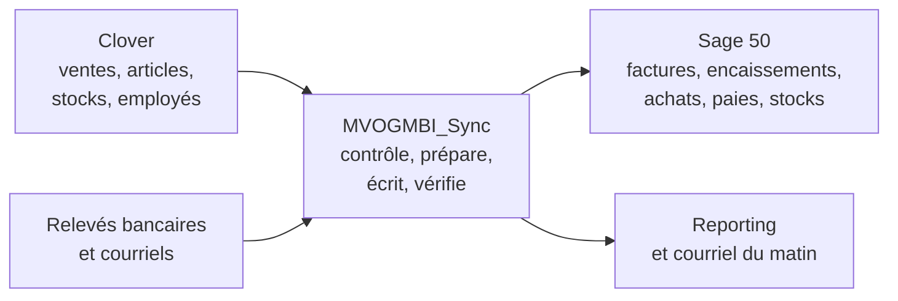
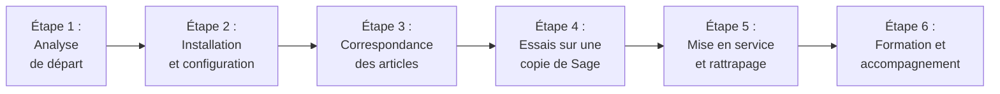

# Présentation de nos services — Clover et Sage 50 enfin reliés

Concept Informatique inc. — Solution MVOGMBI_Sync, version 1.0.11 (novembre 2026)

**Votre caisse Clover et votre comptabilité Sage 50 travaillent ensemble, chaque nuit, sans ressaisie.** Vous gardez vos outils ; nous faisons le lien, nous l'installons chez vous, nous formons votre équipe et nous restons à vos côtés.

---

## 1. Votre situation aujourd'hui

Un commerce qui encaisse avec **Clover** et tient sa comptabilité dans **Sage 50 Comptabilité, Édition canadienne** vit souvent avec deux systèmes qui ne se parlent pas.

| Tâche | Sans lien entre Clover et Sage |
|---|---|
| Ventes du jour | Recopiées à la main dans Sage, article par article |
| Dépôts bancaires | Retrouvés dans le relevé, puis appliqués aux factures un par un |
| Factures fournisseurs | Saisies ligne par ligne depuis le papier ou le PDF |
| Stocks | Clover et Sage ne disent jamais la même chose |
| Paie | Heures sur papier, ressaisies dans Sage |
| Décisions | Rapports de Clover d'un côté, coûts de Sage de l'autre : impossible de connaître la vraie marge |

Le résultat : des heures de saisie chaque semaine, des erreurs difficiles à retrouver, et une comptabilité toujours en retard.

---

## 2. Notre solution : MVOGMBI_Sync

MVOGMBI_Sync se place entre Clover et Sage 50. Il lit, contrôle, écrit, puis **vérifie chaque écriture dans la base de Sage** avant de la compter comme faite.

**Ce que vous ne changez pas :**
- Clover reste votre caisse et Sage 50 reste votre comptabilité.
- Votre comptable retrouve ses habitudes : les écritures sont des factures, des encaissements et des paiements ordinaires de Sage.

**Ce qui change :**
- La nuit, l'application fait le travail répétitif.
- Le matin, vous recevez un courriel qui résume la journée, signale ce qui demande votre attention et propose les décisions à prendre.

---

## 3. Ce que l'application fait pour vous

### 3.1 Ventes et encaissements

- **Une facture de ventes par jour** (une seule pour la fin de semaine), importée automatiquement dans Sage, une ligne par article, au montant net de Clover.
- **Encaissement des dépôts** : chaque dépôt bancaire de Clover est appliqué à la bonne facture. Les virements Interac et les dépôts d'espèces sont répartis automatiquement.
- **Jamais deux fois** la même facture ni le même encaissement. Un jour qui pose problème est signalé, et les autres continuent.
- **Rattrapage** : des mois de ventes en retard peuvent être importés en une seule nuit.

### 3.2 Fournisseurs et achats

- Les **factures PDF ou photographiées** (même au téléphone) sont lues, contrôlées, puis importées dans Sage. Le stock Clover se met à jour en même temps, au choix pour chaque facture.
- La lecture utilise l'**OCR intégré à Windows**, sans intelligence artificielle ni service externe : vos documents ne quittent pas votre serveur.
- Les articles du fournisseur sont **reliés à vos articles** une fois pour toutes, avec la conversion des unités (caisse, kg, lb).
- **Bons de commande** proposés selon les ventes, **retours fournisseurs** et **notes de crédit** (stock retiré de Clover), **paiements** rapprochés des virements Interac.

### 3.3 Articles et stocks

- Création d'un article **dans Clover et dans Sage en une seule fois**, avec les bons comptes.
- **Inventaire** compté une fois, saisi dans les deux systèmes ; inventaire tournant.
- **Transferts** entre magasins, **pertes et démarque**, **promotions**, **étiquettes de prix**.
- **Prix et marges** : prix proposés selon votre marge minimale ; prix de vente de Sage alignés sur Clover.
- **Plusieurs magasins et dépôts**, avec ou sans Clover.

### 3.4 Comptabilité et banque

- **Rapprochement bancaire** avec **toutes les banques et caisses du Canada** (Desjardins, Banque Nationale, RBC, TD, Scotia, BMO, CIBC, Tangerine, caisses, banques en ligne…), à partir des relevés PDF, OFX / QFX ou CSV téléchargés de votre banque.
- **Contrôle de la caisse** du soir, petite caisse et dépenses, plan comptable.
- Déclaration **TPS / TVQ**, âge des comptes, prévision de trésorerie, budget et écarts, clôture du mois.
- Agence **RIA** : états de compte, envois, versements et commissions.

### 3.5 Paie

- **Pointage par NIP** au magasin, sur un poste ou au téléphone, limité au Wi-Fi du magasin.
- Planning mensuel, feuilles de temps approuvées par le gérant, jours fériés et congés selon les Normes du travail du Québec.
- **Chèques de paie créés dans Sage Paie**, bulletins envoyés à chaque employé, **T4 et RL-1** sur les formulaires officiels.

### 3.6 Reporting et aide à la décision

- **18 états** comme dans Clover, enrichis : résumé, graphiques et détail filtrable, toujours comparés à la période d'avant.
- **44 analyses décisionnelles**, en mots simples :
  - les articles rentables ou non ;
  - les ruptures probables ;
  - les articles d'appel ;
  - les ventes complémentaires manquées ;
  - les clients perdus ;
  - les heures sous tension ;
  - le rythme de l'objectif du mois ;
  - le seuil de rentabilité ;
  - et bien d'autres.
- **Synthèse et décisions** : une liste priorisée des décisions à prendre, avec les articles concernés, reprise dans le courriel du matin.
- **La vraie marge** : les ventes de Clover sont croisées avec le coût moyen de Sage.

### 3.7 Partout, en toute sécurité

- **Application Windows** sur le serveur et **application web identique**, accessible du bureau ou du téléphone en HTTPS.
- **Profils et droits** fonction par fonction : un employé ne voit que ses heures et ses paies, et le comptable que la comptabilité.
- Journal d'**audit** de chaque action, verrouillage après inactivité, mots de passe jamais gardés en clair, secrets dans le coffre-fort de Windows.
- **Sauvegarde** quotidienne vérifiée.

---

## 4. Nos services

| Service | Ce que nous faisons |
|---|---|
| **Analyse de départ** | Visite, revue de votre Clover, de votre fichier Sage, de vos comptes, articles, fournisseurs et façons de faire ; liste des réglages et des règles propres à votre commerce |
| **Installation** | Serveur (ou poste principal), Sage 50, MVOGMBI_Sync, accès à distance sécurisé, HTTPS, postes et téléphones de l'équipe |
| **Configuration** | Liaison Clover (jeton en lecture et écriture selon vos choix), utilisateur de lecture Sage, comptes bancaires, courriel, traitement de nuit, profils et droits |
| **Correspondance des articles** | Rapprochement automatique des articles Clover et Sage, puis validation avec vous ; création des articles manquants ; table des comptes par catégorie |
| **Essais sur une copie** | Chaque écriture est d'abord validée sur une copie de votre fichier d'entreprise, jamais directement sur vos données |
| **Rattrapage** | Import des ventes et des encaissements en retard, mois par mois, avec contrôle de chaque facture |
| **Formation** | Gérant, comptable, employés : chacun sur les pages qu'il utilise ; manuel d'utilisation en français et en anglais, adapté à chaque profil |
| **Accompagnement** | Suivi des premières semaines : lecture des courriels du matin, corrections des jours bloqués, réglages fins |
| **Soutien et maintenance** | Mises à jour de l'application (un installateur par version), suivi des nouvelles versions de Sage et de Clover, dépannage à distance |
| **Développement sur mesure** | Nouveaux rapports, modèles d'impression, règles propres à votre commerce, autres banques ou fournisseurs |

---

## 5. Notre démarche, étape par étape

1. **Analyse de départ** : nous comprenons votre commerce et ses règles (facturation, dépôts, taxes, fin de semaine, points de vente).
2. **Installation et configuration** : tout est installé sur votre serveur. Vos données restent chez vous.
3. **Correspondance des articles** : vos articles Clover sont reliés à vos articles Sage, et vous confirmez les cas douteux.
4. **Essais sur une copie** : factures, encaissements, achats et paies sont validés sur une copie de votre fichier Sage.
5. **Mise en service et rattrapage** : le traitement de nuit démarre, et les périodes en retard sont rattrapées.
6. **Formation et accompagnement** : votre équipe est formée, et nous suivons les premières semaines avec vous.

Avant toute saisie dans Sage, l'application vous montre ce qu'elle va faire. Une page « Mise en route » en 10 étapes indique où vous en êtes.

---

## 6. Nos engagements

- **Vos données restent chez vous.** L'application tourne sur votre serveur et n'utilise aucun service d'intelligence artificielle ni de service externe autre que Clover.
- **Jamais d'essai sur vos vraies données.** Chaque nouvelle écriture est d'abord validée sur une copie de votre fichier d'entreprise.
- **Chaque écriture est vérifiée** dans la base de Sage. Ce qui n'a pas pu être fait est signalé, jamais caché.
- **Qualité contrôlée** : près de 400 tests automatiques sont lancés avant chaque livraison.
- **Sécurité vérifiée** : le code est analysé par SonarQube, Bandit et pip-audit (13 novembre 2026 : aucun bug ni aucune vulnérabilité, notes A en sécurité, fiabilité et maintenabilité).
- **Transparence** : documentation complète (manuel, guide de l'administrateur, règles d'affaires, architecture), journal de chaque traitement et audit de chaque action.
- **Votre façon de travailler d'abord** : les règles de facturation, d'encaissement et de droits sont fixées avec vous, puis appliquées à la lettre.

---

## 7. Ce qu'il faut pour commencer

| Élément | Détail |
|---|---|
| Clover | Compte marchand actif ; jeton d'API créé par le propriétaire (lecture, et écriture si vous voulez créer des articles ou mettre le stock à jour) |
| Sage 50 | Comptabilité, Édition canadienne (version 2026 ou plus récente), fichier d'entreprise, accès administrateur pour créer un utilisateur de consultation |
| Serveur | Un ordinateur Windows 10 ou 11 (ou Windows Server) allumé la nuit, où Sage 50 est installé |
| Internet | Accès à Internet pour Clover et le courriel ; accès à distance sécurisé (Tailscale) pour les postes et téléphones |
| Courriel | Une boîte pour les comptes rendus ; au besoin, la boîte qui reçoit les factures des fournisseurs et les avis Interac |
| Banque | Relevés de votre banque ou caisse, quelle qu'elle soit : PDF, ou fichier OFX / QFX / CSV téléchargé de son site |

---

## 8. Questions fréquentes

**Dois-je changer de caisse ou de logiciel comptable ?**
Non. Clover et Sage 50 restent en place, et l'application les relie.

**Mon comptable peut-il continuer à travailler dans Sage ?**
Oui. Les saisies de l'application se font en multi-utilisateur pendant la journée. Les imports se font la nuit.

**Que se passe-t-il si une vente pose problème ?**
Le jour concerné est signalé dans le courriel du matin, avec la raison (par exemple un article non relié). Vous le corrigez en deux clics, il est refait la nuit suivante, et les autres jours ne sont pas bloqués.

**Mes employés voient-ils les chiffres du magasin ?**
Non, sauf si vous le décidez. Chaque profil ne voit que les fonctions permises. Un employé peut ne voir que son horaire, ses heures et ses paies.

**Puis-je consulter mes rapports au téléphone ?**
Oui. L'application web est identique à l'application Windows et s'adapte au téléphone, en HTTPS.

**Et si j'ai plusieurs magasins ?**
Chaque point de vente Clover a son client et son dépôt dans Sage, avec une facture par jour et par magasin. Les rapports se filtrent par magasin.

---

## 9. Prochaine étape

Nous vous proposons une **rencontre d'analyse de départ** chez vous. Pendant cette rencontre :
- nous regardons ensemble votre Clover et votre Sage ;
- nous vous montrons l'application en fonctionnement ;
- nous vous remettons une proposition adaptée à votre commerce : étendue, calendrier et prix sur devis.

| | |
|---|---|
| **Concept Informatique inc.** | Intégration Clover et Sage 50 |
| Responsable | ______________________________ |
| Téléphone | ______________________________ |
| Courriel | ______________________________ |
| Site web | ______________________________ |
