# MVOGMBI_Sync — Processus métier (BPM)

Version 1.0.20 (7 novembre 2026) — Marché MVOG-MBI Sherbrooke.

Notation : chaque couloir est un acteur ou un système ; ( ) = début ou fin, [ ] = activité, { } = décision, flèches = enchaînement. Les processus sont ceux en service.

---

## 1. De la vente à l'encaissement (order-to-cash)

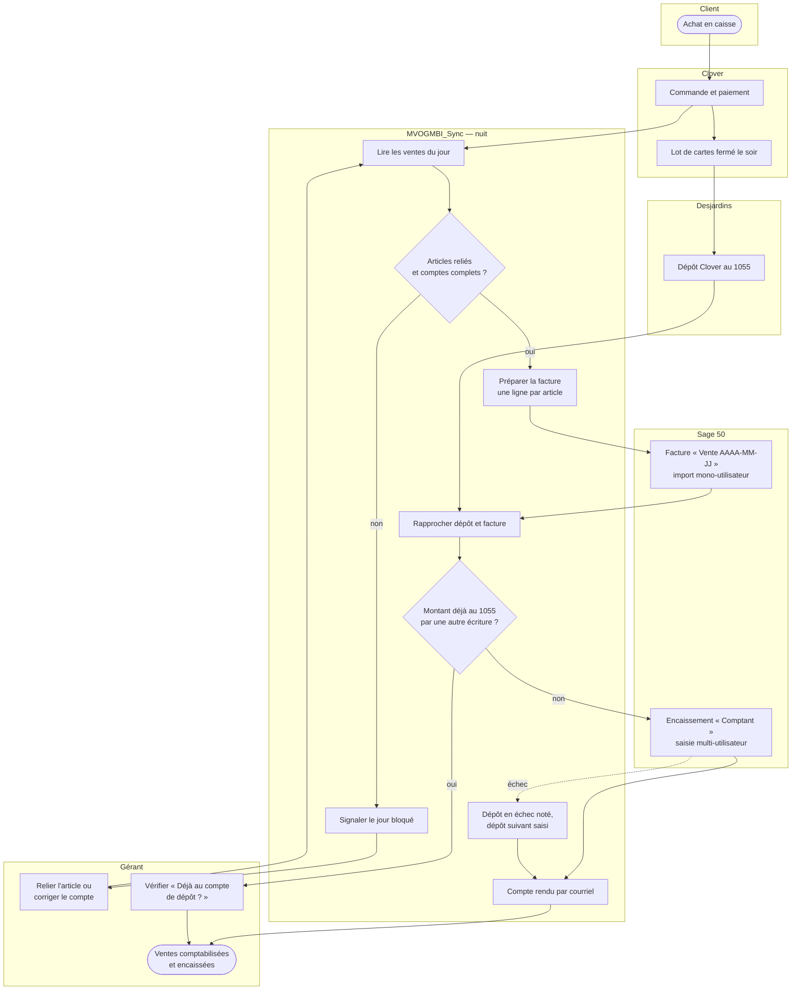

---

## 2. De l'achat au paiement (procure-to-pay)

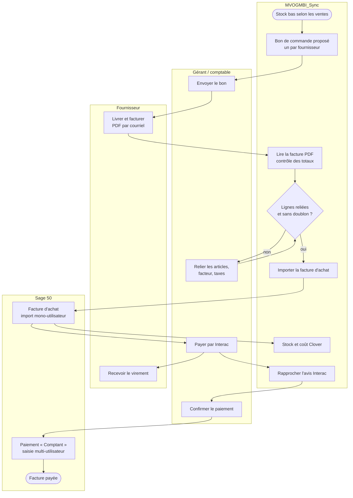

---

## 3. Paie

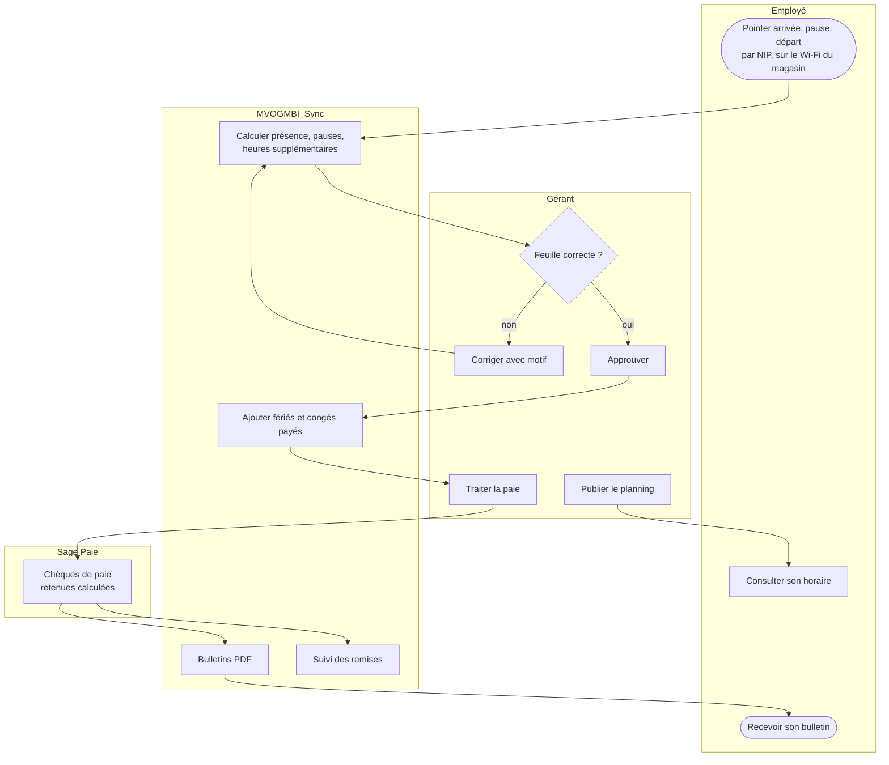

---

## 4. Rapprochement bancaire mensuel

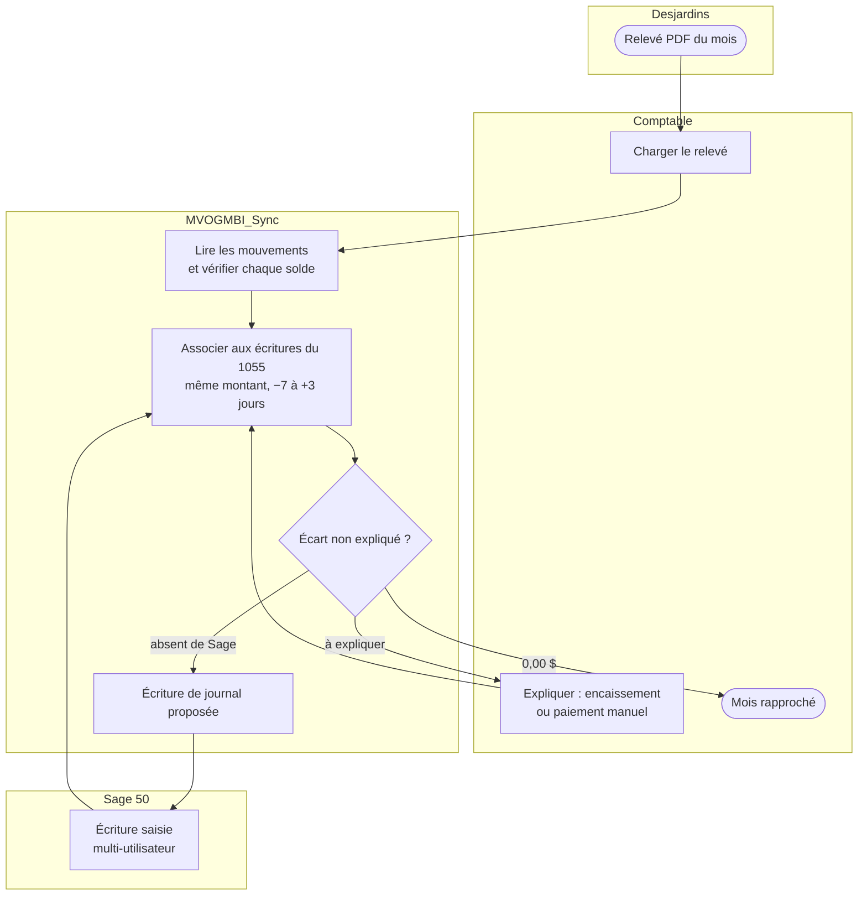

---

## 4 bis. Transferts d'argent RIA

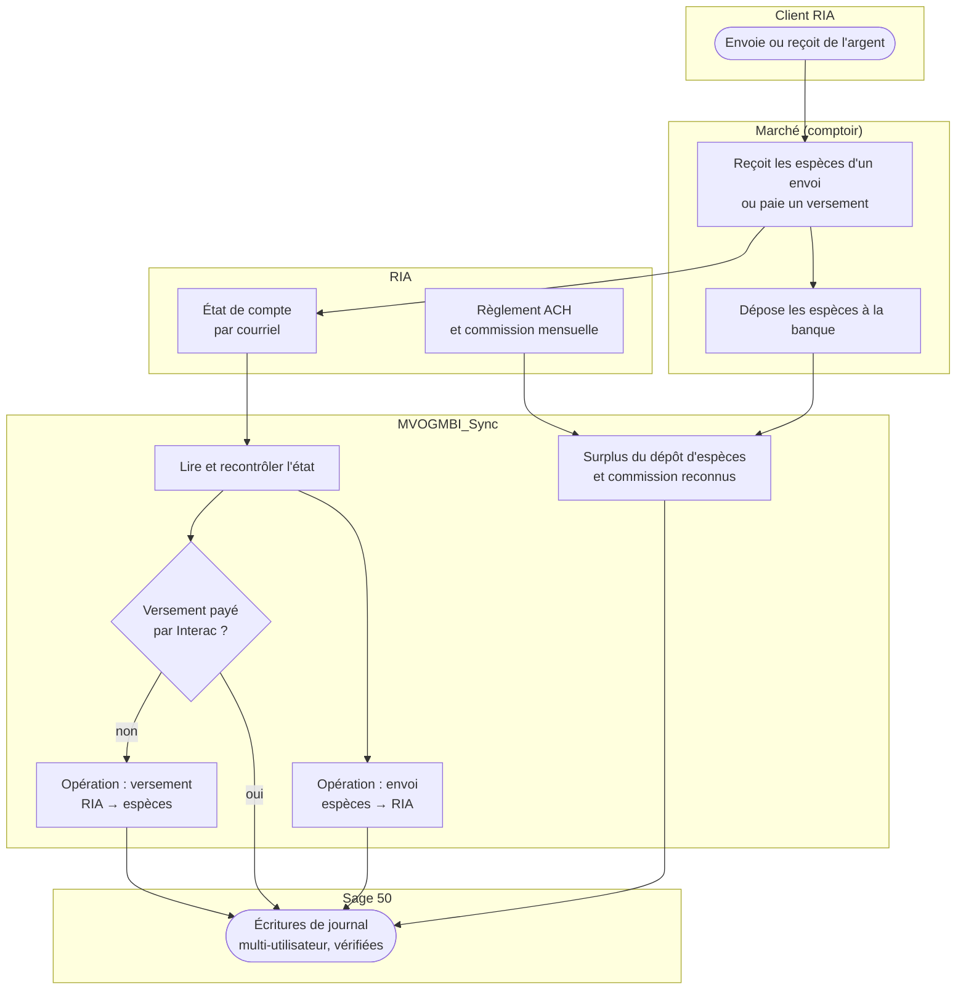

## 4 ter. Chaîne des documents de vente et d'achat

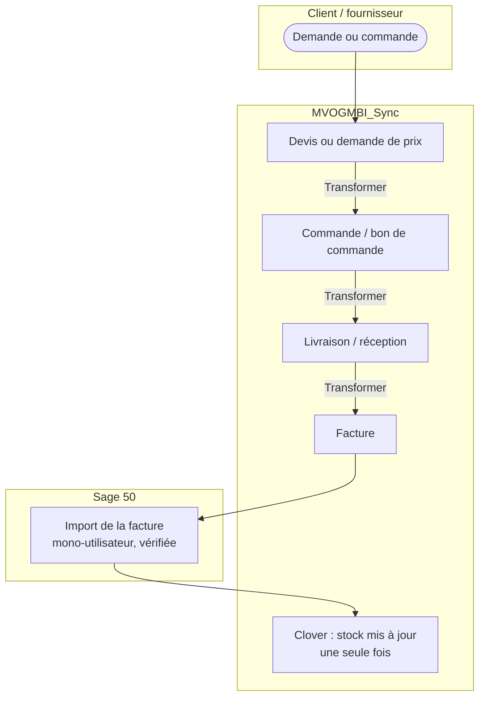

## 5. Gestion des stocks entre points de vente

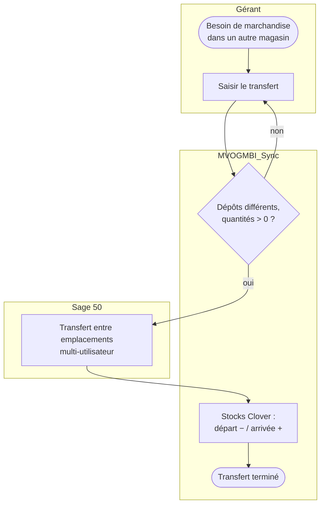

---

## 6. Réception chez un fournisseur dans un dépôt

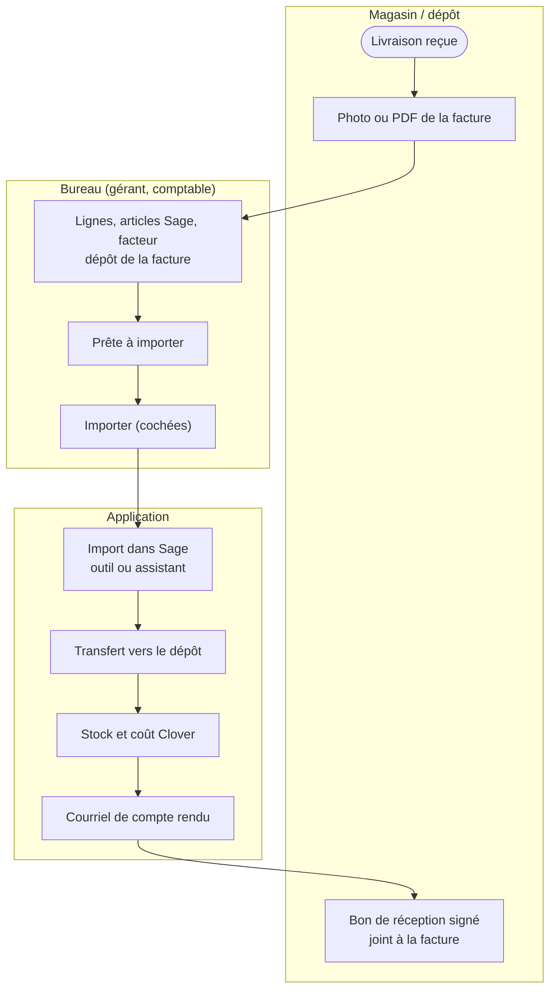

---

## 7. Espèces : du tiroir à la banque

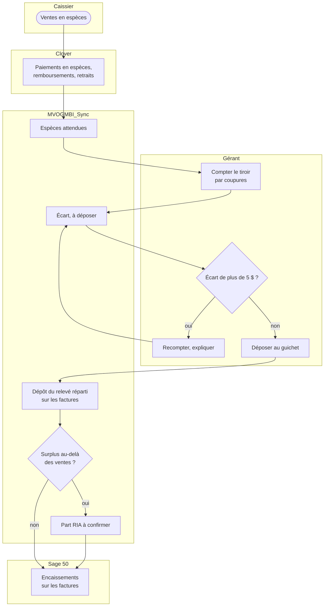

---

## 8. Pertes et démarque

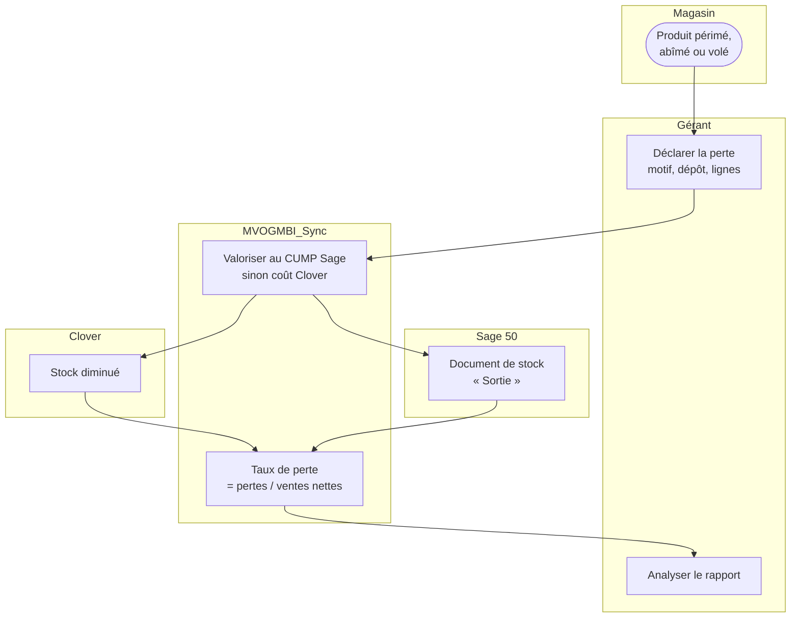

---

## 9. De l'embauche au premier bulletin

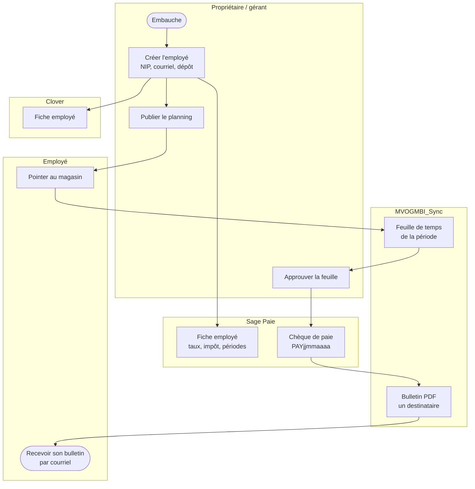
