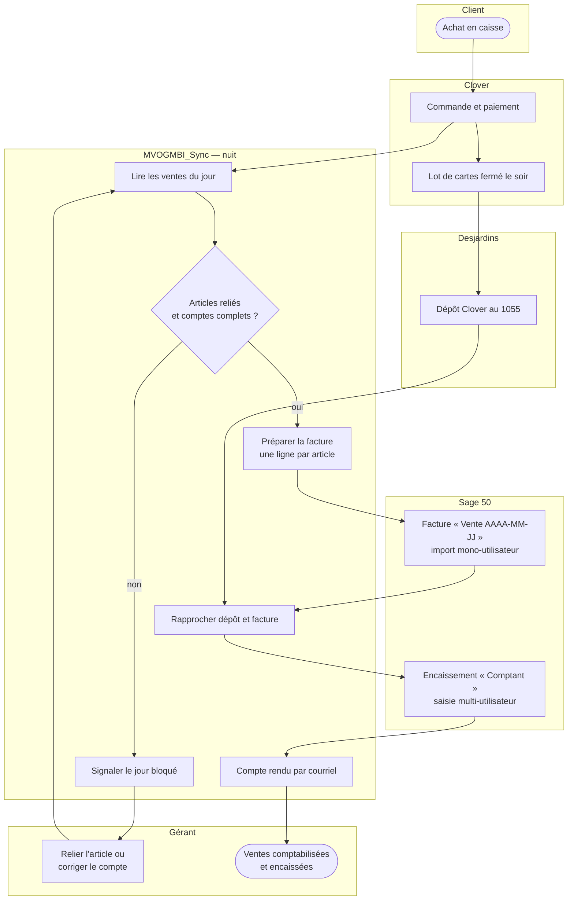
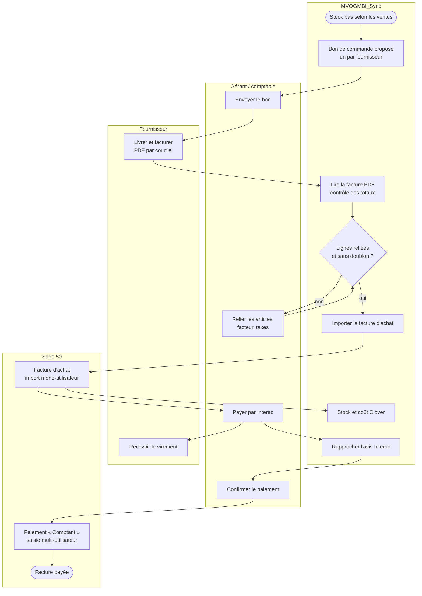
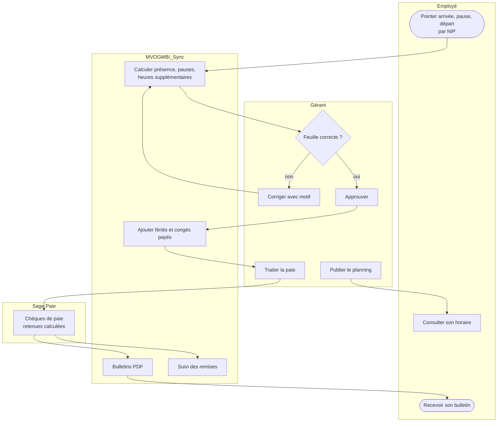
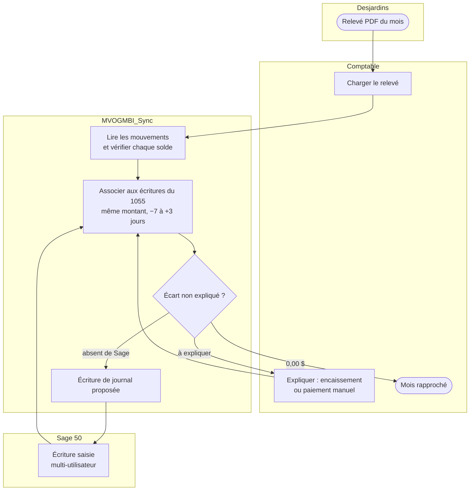
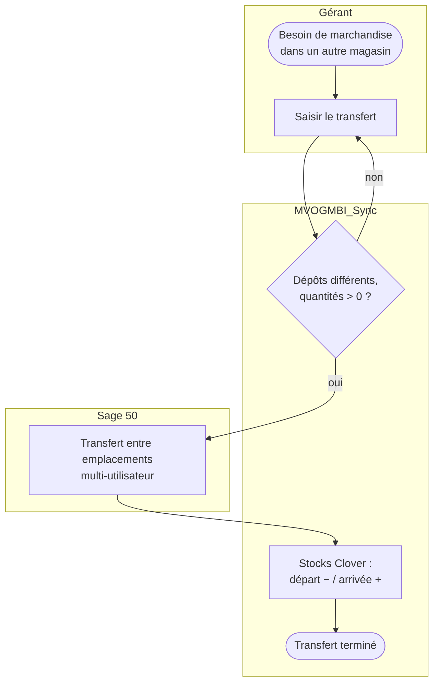

# MVOGMBI_Sync — Processus métier (BPM)

Version 1.0.0 (30 octobre 2026) — Marché MVOG-MBI Sherbrooke.

Notation : chaque couloir est un acteur ou un système ; ( ) = début ou fin, [ ] = activité, { } = décision, flèches = enchaînement. Les processus sont ceux en service.

---

## 1. De la vente à l'encaissement (order-to-cash)

---

## 2. De l'achat au paiement (procure-to-pay)

---

## 3. Paie

---

## 4. Rapprochement bancaire mensuel

---

## 5. Gestion des stocks entre points de vente

