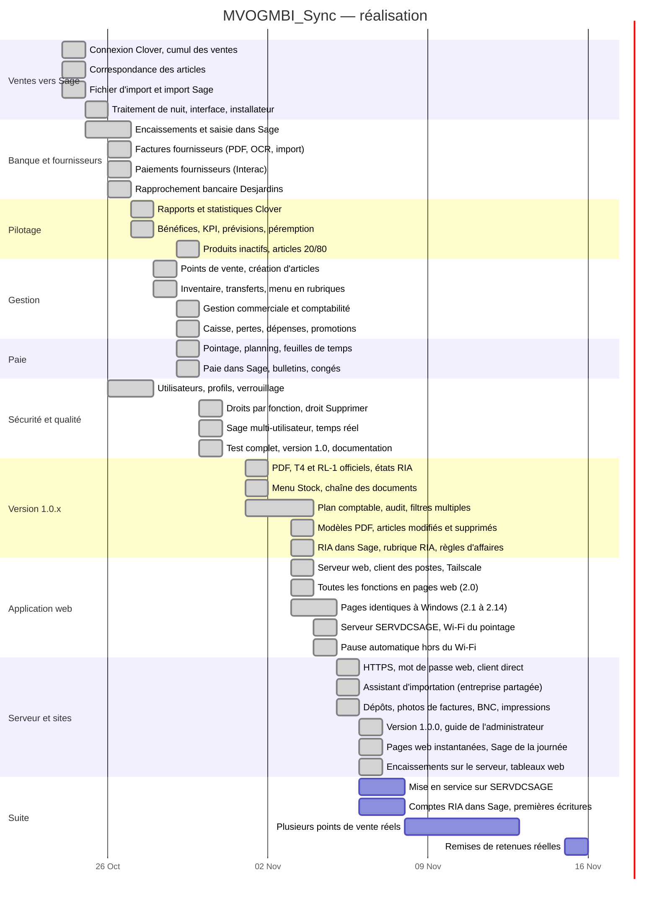
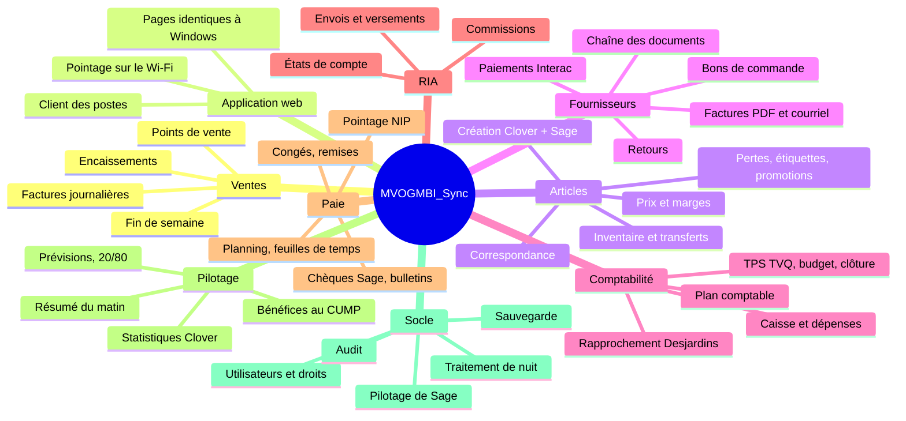

# MVOGMBI_Sync — Diagramme de projet

Version 1.0.7 (6 novembre 2026) — Marché MVOG-MBI Sherbrooke. Plus de 140 versions livrées en 13 jours, chacune avec son installateur ; numérotation remise à 1.0.0 le 5 novembre 2026.

---

## 1. Planning réalisé (Gantt)

---

## 2. Découpage du produit

---

## 3. Jalons

| Date | Jalon | Version |
|---|---|---|
| 24 oct. 2026 | Premier import automatique réussi dans Sage | étape 4 |
| 25 oct. 2026 | Traitement de nuit, installateur Windows | 1.3.0 |
| 26 oct. 2026 | Encaissements la nuit, fournisseurs, rapprochement | 1.7.0 à 1.9.11 |
| 27 oct. 2026 | Statistiques et rapports comme Clover | 1.9.12 à 1.9.29 |
| 28 oct. 2026 | Points de vente, articles, inventaire, transferts | 1.10 à 1.22 |
| 29 oct. 2026 | Gestion commerciale, comptabilité, paie | 1.23 à 1.45 |
| 30 oct. 2026 | Droits par fonction, multi-utilisateur, temps réel, test complet | 1.46.3 |
| 30 oct. 2026 | **Version 1.0.0** : numérotation remise à zéro, documentation complète | 1.0.0 |
| 30 oct. 2026 | Rapports de gestion, services dans Sage seulement, lecture des paies de Sage | 1.0.1 à 1.0.3 |
| 1er nov. 2026 | PDF de secours, T4 / RL-1 officiels, états RIA, menu Stock, chaîne des documents, plan comptable, audit | 1.0.4 à 1.0.7 |
| 3 nov. 2026 | Modèles PDF, articles modifiés et supprimés, RIA dans Sage, rubrique RIA, règles d'affaires, documentation à jour | 1.0.8 à 1.0.11 |
| 3 nov. 2026 | Application web (serveur, client, toutes les fonctions) | 1.1.0 à 2.0.0 |
| 3-4 nov. 2026 | Pages web identiques à Windows : audit des boutons, comparaison côte à côte | 2.1.0 à 2.14.1 |
| 4 nov. 2026 | Nouveau serveur SERVDCSAGE, serveur réglable, app.marchemvogmbi.com, pointage sur le Wi-Fi du magasin | 2.14.2 |
| 4 nov. 2026 | Pause automatique d'un téléphone hors du Wi-Fi du magasin, documentation à jour | 2.15.0 |
| 5 nov. 2026 | Comptes activés / désactivés, prix de vente Sage depuis Clover, HTTPS sans port, mot de passe web solide | 2.15.1 à 2.17.0 |
| 5 nov. 2026 | Suivi des feuilles de temps, client ouvert directement, serveur web sans fenêtre | 2.17.1 à 2.18.0 |
| 5 nov. 2026 | **Premier import dans le vrai fichier partagé** par l'assistant d'importation de Sage | 2.19.0 à 2.22.1 |
| 5 nov. 2026 | Dépôts (plusieurs sites), photos de factures, même état Windows / web, relevés BNC, comptes bancaires, modèles d'impression | 2.20.0 à 2.24.2 |
| 5 nov. 2026 | **Version 1.0.0** : numérotation remise à zéro | 1.0.0 |
| 6 nov. 2026 | Documentation complète à jour et guide de l'administrateur | 1.0.1 |
| 6 nov. 2026 | PDF de la documentation lisibles : diagrammes à la bonne taille, pages en largeur, titres gardés avec leurs diagrammes | 1.0.2 |
| 6 nov. 2026 | 221 factures de vente (janvier à novembre) importées dans le vrai fichier ; pages web instantanées ; **Sage gardé ouvert pour les saisies de la journée** ; contrôle « Déjà au compte de dépôt ? » | 1.0.3 |
| 6 nov. 2026 | Encaissements sur le serveur (grille de Sage plus petite), ouverture du Sage de la journée fiabilisée, textes longs des tableaux web, fonctions RIA dans la rubrique RIA | 1.0.4 à 1.0.6 |
| 6 nov. 2026 | Tests complets (305 tests, tour de 124 pages web), corrections, documentation à jour | 1.0.7 |

---

## 4. Organisation

| Rôle | Responsabilité |
|---|---|
| Propriétaire du marché | Besoins, règles de gestion, validations (« vas-y », confirmations), essais réels |
| Développement | Code, tests, installateurs, documentation |
| Copie d'essai Sage | Tous les essais d'écriture avant le vrai fichier |

Méthode : une demande → une version livrée avec son installateur, ses tests et sa documentation ; règles du propriétaire notées dans le projet et appliquées partout.

---

## 5. Risques suivis

| Risque | Mesure |
|---|---|
| Sage sans API ouverte | Import par l'outil officiel, saisies par les fenêtres de Sage, vérification dans la base |
| Écriture dans le vrai fichier par erreur | Fichier d'import distinct (copie d'essai) tant que non validé |
| Double import, double encaissement | Contrôle de présence avant et après chaque écriture |
| Service de connexion de Sage arrêté | Message clair ; lecture de secours |
| Données réelles dans le dépôt public | `.gitignore`, contrôle avant chaque envoi |
| Installation bloquée sur un serveur (Sage sur SERVDC01) | Nouveau serveur SERVDCSAGE ; adresses réglées dans la configuration |
| Deux serveurs qui traitent les mêmes ventes | Retirer la tâche et le serveur web de l'ancien serveur à la mise en service |
| Sage gardé ouvert qui bloque l'entreprise | Refermé la nuit, avant chaque import et à la sortie ; jamais l'outil d'import pendant la journée ; `[sage] garder_ouvert = false` pour revenir en arrière |
| Écran du serveur différent de la copie d'essai (taille des fenêtres de Sage) | Positions calculées d'après la fenêtre réelle ; photo de diagnostic à chaque échec |
