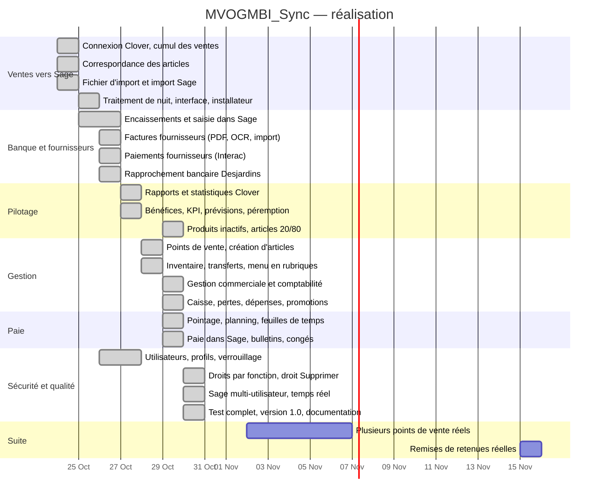
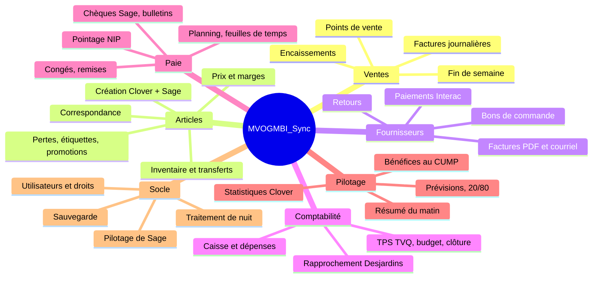

# MVOGMBI_Sync — Diagramme de projet

Version 1.0.0 (30 octobre 2026) — Marché MVOG-MBI Sherbrooke. 97 versions livrées en 7 jours, chacune avec son installateur.

---

## 1. Planning réalisé (Gantt)

---

## 2. Découpage du produit

---

## 3. Jalons

| Date | Jalon | Version |
|---|---|---|
| 24 oct. 2026 | Premier import automatique réussi dans Sage | étape 4 |
| 25 oct. 2026 | Traitement de nuit, installateur Windows | 1.3.0 |
| 26 oct. 2026 | Encaissements la nuit, fournisseurs, rapprochement | 1.7.0 à 1.9.11 |
| 27 oct. 2026 | Statistiques et rapports comme Clover | 1.9.12 à 1.9.29 |
| 28 oct. 2026 | Points de vente, articles, inventaire, transferts | 1.10 à 1.22 |
| 29 oct. 2026 | Gestion commerciale, comptabilité, paie | 1.23 à 1.45 |
| 30 oct. 2026 | Droits par fonction, multi-utilisateur, temps réel, test complet | 1.46.3 |
| 30 oct. 2026 | **Version 1.0.0** : numérotation remise à zéro, documentation complète | 1.0.0 |

---

## 4. Organisation

| Rôle | Responsabilité |
|---|---|
| Propriétaire du marché | Besoins, règles de gestion, validations (« vas-y », confirmations), essais réels |
| Développement | Code, tests, installateurs, documentation |
| Copie d'essai Sage | Tous les essais d'écriture avant le vrai fichier |

Méthode : une demande → une version livrée avec son installateur, ses tests et sa documentation ; règles du propriétaire notées dans le projet et appliquées partout.

---

## 5. Risques suivis

| Risque | Mesure |
|---|---|
| Sage sans API ouverte | Import par l'outil officiel, saisies par les fenêtres de Sage, vérification dans la base |
| Écriture dans le vrai fichier par erreur | Fichier d'import distinct (copie d'essai) tant que non validé |
| Double import, double encaissement | Contrôle de présence avant et après chaque écriture |
| Service de connexion de Sage arrêté | Message clair ; lecture de secours |
| Données réelles dans le dépôt public | `.gitignore`, contrôle avant chaque envoi |
