# MVOGMBI_Sync — Workflows d'utilisation

Version 2.15.0 (4 novembre 2026) — Marché MVOG-MBI Sherbrooke.

Chaque workflow suit l'ordre réel des écrans. Les noms entre guillemets sont ceux du menu (« Rubrique > Fonction »).

---

## 1. Mise en route (une fois)

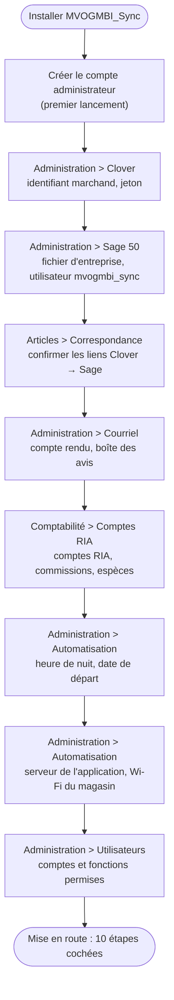

---

## 2. Journée type du gérant

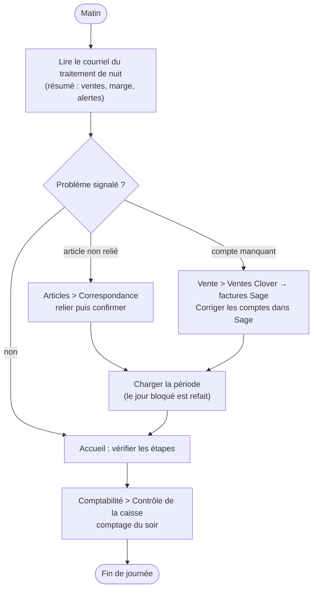

---

## 3. Facture fournisseur reçue

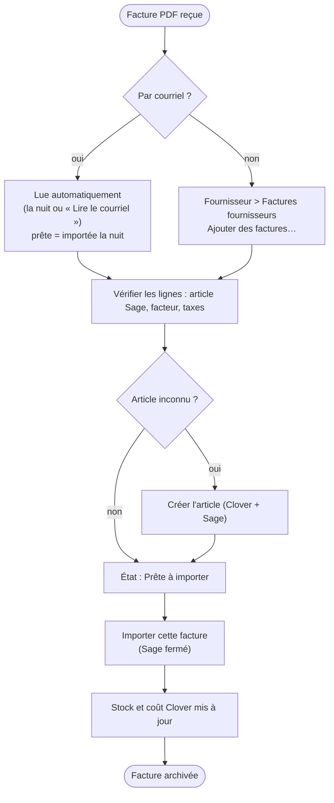

---

## 4. Paiement d'un fournisseur

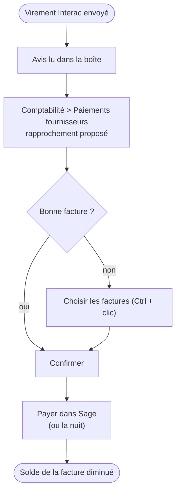

---

## 5. Fin de mois

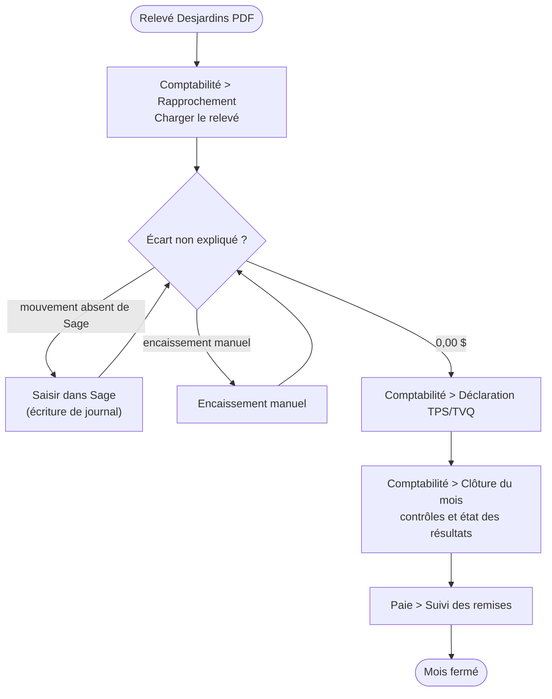

---

## 6. Paie toutes les deux semaines

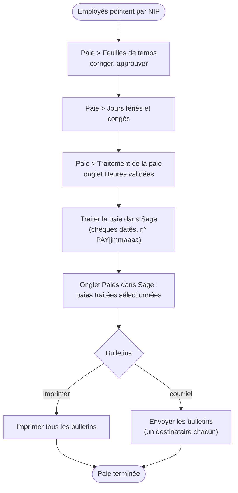

---

## 6 bis. Dépôt d'espèces et RIA

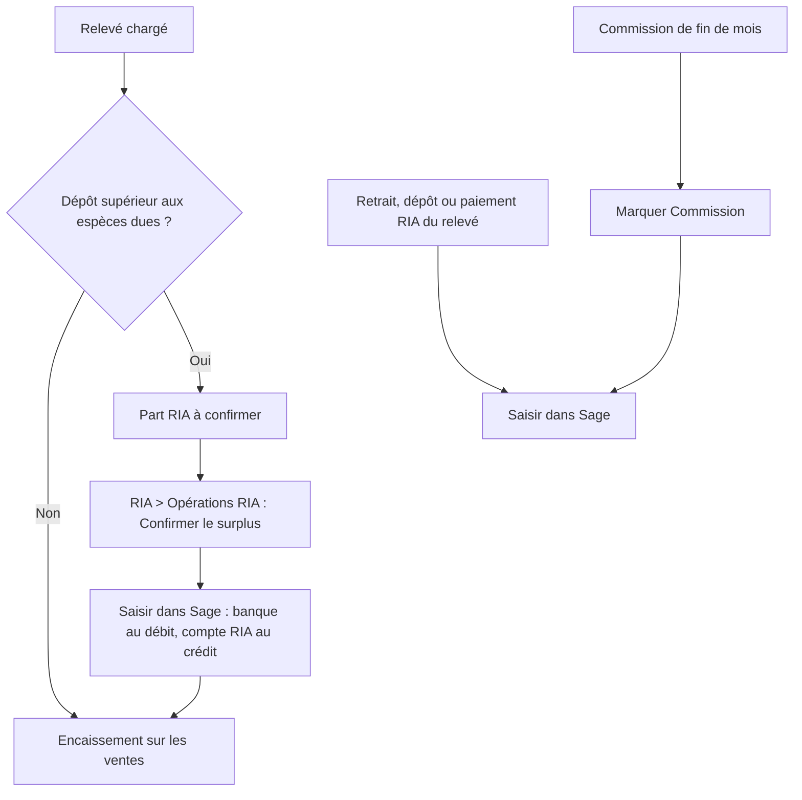

## 6 ter. États de compte RIA

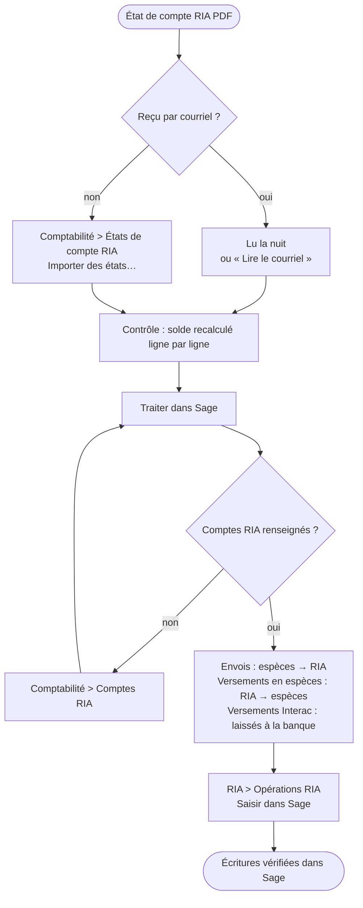

## 7. Nouvel article

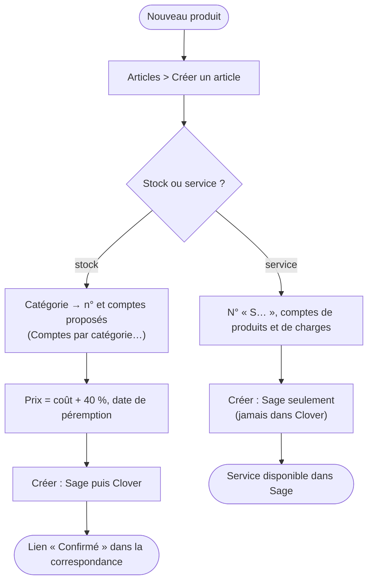

## 7 bis. Modifier ou supprimer un article

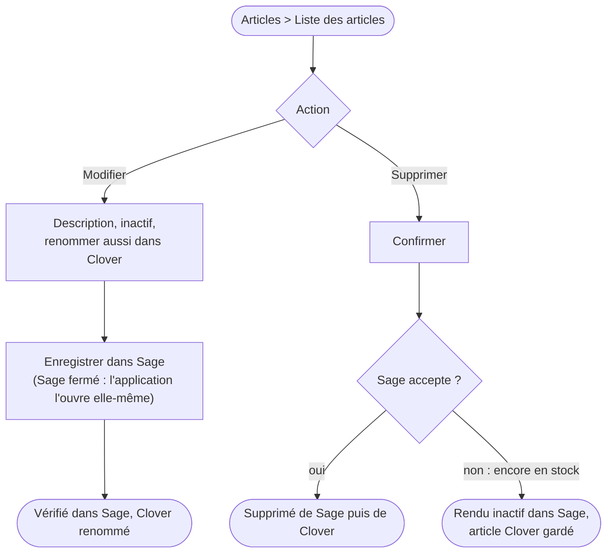

## 7 ter. Chaîne des documents

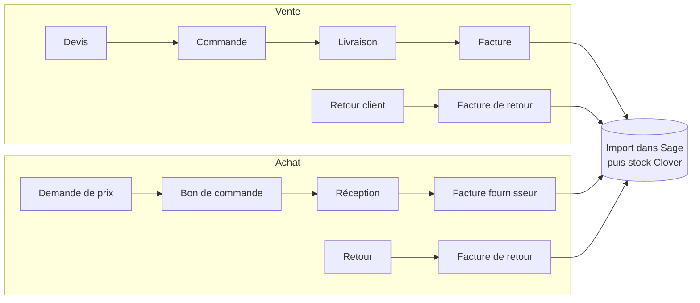

« Transformer » reprend les lignes, le client ou fournisseur et le dépôt ; seules les factures touchent le stock.

---

## 8. Inventaire

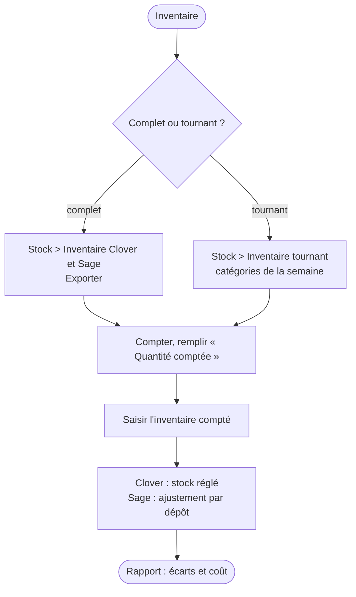

---

## 8 bis. Installer sur un serveur et déployer les postes

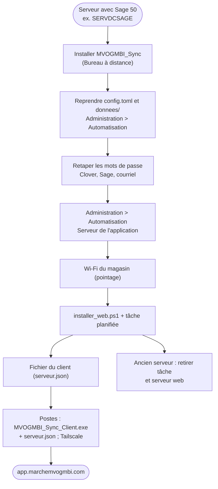

## 8 ter. Pointer au magasin

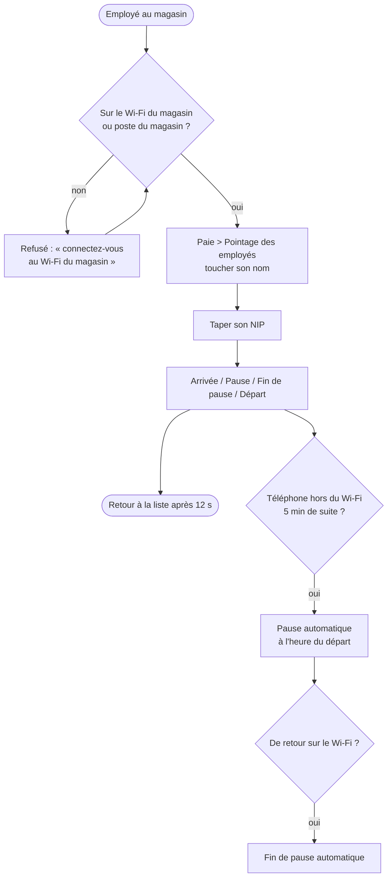

## 9. Droits d'un profil

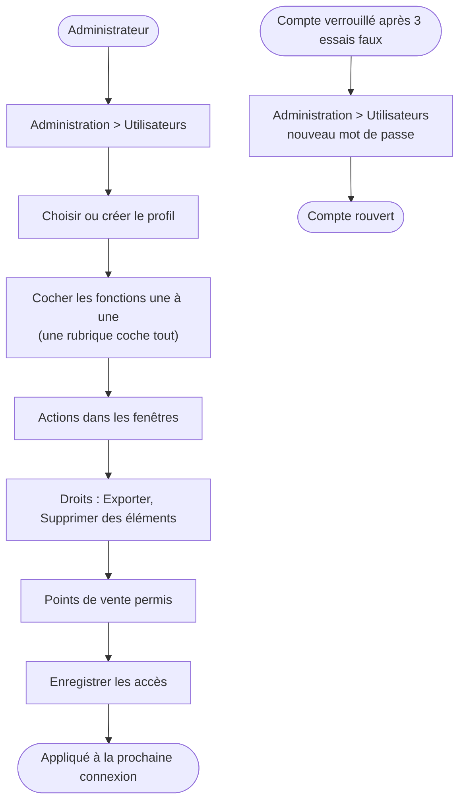
