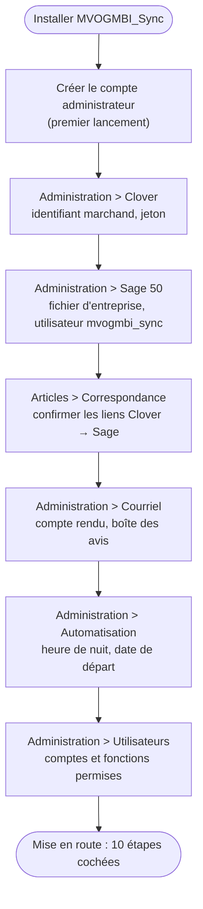
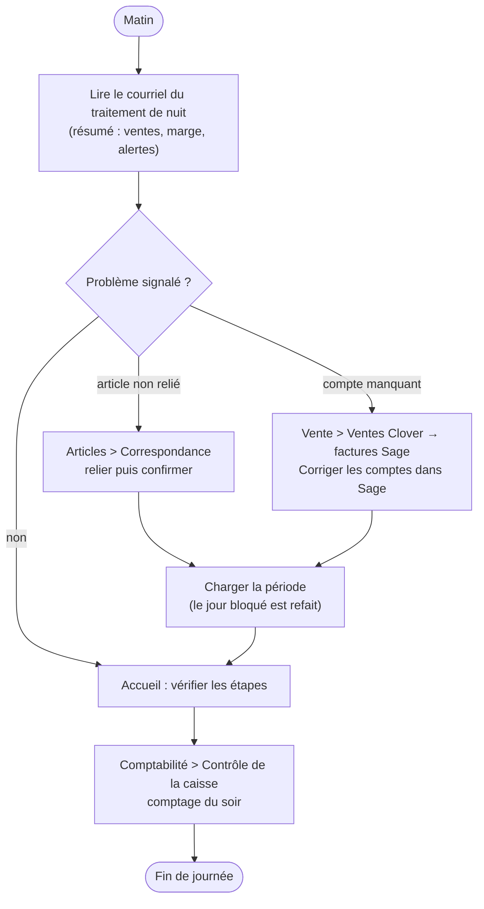
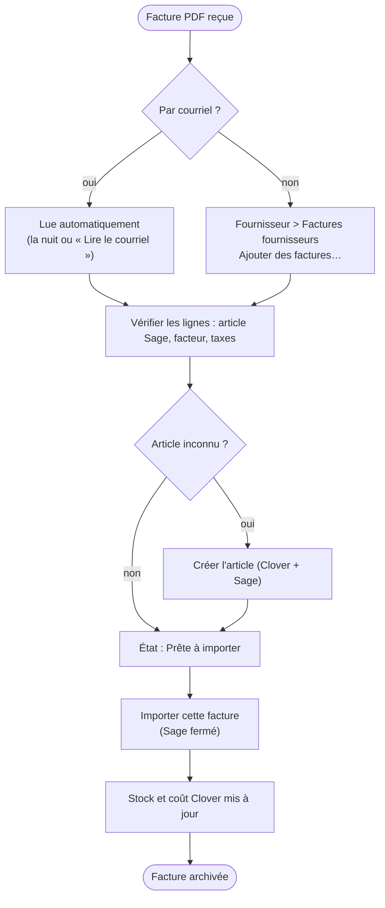
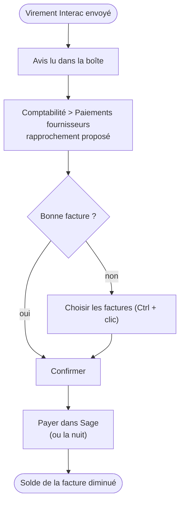
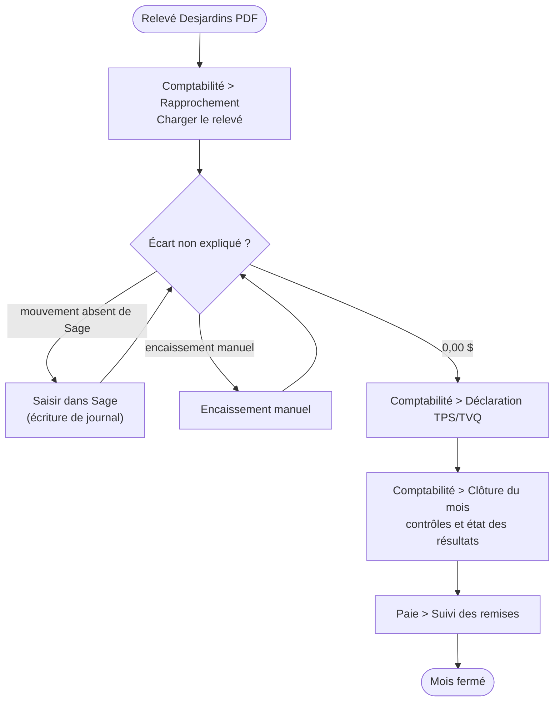
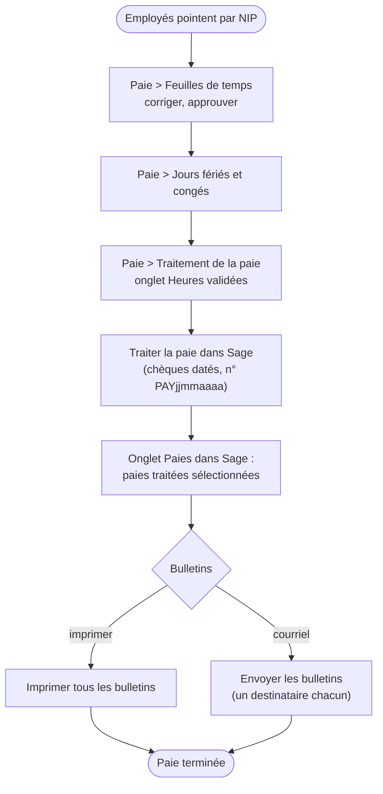
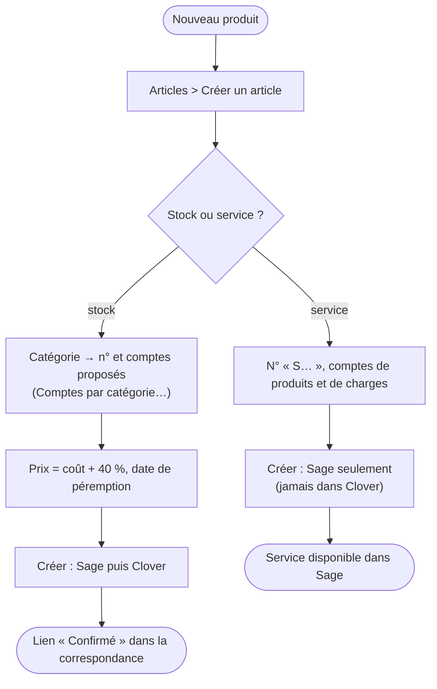
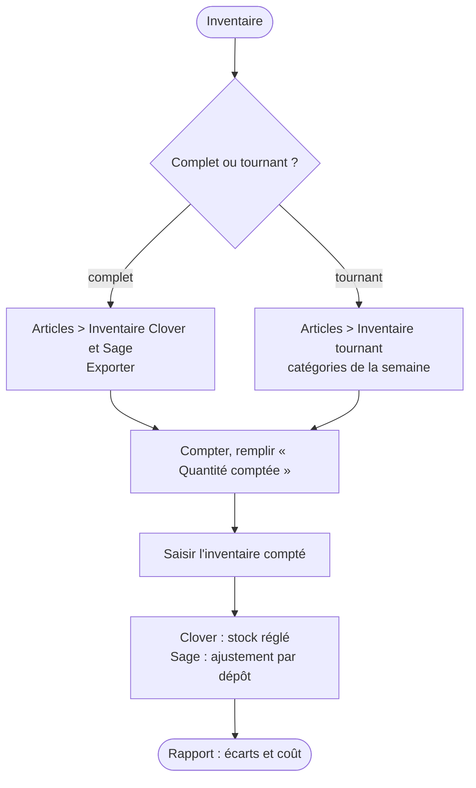
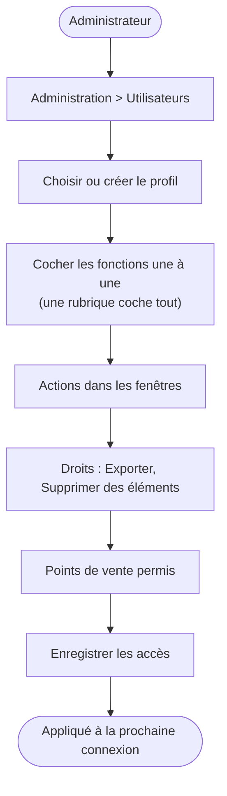

# MVOGMBI_Sync — Workflows d'utilisation

Version 1.0.0 (30 octobre 2026) — Marché MVOG-MBI Sherbrooke.

Chaque workflow suit l'ordre réel des écrans. Les noms entre guillemets sont ceux du menu (« Rubrique > Fonction »).

---

## 1. Mise en route (une fois)

---

## 2. Journée type du gérant

---

## 3. Facture fournisseur reçue

---

## 4. Paiement d'un fournisseur

---

## 5. Fin de mois

---

## 6. Paie toutes les deux semaines

---

## 7. Nouvel article

---

## 8. Inventaire

---

## 9. Droits d'un profil

